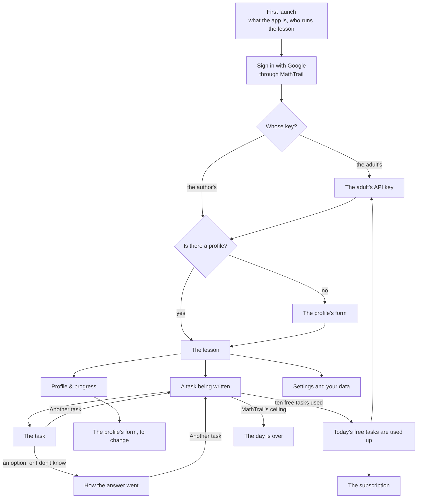

# An app for MathTrail lessons on phones, tablets and the browser: specification

> Status: being written, a part at a time. Sections 1 and 2 were written on 2026-11-11; the others are written by the parts the contents name.

This is the specification of an app in which a family takes a MathTrail lesson without a chat: on an Android or iOS phone or tablet, or in a browser on a computer. It is written for two readers. The first is the author, who chooses from it: the name, the architecture, the default model, the payment. The second is whoever builds the app. The app is built in a new public repository of its own, and that repository starts with a copy of this file. Links to the service's own files are therefore full addresses on GitHub, and stay valid in the copy.

The app is a client of the MathTrail service, the same service that Claude and ChatGPT reach as a connector. The service is not rewritten for it. What the app needs from the service is listed in section 12.

## The decisions it rests on

### The author's

The task was set on 2026-10-14, and its decisions were revised on 2026-11-11. Where the two disagree, the later one stands.

- **What it is.** A MathTrail lesson without a chat, not a new kind of lesson. The cards are the widget's: a task with options A–E and its picture, the hint, how the answer went, the progress, the profile and the choice of the topic. There is no open answer.
- **Who runs the lesson.** An adult, a parent or a tutor, runs it, and the child sits beside them and answers on the card, as in the chat. The app is addressed to parents, not to children. This was confirmed on 2026-11-11.
- **Devices.** Phones and tablets on Android and iOS, and a browser on a computer (2026-11-11).
- **The model.** Claude alone writes the tasks, on the author's API key or on the adult's own. The first release has no second provider, no interface over two providers and no measurement on OpenAI's models (2026-11-11).
- **Money.** MathTrail stays free in Claude and ChatGPT. The app is free too when the adult puts their own Claude API key into it. It is paid only on the author's key: ten tasks a day are free, and beyond them there is a subscription. The specification decides the subscription's price and whether the free quota can pay for itself (2026-11-11).
- **The first release** is cards alone. The model only writes tasks: there is no conversation with the adult, in text or in voice. Voice is a note for the second release, section 7 (2026-11-11).
- **The profile** is shared with the free MathTrail: the same file in the parent's Drive, and one child to a Google account.
- **Languages and countries.** The first release speaks all 64 languages of the card, and the app is offered worldwide, as MathTrail is.
- **The code** lives in a new public repository. The name MathTrail is not licensed to forks.
- **The architecture** is not chosen yet. Section 3 weighs the approaches and recommends one, and the author chooses.
- **The name and the web address.** The app gets a new name of its own, and its web version a domain of its own (2026-11-11, section 1.4). The name itself is still to be chosen.
- MathTrail Canvas and the coach on the site's page "Coach" have nothing to do with this app.

### MathTrail's

The specification rests on these, and proposes to change any of them only as a question to the author, with its reasons. The R- numbers are decisions of the service's [decision log](https://github.com/MathTrail/mathtrail-standalone/blob/main/docs/decisions.md). The О- numbers are questions of the service's product requirements, PRODUCT-V1, which are kept outside git.

- **MathTrail calls no model** and stays within Cloud Run's free tier. The model's API key, the payment and the app's quotas live in the app or on its server, never in MathTrail.
- **There is no REST interface** (О-1). The app speaks to MathTrail over MCP 2026-07-28, as Claude and ChatGPT do.
- **Sign-in.**
  - A client registers by a Client ID Metadata Document (R03, R105). Clients are only public, with PKCE (R106).
  - A redirect address is `https` or the computer's own loopback address. A custom scheme such as `app://` is refused (SPEC 9.3).
  - Taking access back at Google disconnects every app of the parent's at once (R114).
- **The day.**
  - A child's day holds 50 tasks and 10 failed requests. The counters live in the profile, so every client of the profile shares them (R291).
  - The day ends at the family's midnight, by the clock the card tells with each answer (R293).
  - One address may send at most 20 requests a minute to the sign-in and to the renewal of tokens (R219).
- **Which client it is.**
  - MathTrail knows a client by the name the client gives itself (SPEC 12.2).
  - What a client declares of MCP Apps decides whether it is treated as a client that draws the cards. A client with `chatgpt` or `openai` in its name is taken to be ChatGPT (R305, R307).
  - A task solved from its picture goes only to a client known to draw the cards (R322).
- **The free MathTrail is silent about paid products.**
  - The free MathTrail neither links to a paid product nor advertises one: not in its tools' results, its instructions or its card.
  - The site names a paid product on its page "Coach" alone (R198, О-64).
  - The Claude and ChatGPT directories forbid advertising ([docs/catalogs.md](https://github.com/MathTrail/mathtrail-standalone/blob/main/docs/catalogs.md) §5).
- **The child's data.** The rules hold in the app too:
  - the child is known by a pseudonym alone, and the pseudonym never goes into a task;
  - the answer is hidden until the child answers;
  - no log carries personal data, a task's text or an answer.
- **The name.** Since 2026-11-01 the name MathTrail belongs to the company ALT EdTech LLC, by the author's decision. The terms of use say that forks are named differently (О-4). The company's own app may therefore carry the name. The task's text of 2026-10-14 said the name stays with the author; that changed on 2026-11-01.

## Contents

| # | Section | Status |
|---|---|---|
| 1 | [What it is and for whom](#1-what-it-is-and-for-whom) | Written |
| 2 | [Screens and scenarios](#2-screens-and-scenarios) | Written |
| 3 | Architecture | Written in T112.3 |
| 4 | Cards | Written in T112.4 |
| 5 | Connecting to MathTrail | Written in T112.3 |
| 6 | The model and the measurement | Written in T112.5 |
| 7 | Voice | Written in T112.7 |
| 8 | Money | Written in T112.6 |
| 9 | Law and the stores | Written in T112.2 |
| 10 | 64 languages | Written in T112.4 |
| 11 | Technologies | Written in T112.4 |
| 12 | Changes to MathTrail | Written in T112.7 |
| 13 | The first release and after | Written in T112.7 |
| 14 | Open questions | Written in T112.7 |

The T- numbers are the parts of the plan in the service's [RUN.md](https://github.com/MathTrail/mathtrail-standalone/blob/main/RUN.md), phase 19.

## 1. What it is and for whom

### 1.1 A lesson without a chat

The app is for an adult who wants to give a child of grades 1–6 olympiad maths without opening Claude or ChatGPT. The adult runs the lesson. They sign in, make the child's profile, start the lesson, and decide when it stops. The child sits beside them and answers each task by pressing an option on the card. The child never signs in and has no account.

Everything a lesson needs is in the app's own screens. The model writes each task out of sight, and MathTrail checks it before the child sees it. Nothing in the app is a conversation: the hint, the explanation of a wrong answer and the solution come from the card, and the next task comes when the adult presses a button.

### 1.2 Three ways to take a lesson

| | In a chat: Claude or ChatGPT | The app, on the adult's key | The app, on the author's key |
|---|---|---|---|
| **Who writes the task** | The chat's own model | Claude, through the Claude API, on the adult's API key | Claude, through the Claude API, on the author's key |
| **Who pays for the model** | The adult's chat plan, the free one included | The adult pays Anthropic for every call, refused tries included | The author pays for the first ten tasks of a day; beyond them the subscription does |
| **What the adult pays ALT EdTech** | Nothing | Nothing | The subscription, for tasks beyond ten a day |
| **Conversation with the model** | Yes, in the chat's words | None: cards alone | None: cards alone |
| **How the cards are shown** | The widget, in the host's MCP Apps frame, or words alone where the host draws no card | The app's own screens; how they are drawn is section 4 | The same |
| **Tasks a day** | MathTrail's ceiling: 50 tasks and 10 failed requests | The same ceiling | Ten free, then, with a subscription, up to the same ceiling |
| **Accounts the adult needs** | A Claude or ChatGPT account, and Google | A Google account, and an account in the [Claude Console](https://platform.claude.com/settings/keys) for the key (read 2026-11-11) | A Google account, and a store's account to pay through |
| **Where it runs** | The chat's apps and website | The app on phones and tablets, and in a browser on a computer | The same |

### 1.3 What stays the same, and what changes

**What stays the same:**
- **The cards and what they show.** A task with five options A–E, often with a picture of one of seventeen kinds. A hint that opens in place. How the answer went: the verdict, the trap behind a wrong option, the picture of the solution, the solution step by step and how the rating moved. The progress with the ranks and the review, the profile, and the choice of the topic.
- **The profile.** It is one file, `MathTrail/mathtrail-profile.json`, in the parent's Google Drive. The app and the chat read the same file, so a family can do one lesson in the chat and the next in the app: the ratings, the trial series and the day's counters carry over. Tasks taken in the chat count against the same 50 of the day.
- **One child to a Google account.** A second child needs a second Google account, as in the chat.
- **The rules about the child's data.** The pseudonym, the hidden answer and the clean logs, as listed above.
- **The engine.** MathTrail picks the topic and the difficulty, checks every task, records the answer and keeps the ratings. The app decides none of these.

**What changes:**
- **No conversation.** The model only writes tasks. In the chat the model explains a wrong answer in its own words, answers the adult's questions about a task and tells what to work on. In the app the card's own texts do that: the trap of the option chosen, the solution step by step and the progress's review. The adult cannot ask a question about a task.
- **Buttons instead of words.** In the chat the adult asks for another task, and says "I don't know", in a message; the card has no button for "I don't know" because of that. The app has no chat, so its card has both buttons: "Another task" and "I don't know".
- **Claude alone**, and no voice in the first release.

### 1.4 The name and the web address

What constrains the choice, all read on 2026-11-11:

- **The promise.**
  - The terms of use say of MathTrail: "A free app for Claude and ChatGPT … It is free, and it stays free." ([terms](https://github.com/MathTrail/mathtrail-standalone/blob/main/site/content/en/terms.md), in each of the site's ten languages.)
  - The product requirements say that v1 is free forever.
  - The promise speaks of the app in the chats. The app on the adult's own key is free as well. Only the mode on the author's key is paid.
- **What the free side may say.**
  - The site names a paid product on the page "Coach" alone. Every other page, and the free app itself (its tools' results, its instructions and its card), carries no link to one (R198).
  - The ChatGPT directory forbids selling subscriptions "directly or indirectly (for example, through freemium upsells)". It also forbids linking to a page that starts a subscription. Claude's directory forbids advertising and paid placements ([docs/catalogs.md](https://github.com/MathTrail/mathtrail-standalone/blob/main/docs/catalogs.md) §5).
- **The stores.**
  - An app's name is at most 30 characters in the [App Store](https://developer.apple.com/help/app-store-connect/reference/app-information/app-information) and on [Google Play](https://support.google.com/googleplay/android-developer/answer/9859152).
  - Apple asks for "a unique app name", and keeps prices out of names and subtitles ([guideline 2.3.7](https://developer.apple.com/app-store/review/guidelines/)). It also refuses third parties' trademarks without permission ([guideline 5.2.1](https://developer.apple.com/app-store/review/guidelines/)).
- **The name is already used in the same field.**
  - MathTalk PBC runs [mathtrail.com](https://mathtrail.com) (registered in 2014) and the [Bob Moses MathTrail](https://www.cambridgema.gov/steam/mathtrail) in Cambridge, Massachusetts. That is a maths trail for children and families, with apps of its own ([Cambridge Day, 2024](https://www.cambridgeday.com/2024/12/06/mathtalk-apps-augmented-reality-lessons-continue-educational-mission-of-bob-moses/)).
  - "Math trail" is also a common name for a walk with maths tasks on the way, as in [MathCityMap](https://apps.apple.com/us/app/mathcitymap/id1220878492).
  - The free MathTrail already lives with this. An app in the stores, under the same name and in the same field, is more exposed to it.
  - No trademark search was made here: the registers of the USPTO, EUIPO and WIPO have no interface that reads without a browser. Section 9 makes one before anything is listed.
- **The adult sees "MathTrail" at sign-in under any name.** The sign-in goes through MathTrail's own consent page, which names the client. Google's screen then names MathTrail's OAuth client. That is honest, and it tells the adult what the app runs on.
- **Domains**, read in RDAP on 2026-11-11.
  - Already registered: `mathtrail.com`, `mathtrail.org`, `mathpeak.com`, `mathhike.com`.
  - Free: `mathtrail.net`, `mathtrail.io`, `getmathtrail.com`, `mathtrailapp.com`, `mathtraillessons.com`, `mathpeak.app`, `mathhike.app`.
  - At Cloudflare, the registrar `mathtrail.app` is already at, a `.app` costs $8.20 for its first year and $14.20 a year after, and a `.com` $10.46 a year ([cfdomainpricing.com](https://cfdomainpricing.com/), a table of Cloudflare's prices kept by a third party).

The three ways to name it:

| | A. MathTrail, on the service's domain | B. MathTrail with a word, on its own domain | C. A new name, on its own domain |
|---|---|---|---|
| **The name in the stores** | MathTrail | For example "MathTrail Lessons" | For example "MathPeak" or "MathHike": candidates, each still to be searched as a trademark |
| **The web version** | `app.mathtrail.app`: one more record in the company's DNS zone, at no cost | For example `mathtraillessons.com` or `getmathtrail.com` | For example `mathpeak.app` or `mathhike.app` |
| **The site `mathtrail.app`** | Unchanged. The app is spoken of on its own subdomain and in the stores, and no page of the site links to it | Unchanged; the app has a site of its own | Unchanged; the app has a site of its own |
| **R198** | Its words hold. A subdomain is not a page of the site, but a search for "MathTrail" now finds a subscription under the name the site uses | Holds | Holds |
| **The promise** | Strained. "It is free, and it stays free", said of MathTrail, stands beside a store listing of "MathTrail" with a subscription. The terms need a sentence saying the promise is about the app in the chats | The word sets the app apart, but the terms still need a sentence that it is a separate product | Untouched |
| **The directories** | The most risk. A reviewer can read the free connector as the way into a paid app of the same name, and OpenAI forbids an upsell that is "indirect" | Less | The least. The two still share a profile, so the link is there in substance, but not in the name |
| **The stores** | A web search of the App Store and Google Play found no app of this name. MathTalk's MathTrail is the risk under guideline 5.2.1 | The same risk, for the "MathTrail" part | Only the candidate's own search |
| **Brand** | One name, its site and its research page. But the free side may not point to the app anyway (R198), so families learn of the app from the stores and from its own page under any name | Kinship shows | A new brand from nothing: a mark, a site and listings of its own |
| **Cost** | $0 | A domain, about $10–15 a year | A domain, and a new mark and site |

**Recommendation: C.** The free MathTrail is the core of the work, and its listings are still under review. A paid app under its name puts the promise and those reviews at risk for little gain, because the free side may not lead families to the app under any name. A new name also leaves MathTalk's MathTrail out of the stores' trademark rule. The cost is a new brand. MathTrail's name still appears where it is true: at sign-in, and on the app's own page, which can say the lessons run on MathTrail, the free and open-source service.

**Chosen on 2026-11-11: C.**
- The app gets a new name of its own, and its web version a domain of its own.
- The site `mathtrail.app`, R198 and the promise stay as they are.
- The name itself is not chosen yet. MathPeak and MathHike are candidates, and the author may name another.
- Section 9 searches the chosen name as a trademark before its domain is bought and before anything is listed.
- Until then this document calls it "the app".

## 2. Screens and scenarios

Each scenario below says what the adult sees and does, which MathTrail tools stand behind it, and what happens when a quota runs out. Tools are named as the service names them in [`internal/transport/mcp/`](https://github.com/MathTrail/mathtrail-standalone/tree/main/internal/transport/mcp) and in SPEC 7. How the app calls them is a question for section 3: from the device, or through a server of its own. The app's screens follow the widget's screens of SPEC 8.2.

### 2.1 The map

### 2.2 First launch

**What the adult sees.**
- One screen says what the app is: olympiad maths for grades 1–6, a task at a time, each checked by MathTrail before the child sees it.
- It says who runs the lesson: the adult, with the child beside them, answering on the card.
- It says what is kept about the child, and where: a pseudonym and a grade, never a real name, an age or a school, in one file in the adult's own Google Drive.
- One button goes on to sign in.

**Tools.** None.

### 2.3 Sign-in

**What the adult sees.** "Sign in with Google" opens the system's browser, not a view inside the app.
1. On a browser that has not approved the app before, MathTrail's consent page names the app and its address, says what Google will be asked for, and links to MathTrail's privacy policy and terms.
2. Google's screen then asks for access to the files MathTrail makes in Drive (`drive.file`). The adult ticks it.
3. If they leave it unticked, MathTrail's page asks them to go back and tick it.
4. The browser hands the adult back to the app.

The sign-in lasts while the app is used at least once in 30 days, and at most 90 days. After that, the adult signs in again.

**Behind it.**
- The sign-in is not a tool. It is MathTrail's authorization server: `/oauth/authorize`, the consent page, Google, `/oauth/callback`, and `/oauth/token` for the tokens.
- Renewal goes through `/oauth/token` with the refresh token.
- The service's [sign-in diagram](https://github.com/MathTrail/mathtrail-standalone/blob/main/docs/architecture/02-auth.md) shows the whole of it.
- After the sign-in the app calls `get_profile`. Its `screen` is `first_run` when there is no profile, and `profile` when there is one.

### 2.4 The adult's API key

This screen appears only when the adult chooses to use their own key.

**What the adult sees.**
- A field for a Claude API key, with a link to the [Claude Console](https://platform.claude.com/settings/keys), where keys are made (read 2026-11-11).
- A line that the adult pays Anthropic for each task written, refused tries included, and that ALT EdTech is paid nothing.
- The app tries the key once with a small call before keeping it. A key that fails is named as failing, and nothing is kept.
- In the settings, the key can be replaced or removed. Removing it moves the app to the author's key, with its ten free tasks.

**Tools.** None of MathTrail's. Where the key is kept, on the device or on a server, is section 3. Wherever it is, it is never sent to MathTrail.

### 2.5 The profile

**Making it.** The adult sees a form in place of the chat's questions.
1. A tick: "I am this child's parent or tutor". It is required, as the chat asks for it first.
2. A pseudonym, at most 32 characters, under a line that it must not be the child's real name.
3. A grade from 1 to 6, under a line that it only says where the first tasks start.
4. Optional fields, as the widget's form has them: interests (up to ten); skills the child has not met yet, such as division; the language of the lessons, which follows the device's language unless set; the country, and the state in the United States; and the tick "Don't count the country I sign in from".
5. The form has no free notes about the child, as the widget's form has none.

The form calls `save_profile` with what was filled in. `edit_profile` cannot be used here, because it never makes a profile ("Nothing was saved: there is no profile to change."). A refusal comes back with `problems`, a field and a code for each, and the form shows each under its field.

**Changing it.** From "Profile & progress", the same form, filled in. It calls `edit_profile` with the fields that changed and no others, so that a change made meanwhile in the chat is kept.

**When the file cannot be read.** Any tool can fail with a sentence that the profile cannot be read: damaged, in Drive's bin, or written by a newer version. The app then shows a screen with what the adult can do, by the case:
- a damaged file: "Put back the latest version that can be read", which calls `save_profile` with `restore` alone;
- a file in Drive's bin: "Restore it from the bin", which opens Drive;
- a file written by a newer version of MathTrail a moment ago, as a release does: "Try again in a few minutes";
- in every case: "Start a new profile", which calls `save_profile` with `start_over`. The old file is set aside under a new name and never deleted.

Telling these cases apart needs a code the failure does not carry today (2.12).

`get_profile` lists other files that hold a profile in `location.others`, so that the adult can delete them.

### 2.6 The lesson

**Starting.** "Start the lesson" asks MathTrail for a task with `next_task`, given the lesson's language. What comes back decides the screen:
- `screen: task` — a task written ahead and kept was handed out, and is on the card at once;
- `screen: coming` — a request was opened, and its task is to be written;
- `screen: first_run` — there is no profile, so the form opens;
- `status: limited` — the day is over (2.7).

A task left on the card without an answer when `next_task` is called again is recorded as skipped.

**A task being written.** The adult sees the steps: the topic and the difficulty picked, the task being written, every answer checked, then the task. A try that did not pass the checks says so, and that a new one is being written. Behind it:
1. `get_package` gives the brief, the reference tasks and the writing guide for the request.
2. The model writes the task, its solver and its self-check.
3. `submit_task` checks them. A refusal lists every reason, and the model writes again: three attempts in all.
4. After the third refusal, the card says this task did not work out and that a new one can be asked for. The request counts as failed for the day.

Who runs this loop — the app's own code, or the Claude API's MCP connector — is section 3.

**The task.**
- The card shows the wording, the picture when there is one, the five options with their letters, and the buttons "Hint", "I don't know" and "Another task".
- After the trial series it also shows "Topic".
- Its head shows the pseudonym and the grade, and "Profile & progress".
- "Hint" opens the hint in place, with no call: the hint came with the task. That it was opened goes with the answer.

**Writing the next task ahead.** Once a task is on the card, the app asks for the next one while the child works: `prepare_task`, then the model, then `submit_task`. MathTrail keeps that task sealed in the profile, and it is not counted against the day until it is handed out. The adult sees nothing of it. The next "Another task" puts it on the card at once.

**The answer.**
- Pressing an option calls `submit_answer` with the task's `task_id`, the letter, whether the hint was opened (`hint_used`), and how far the device's clock runs from UTC (`utc_offset`), so that the day ends at the family's midnight.
- "I don't know" calls `submit_answer` with `?`. It counts as a wrong answer and shows the solution.
- The card then turns into how the answer went, in the same place. It shows the verdict; the trap of a wrong option, and whether the mistake has come up before; the picture of the solution and its total; the solution step by step; the type of the task; and how the rating in its topic moved.
- During the five tasks of the trial series, the card shows "Trial series 2 of 5" in place of the rating.
- An answer already recorded is shown as it was recorded.

**Another task.** "Another task", on the task or under how the answer went, calls `next_task` again.

**The topic.**
- After the trial series, "Topic" opens the choice: "The coach chooses" (MathTrail's rule), the topics the review suggests, and every topic in its group.
- A choice saves the topic of the lessons with `edit_profile` (`lesson_topic`), and then asks for the next task with `next_task`.
- Every task after it keeps to that topic until "The coach chooses" gives the choice back. In the chat the adult can also ask for one task on a topic; the app has no such request, as the card has none.
- During the trial series there is no "Topic", and a topic chosen before waits until the series is over.

### 2.7 The day's quota and the subscription

**On the author's key**, the lesson's screen shows how many of the day's ten free tasks are used: "3 of 10 free tasks today".
- After the tenth, the app does not call `next_task`. It shows "Today's free tasks are used up", with four ways on:
  - subscribe;
  - use your own API key, which is free;
  - look at the progress;
  - come back tomorrow, after the family's midnight.
- The app also does not write a task ahead after the tenth free task without a subscription, since nobody would get it and the author would pay for it.

**With a subscription**, tasks go on past ten, up to MathTrail's own ceiling.

**MathTrail's ceiling** holds in every mode, the subscription included: 50 tasks or 10 failed requests a day. When it is reached, `next_task` answers `status: limited`, `code: limit_reached`. The adult sees the widget's night card, "Make a wish for tomorrow", with "That's all the tasks for today — it's the daily limit. New ones will come tomorrow." Under it the app offers the progress meanwhile, as MathTrail tells the chat's model to. The subscription cannot lift this ceiling, and the subscription's screen says so. The ceiling counts tasks taken in the chat too.

**On the adult's key** there is no quota of the app's, only MathTrail's ceiling.

**The subscription's screen.**
- It says what the subscription gives: tasks beyond ten a day, up to MathTrail's ceiling.
- It shows the price (section 8).
- It has a purchase through the store, or in the browser (sections 8 and 9), restoring a purchase made on another device, and a link to manage or cancel it.

No MathTrail tool stands behind it.

### 2.8 Progress

"Profile & progress", from the head of any lesson card or from the lesson's screen, reads the progress with `read_progress`. It is the same payload as `get_progress`. The adult sees:
- the pseudonym and the grade;
- the overall rank, such as "Rank 3 of 11", with a bar of how far it is to the next rank;
- a switch between the last task and the past week;
- the topics, each with its rank, ahead of or behind the overall one, or paused;
- the review: the strong topics, the ones to develop, the ones too early to judge, mistakes that repeat, and what to do next;
- the recent answers, and how many tasks were skipped;
- the profile, with "Edit" and "Your data".

During the trial series it shows only how many of its five tasks are done, and that ranks come after five tasks. A topic's name opens its page on the site `mathtrail.app`. A link from the app to the free site is allowed: what is restricted is the other direction.

### 2.9 Settings and your data

**Settings.**
- The language of the lessons, saved with `edit_profile` (`ui_language`).
- Whose key: the adult's or the author's (2.4).
- The subscription (2.7).

**Your data.**
- **Where the file is.** The folder, the file and a link to it in Drive, from `get_profile` (`location.folder`, `location.file`, `location.link`). Downloading that file is the export.
- **Sign out.** It asks MathTrail to end the grant with `/oauth/revoke`. Google ends all of the parent's grants to MathTrail together, so signing out of the app also disconnects MathTrail in Claude and ChatGPT (R114). The screen says so before it signs out, and the file is not touched. A sign-out that leaves the grant is the alternative in 2.12.
- **Delete the child's data.** The app deletes what it keeps itself: the key, and its record of the subscription. Then, for the profile, it opens the file in Drive and says how to delete it and empty the bin. No MathTrail tool deletes the file today. Whether the stores accept that is section 9, and a tool that deletes it would be a change in section 12.
- **What stays elsewhere.** The parent's Google account lists MathTrail under its linked apps; removing it there cuts every app off. And Anthropic keeps what the API received under its own terms (section 9).

### 2.10 When something goes wrong

| What happened | What MathTrail returns | What the adult sees |
|---|---|---|
| A try did not pass the checks | `submit_task`: `status: rejected`, the reasons | "A try didn't pass the checks; a new one is being written." |
| Three tries refused | `submit_task`: `status: rejected` with `attempts_left: 0` | "This task didn't work out", and "Another task" |
| Too many calls in a short time | `isError`, a sentence, no payload | Nothing, at first: the app waits a moment and makes the same call again; if that keeps failing, "MathTrail is busy, try again in a minute" |
| The sign-in has ended, or access was taken back | `401` with a challenge, or `isError` with `mcp/www_authenticate` | "Sign in again", which starts 2.3 |
| Drive is full | `isError`, a sentence | "Your Google Drive is full: nothing was saved, the answer included. Free up space and try again" |
| The profile cannot be read | `isError`, a sentence | The screen of 2.5 |
| Drive did not answer | `isError`, a sentence | "Google Drive did not answer. Try again in a minute" |

### 2.11 Every scenario and its tools

| Scenario | MathTrail tools and endpoints | Screens |
|---|---|---|
| First launch | none | what the app is |
| Sign-in | `/oauth/authorize`, the consent page, Google, `/oauth/token`; then `get_profile` | the system's browser, then the profile's form or the lesson |
| The adult's key | none | the key |
| Making the profile | `save_profile` | the form |
| Changing the profile | `edit_profile` | the form |
| A profile that cannot be read | `save_profile` with `restore` or `start_over` | what to do with the file |
| Starting a lesson, another task | `next_task`; with no task kept, `get_package` and `submit_task` | a task being written, then the task |
| Writing ahead | `prepare_task`, `submit_task` | none |
| The answer, "I don't know" | `submit_answer` | how the answer went, in the task's place |
| The topic | `edit_profile` (`lesson_topic`), then `next_task` | the choice, then a new task |
| Ten free tasks used | none: the app's own count | today's free tasks are used up |
| MathTrail's ceiling | `next_task` with `status: limited` | the day is over |
| The subscription | none | the subscription |
| Progress | `read_progress` | Profile & progress |
| Your data, sign-out | `get_profile` (`location`), `/oauth/revoke` | your data |

### 2.12 Notes for the later parts

These came up while the screens were written. Each belongs to a later part.

- **For section 3.** Do tasks taken in the chat count against the ten free tasks of the author's key, or only the app's own? Where is the ten counted, and does its day end at the family's midnight, as MathTrail's does (R293)? Do refused tries and failed requests count against the ten? Every one of them costs the author tokens.
- **For sections 3 and 5.** The app must declare MCP Apps when it connects, or be known by MathTrail in some other way to draw the cards. Otherwise MathTrail treats it as a chat of words: its instructions change, and no task solved from its picture comes to it (R305, R322).
- **For section 12.** A failure reaches the app as one English sentence and `isError`. The reasons are a damaged profile, a profile in the bin, a full Drive, or Drive not answering, and they carry no code. To show the screens of 2.5 and 2.10 in the adult's language, the app needs a code it can read. It would have to guess from English words otherwise.
- **For sections 4 and 12.** The widget's card has no "I don't know". If the app shows MathTrail's own card (section 4), the button is a change to the card, hidden in the chat, where the adult says it in words.
- **For section 9.** What the stores ask of deleting an account in the app, and whether opening the profile's file in Drive meets it. The profile is a file in the adult's own Drive, which no tool deletes. If it does not meet it, MathTrail needs a tool that deletes the file (section 12).
- **For sections 5 and 9.** Signing out of the app ends the parent's grant at Google, and so disconnects MathTrail in their chats too (R114). The alternative is a sign-out that only forgets the app's tokens and leaves the grant, which the adult then removes in their Google account. Which of the two the app does, and what the stores ask of a sign-out, is still to be decided.
- **For section 14.** "MathTrail" is used by MathTalk PBC for a maths trail for children in Cambridge, Massachusetts, and its domain `mathtrail.com`. That concerns the free MathTrail as well as the app.
