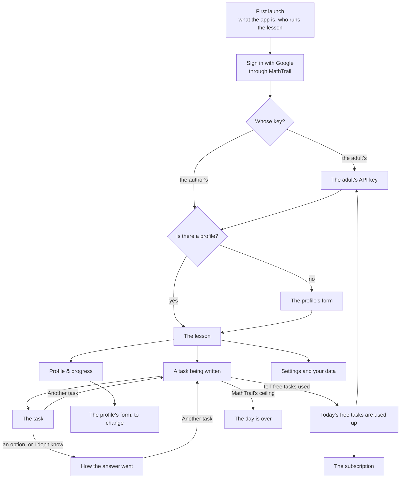

# An app for MathTrail lessons on phones, tablets and the browser: specification

> Status: being written, a part at a time. Sections 1, 2 and 9 were written on 2026-11-11; the others are written by the parts the contents name.

This is the specification of an app in which a family takes a MathTrail lesson without a chat: on an Android or iOS phone or tablet, or in a browser on a computer. It is written for two readers. The first is the author, who chooses from it: the name, the architecture, the default model, the payment. The second is whoever builds the app. The app is built in a new public repository of its own, and that repository starts with a copy of this file. Links to the service's own files are therefore full addresses on GitHub, and stay valid in the copy.

The app is a client of the MathTrail service, the same service that Claude and ChatGPT reach as a connector. The service is not rewritten for it. What the app needs from the service is listed in section 12.

## The decisions it rests on

### The author's

The task was set on 2026-10-14, and its decisions were revised on 2026-11-11. Where the two disagree, the later one stands.

- **What it is.** A MathTrail lesson without a chat, not a new kind of lesson. The cards are the widget's: a task with options A–E and its picture, the hint, how the answer went, the progress, the profile and the choice of the topic. There is no open answer.
- **Who runs the lesson.** An adult, a parent or a tutor, runs it, and the child sits beside them and answers on the card, as in the chat. The app is addressed to parents, not to children. This was confirmed on 2026-11-11.
- **Devices.** Phones and tablets on Android and iOS, and a browser on a computer (2026-11-11).
- **The model.** Claude alone writes the tasks, on the author's API key or on the adult's own. The first release has no second provider, no interface over two providers and no measurement on OpenAI's models (2026-11-11).
- **Money.** MathTrail stays free in Claude and ChatGPT. The app is free too when the adult puts their own Claude API key into it. It is paid only on the author's key: ten tasks a day are free, and beyond them there is a subscription. The specification decides the subscription's price and whether the free quota can pay for itself (2026-11-11).
- **The first release** is cards alone. The model only writes tasks: there is no conversation with the adult, in text or in voice. Voice is a note for the second release, section 7 (2026-11-11).
- **The profile** is shared with the free MathTrail: the same file in the parent's Drive, and one child to a Google account.
- **Languages and countries.** The first release speaks all 64 languages of the card, and the app is offered worldwide, as MathTrail is.
- **The code** lives in a new public repository. The name MathTrail is not licensed to forks.
- **The architecture** is not chosen yet. Section 3 weighs the approaches and recommends one, and the author chooses.
- **The name and the web address.** The app gets a new name of its own, and its web version a domain of its own (2026-11-11, section 1.4). The name itself is still to be chosen.
- **Developer accounts.** The App Store and Google Play accounts are the company's, ALT EdTech LLC's (2026-11-11, section 9.2).
- MathTrail Canvas and the coach on the site's page "Coach" have nothing to do with this app.

### MathTrail's

The specification rests on these, and proposes to change any of them only as a question to the author, with its reasons. The R- numbers are decisions of the service's [decision log](https://github.com/MathTrail/mathtrail-standalone/blob/main/docs/decisions.md). The О- numbers are questions of the service's product requirements, PRODUCT-V1, which are kept outside git.

- **MathTrail calls no model** and stays within Cloud Run's free tier. The model's API key, the payment and the app's quotas live in the app or on its server, never in MathTrail.
- **There is no REST interface** (О-1). The app speaks to MathTrail over MCP 2026-07-28, as Claude and ChatGPT do.
- **Sign-in.**
  - A client registers by a Client ID Metadata Document (R03, R105). Clients are only public, with PKCE (R106).
  - A redirect address is `https` or the computer's own loopback address. A custom scheme such as `app://` is refused (SPEC 9.3).
  - Taking access back at Google disconnects every app of the parent's at once (R114).
- **The day.**
  - A child's day holds 50 tasks and 10 failed requests. The counters live in the profile, so every client of the profile shares them (R291).
  - The day ends at the family's midnight, by the clock the card tells with each answer (R293).
  - One address may send at most 20 requests a minute to the sign-in and to the renewal of tokens (R219).
- **Which client it is.**
  - MathTrail knows a client by the name the client gives itself (SPEC 12.2).
  - What a client declares of MCP Apps decides whether it is treated as a client that draws the cards. A client with `chatgpt` or `openai` in its name is taken to be ChatGPT (R305, R307).
  - A task solved from its picture goes only to a client known to draw the cards (R322).
- **The free MathTrail is silent about paid products.**
  - The free MathTrail neither links to a paid product nor advertises one: not in its tools' results, its instructions or its card.
  - The site names a paid product on its page "Coach" alone (R198, О-64).
  - The Claude and ChatGPT directories forbid advertising ([docs/catalogs.md](https://github.com/MathTrail/mathtrail-standalone/blob/main/docs/catalogs.md) §5).
- **The child's data.** The rules hold in the app too:
  - the child is known by a pseudonym alone, and the pseudonym never goes into a task;
  - the answer is hidden until the child answers;
  - no log carries personal data, a task's text or an answer.
- **The name.** Since 2026-11-01 the name MathTrail belongs to the company ALT EdTech LLC, by the author's decision. The terms of use say that forks are named differently (О-4). The company's own app may therefore carry the name. The task's text of 2026-10-14 said the name stays with the author; that changed on 2026-11-01.

## Contents

| # | Section | Status |
|---|---|---|
| 1 | [What it is and for whom](#1-what-it-is-and-for-whom) | Written |
| 2 | [Screens and scenarios](#2-screens-and-scenarios) | Written |
| 3 | Architecture | Written in T112.3 |
| 4 | Cards | Written in T112.4 |
| 5 | Connecting to MathTrail | Written in T112.3 |
| 6 | The model and the measurement | Written in T112.5 |
| 7 | Voice | Written in T112.7 |
| 8 | Money | Written in T112.6 |
| 9 | [Law and the stores](#9-law-and-the-stores) | Written |
| 10 | 64 languages | Written in T112.4 |
| 11 | Technologies | Written in T112.4 |
| 12 | Changes to MathTrail | Written in T112.7 |
| 13 | The first release and after | Written in T112.7 |
| 14 | Open questions | Written in T112.7 |

The T- numbers are the parts of the plan in the service's [RUN.md](https://github.com/MathTrail/mathtrail-standalone/blob/main/RUN.md), phase 19.

## 1. What it is and for whom

### 1.1 A lesson without a chat

The app is for an adult who wants to give a child of grades 1–6 olympiad maths without opening Claude or ChatGPT. The adult runs the lesson. They sign in, make the child's profile, start the lesson, and decide when it stops. The child sits beside them and answers each task by pressing an option on the card. The child never signs in and has no account.

Everything a lesson needs is in the app's own screens. The model writes each task out of sight, and MathTrail checks it before the child sees it. Nothing in the app is a conversation: the hint, the explanation of a wrong answer and the solution come from the card, and the next task comes when the adult presses a button.

### 1.2 Three ways to take a lesson

| | In a chat: Claude or ChatGPT | The app, on the adult's key | The app, on the author's key |
|---|---|---|---|
| **Who writes the task** | The chat's own model | Claude, through the Claude API, on the adult's API key | Claude, through the Claude API, on the author's key |
| **Who pays for the model** | The adult's chat plan, the free one included | The adult pays Anthropic for every call, refused tries included | The author pays for the first ten tasks of a day; beyond them the subscription does |
| **What the adult pays ALT EdTech** | Nothing | Nothing | The subscription, for tasks beyond ten a day |
| **Conversation with the model** | Yes, in the chat's words | None: cards alone | None: cards alone |
| **How the cards are shown** | The widget, in the host's MCP Apps frame, or words alone where the host draws no card | The app's own screens; how they are drawn is section 4 | The same |
| **Tasks a day** | MathTrail's ceiling: 50 tasks and 10 failed requests | The same ceiling | Ten free, then, with a subscription, up to the same ceiling |
| **Accounts the adult needs** | A Claude or ChatGPT account, and Google | A Google account, and an account in the [Claude Console](https://platform.claude.com/settings/keys) for the key (read 2026-11-11) | A Google account, and a store's account to pay through |
| **Where it runs** | The chat's apps and website | The app on phones and tablets, and in a browser on a computer | The same |

### 1.3 What stays the same, and what changes

**What stays the same:**
- **The cards and what they show.** A task with five options A–E, often with a picture of one of seventeen kinds. A hint that opens in place. How the answer went: the verdict, the trap behind a wrong option, the picture of the solution, the solution step by step and how the rating moved. The progress with the ranks and the review, the profile, and the choice of the topic.
- **The profile.** It is one file, `MathTrail/mathtrail-profile.json`, in the parent's Google Drive. The app and the chat read the same file, so a family can do one lesson in the chat and the next in the app: the ratings, the trial series and the day's counters carry over. Tasks taken in the chat count against the same 50 of the day.
- **One child to a Google account.** A second child needs a second Google account, as in the chat.
- **The rules about the child's data.** The pseudonym, the hidden answer and the clean logs, as listed above.
- **The engine.** MathTrail picks the topic and the difficulty, checks every task, records the answer and keeps the ratings. The app decides none of these.

**What changes:**
- **No conversation.** The model only writes tasks. In the chat the model explains a wrong answer in its own words, answers the adult's questions about a task and tells what to work on. In the app the card's own texts do that: the trap of the option chosen, the solution step by step and the progress's review. The adult cannot ask a question about a task.
- **Buttons instead of words.** In the chat the adult asks for another task, and says "I don't know", in a message; the card has no button for "I don't know" because of that. The app has no chat, so its card has both buttons: "Another task" and "I don't know".
- **Claude alone**, and no voice in the first release.

### 1.4 The name and the web address

What constrains the choice, all read on 2026-11-11:

- **The promise.**
  - The terms of use say of MathTrail: "A free app for Claude and ChatGPT … It is free, and it stays free." ([terms](https://github.com/MathTrail/mathtrail-standalone/blob/main/site/content/en/terms.md), in each of the site's ten languages.)
  - The product requirements say that v1 is free forever.
  - The promise speaks of the app in the chats. The app on the adult's own key is free as well. Only the mode on the author's key is paid.
- **What the free side may say.**
  - The site names a paid product on the page "Coach" alone. Every other page, and the free app itself (its tools' results, its instructions and its card), carries no link to one (R198).
  - The ChatGPT directory forbids selling subscriptions "directly or indirectly (for example, through freemium upsells)". It also forbids linking to a page that starts a subscription. Claude's directory forbids advertising and paid placements ([docs/catalogs.md](https://github.com/MathTrail/mathtrail-standalone/blob/main/docs/catalogs.md) §5).
- **The stores.**
  - An app's name is at most 30 characters in the [App Store](https://developer.apple.com/help/app-store-connect/reference/app-information/app-information) and on [Google Play](https://support.google.com/googleplay/android-developer/answer/9859152).
  - Apple asks for "a unique app name", and keeps prices out of names and subtitles ([guideline 2.3.7](https://developer.apple.com/app-store/review/guidelines/)). It also refuses third parties' trademarks without permission ([guideline 5.2.1](https://developer.apple.com/app-store/review/guidelines/)).
- **The name is already used in the same field.**
  - MathTalk PBC runs [mathtrail.com](https://mathtrail.com) (registered in 2014) and the [Bob Moses MathTrail](https://www.cambridgema.gov/steam/mathtrail) in Cambridge, Massachusetts. That is a maths trail for children and families, with apps of its own ([Cambridge Day, 2024](https://www.cambridgeday.com/2024/12/06/mathtalk-apps-augmented-reality-lessons-continue-educational-mission-of-bob-moses/)).
  - "Math trail" is also a common name for a walk with maths tasks on the way, as in [MathCityMap](https://apps.apple.com/us/app/mathcitymap/id1220878492).
  - The free MathTrail already lives with this. An app in the stores, under the same name and in the same field, is more exposed to it.
  - No trademark search was made here: the registers of the USPTO, EUIPO and WIPO have no interface that reads without a browser. Section 9 makes one before anything is listed.
- **The adult sees "MathTrail" at sign-in under any name.** The sign-in goes through MathTrail's own consent page, which names the client. Google's screen then names MathTrail's OAuth client. That is honest, and it tells the adult what the app runs on.
- **Domains**, read in RDAP on 2026-11-11.
  - Already registered: `mathtrail.com`, `mathtrail.org`, `mathpeak.com`, `mathhike.com`.
  - Free: `mathtrail.net`, `mathtrail.io`, `getmathtrail.com`, `mathtrailapp.com`, `mathtraillessons.com`, `mathpeak.app`, `mathhike.app`.
  - At Cloudflare, the registrar `mathtrail.app` is already at, a `.app` costs $8.20 for its first year and $14.20 a year after, and a `.com` $10.46 a year ([cfdomainpricing.com](https://cfdomainpricing.com/), a table of Cloudflare's prices kept by a third party).

The three ways to name it:

| | A. MathTrail, on the service's domain | B. MathTrail with a word, on its own domain | C. A new name, on its own domain |
|---|---|---|---|
| **The name in the stores** | MathTrail | For example "MathTrail Lessons" | For example "MathPeak" or "MathHike": candidates, each still to be searched as a trademark |
| **The web version** | `app.mathtrail.app`: one more record in the company's DNS zone, at no cost | For example `mathtraillessons.com` or `getmathtrail.com` | For example `mathpeak.app` or `mathhike.app` |
| **The site `mathtrail.app`** | Unchanged. The app is spoken of on its own subdomain and in the stores, and no page of the site links to it | Unchanged; the app has a site of its own | Unchanged; the app has a site of its own |
| **R198** | Its words hold. A subdomain is not a page of the site, but a search for "MathTrail" now finds a subscription under the name the site uses | Holds | Holds |
| **The promise** | Strained. "It is free, and it stays free", said of MathTrail, stands beside a store listing of "MathTrail" with a subscription. The terms need a sentence saying the promise is about the app in the chats | The word sets the app apart, but the terms still need a sentence that it is a separate product | Untouched |
| **The directories** | The most risk. A reviewer can read the free connector as the way into a paid app of the same name, and OpenAI forbids an upsell that is "indirect" | Less | The least. The two still share a profile, so the link is there in substance, but not in the name |
| **The stores** | A web search of the App Store and Google Play found no app of this name; the App Store's own search later found one (9.8). MathTalk's MathTrail is the risk under guideline 5.2.1 | The same risk, for the "MathTrail" part | Only the candidate's own search |
| **Brand** | One name, its site and its research page. But the free side may not point to the app anyway (R198), so families learn of the app from the stores and from its own page under any name | Kinship shows | A new brand from nothing: a mark, a site and listings of its own |
| **Cost** | $0 | A domain, about $10–15 a year | A domain, and a new mark and site |

**Recommendation: C.** The free MathTrail is the core of the work, and its listings are still under review. A paid app under its name puts the promise and those reviews at risk for little gain, because the free side may not lead families to the app under any name. A new name also leaves MathTalk's MathTrail out of the stores' trademark rule. The cost is a new brand. MathTrail's name still appears where it is true: at sign-in, and on the app's own page, which can say the lessons run on MathTrail, the free and open-source service.

**Chosen on 2026-11-11: C.**
- The app gets a new name of its own, and its web version a domain of its own.
- The site `mathtrail.app`, R198 and the promise stay as they are.
- The name itself is not chosen yet. MathPeak and MathHike are candidates, and the author may name another.
- Section 9 searches the chosen name as a trademark before its domain is bought and before anything is listed.
- Until then this document calls it "the app".

## 2. Screens and scenarios

Each scenario below says what the adult sees and does, which MathTrail tools stand behind it, and what happens when a quota runs out. Tools are named as the service names them in [`internal/transport/mcp/`](https://github.com/MathTrail/mathtrail-standalone/tree/main/internal/transport/mcp) and in SPEC 7. How the app calls them is a question for section 3: from the device, or through a server of its own. The app's screens follow the widget's screens of SPEC 8.2.

### 2.1 The map

### 2.2 First launch

**What the adult sees.**
- One screen says what the app is: olympiad maths for grades 1–6, a task at a time, each checked by MathTrail before the child sees it.
- It says who runs the lesson: the adult, with the child beside them, answering on the card.
- It says what is kept about the child, and where: a pseudonym and a grade, never a real name, an age or a school, in one file in the adult's own Google Drive.
- One button goes on to sign in.

**Tools.** None.

### 2.3 Sign-in

**What the adult sees.** "Sign in with Google" opens the system's browser, not a view inside the app.
1. On a browser that has not approved the app before, MathTrail's consent page names the app and its address, says what Google will be asked for, and links to MathTrail's privacy policy and terms.
2. Google's screen then asks for access to the files MathTrail makes in Drive (`drive.file`). The adult ticks it.
3. If they leave it unticked, MathTrail's page asks them to go back and tick it.
4. The browser hands the adult back to the app.

The sign-in lasts while the app is used at least once in 30 days, and at most 90 days. After that, the adult signs in again.

**Behind it.**
- The sign-in is not a tool. It is MathTrail's authorization server: `/oauth/authorize`, the consent page, Google, `/oauth/callback`, and `/oauth/token` for the tokens.
- Renewal goes through `/oauth/token` with the refresh token.
- The service's [sign-in diagram](https://github.com/MathTrail/mathtrail-standalone/blob/main/docs/architecture/02-auth.md) shows the whole of it.
- After the sign-in the app calls `get_profile`. Its `screen` is `first_run` when there is no profile, and `profile` when there is one.

### 2.4 The adult's API key

This screen appears only when the adult chooses to use their own key.

**What the adult sees.**
- A field for a Claude API key, with a link to the [Claude Console](https://platform.claude.com/settings/keys), where keys are made (read 2026-11-11).
- A line that the adult pays Anthropic for each task written, refused tries included, and that ALT EdTech is paid nothing.
- The app tries the key once with a small call before keeping it. A key that fails is named as failing, and nothing is kept.
- In the settings, the key can be replaced or removed. Removing it moves the app to the author's key, with its ten free tasks.

**Tools.** None of MathTrail's. Where the key is kept, on the device or on a server, is section 3. Wherever it is, it is never sent to MathTrail.

### 2.5 The profile

**Making it.** The adult sees a form in place of the chat's questions.
1. A tick: "I am this child's parent or tutor". It is required, as the chat asks for it first.
2. A pseudonym, at most 32 characters, under a line that it must not be the child's real name.
3. A grade from 1 to 6, under a line that it only says where the first tasks start.
4. Optional fields, as the widget's form has them: interests (up to ten); skills the child has not met yet, such as division; the language of the lessons, which follows the device's language unless set; the country, and the state in the United States; and the tick "Don't count the country I sign in from".
5. The form has no free notes about the child, as the widget's form has none.

The form calls `save_profile` with what was filled in. `edit_profile` cannot be used here, because it never makes a profile ("Nothing was saved: there is no profile to change."). A refusal comes back with `problems`, a field and a code for each, and the form shows each under its field.

**Changing it.** From "Profile & progress", the same form, filled in. It calls `edit_profile` with the fields that changed and no others, so that a change made meanwhile in the chat is kept.

**When the file cannot be read.** Any tool can fail with a sentence that the profile cannot be read: damaged, in Drive's bin, or written by a newer version. The app then shows a screen with what the adult can do, by the case:
- a damaged file: "Put back the latest version that can be read", which calls `save_profile` with `restore` alone;
- a file in Drive's bin: "Restore it from the bin", which opens Drive;
- a file written by a newer version of MathTrail a moment ago, as a release does: "Try again in a few minutes";
- in every case: "Start a new profile", which calls `save_profile` with `start_over`. The old file is set aside under a new name and never deleted.

Telling these cases apart needs a code the failure does not carry today (2.12).

`get_profile` lists other files that hold a profile in `location.others`, so that the adult can delete them.

### 2.6 The lesson

**Starting.** "Start the lesson" asks MathTrail for a task with `next_task`, given the lesson's language. What comes back decides the screen:
- `screen: task` — a task written ahead and kept was handed out, and is on the card at once;
- `screen: coming` — a request was opened, and its task is to be written;
- `screen: first_run` — there is no profile, so the form opens;
- `status: limited` — the day is over (2.7).

A task left on the card without an answer when `next_task` is called again is recorded as skipped.

**A task being written.** The adult sees the steps: the topic and the difficulty picked, the task being written, every answer checked, then the task. A try that did not pass the checks says so, and that a new one is being written. Behind it:
1. `get_package` gives the brief, the reference tasks and the writing guide for the request.
2. The model writes the task, its solver and its self-check.
3. `submit_task` checks them. A refusal lists every reason, and the model writes again: three attempts in all.
4. After the third refusal, the card says this task did not work out and that a new one can be asked for. The request counts as failed for the day.

Who runs this loop — the app's own code, or the Claude API's MCP connector — is section 3.

**The task.**
- The card shows the wording, the picture when there is one, the five options with their letters, and the buttons "Hint", "I don't know" and "Another task".
- After the trial series it also shows "Topic".
- Its head shows the pseudonym and the grade, and "Profile & progress".
- "Hint" opens the hint in place, with no call: the hint came with the task. That it was opened goes with the answer.

**Writing the next task ahead.** Once a task is on the card, the app asks for the next one while the child works: `prepare_task`, then the model, then `submit_task`. MathTrail keeps that task sealed in the profile, and it is not counted against the day until it is handed out. The adult sees nothing of it. The next "Another task" puts it on the card at once.

**The answer.**
- Pressing an option calls `submit_answer` with the task's `task_id`, the letter, whether the hint was opened (`hint_used`), and how far the device's clock runs from UTC (`utc_offset`), so that the day ends at the family's midnight.
- "I don't know" calls `submit_answer` with `?`. It counts as a wrong answer and shows the solution.
- The card then turns into how the answer went, in the same place. It shows the verdict; the trap of a wrong option, and whether the mistake has come up before; the picture of the solution and its total; the solution step by step; the type of the task; and how the rating in its topic moved.
- During the five tasks of the trial series, the card shows "Trial series 2 of 5" in place of the rating.
- An answer already recorded is shown as it was recorded.

**Another task.** "Another task", on the task or under how the answer went, calls `next_task` again.

**The topic.**
- After the trial series, "Topic" opens the choice: "The coach chooses" (MathTrail's rule), the topics the review suggests, and every topic in its group.
- A choice saves the topic of the lessons with `edit_profile` (`lesson_topic`), and then asks for the next task with `next_task`.
- Every task after it keeps to that topic until "The coach chooses" gives the choice back. In the chat the adult can also ask for one task on a topic; the app has no such request, as the card has none.
- During the trial series there is no "Topic", and a topic chosen before waits until the series is over.

### 2.7 The day's quota and the subscription

**On the author's key**, the lesson's screen shows how many of the day's ten free tasks are used: "3 of 10 free tasks today".
- After the tenth, the app does not call `next_task`. It shows "Today's free tasks are used up", with four ways on:
  - subscribe;
  - use your own API key, which is free;
  - look at the progress;
  - come back tomorrow, after the family's midnight.
- The app also does not write a task ahead after the tenth free task without a subscription, since nobody would get it and the author would pay for it.

**With a subscription**, tasks go on past ten, up to MathTrail's own ceiling.

**MathTrail's ceiling** holds in every mode, the subscription included: 50 tasks or 10 failed requests a day. When it is reached, `next_task` answers `status: limited`, `code: limit_reached`. The adult sees the widget's night card, "Make a wish for tomorrow", with "That's all the tasks for today — it's the daily limit. New ones will come tomorrow." Under it the app offers the progress meanwhile, as MathTrail tells the chat's model to. The subscription cannot lift this ceiling, and the subscription's screen says so. The ceiling counts tasks taken in the chat too.

**On the adult's key** there is no quota of the app's, only MathTrail's ceiling.

**The subscription's screen.**
- It says what the subscription gives: tasks beyond ten a day, up to MathTrail's ceiling.
- It shows the price (section 8).
- It has a purchase through the store, or in the browser (sections 8 and 9), restoring a purchase made on another device, and a link to manage or cancel it.

No MathTrail tool stands behind it.

### 2.8 Progress

"Profile & progress", from the head of any lesson card or from the lesson's screen, reads the progress with `read_progress`. It is the same payload as `get_progress`. The adult sees:
- the pseudonym and the grade;
- the overall rank, such as "Rank 3 of 11", with a bar of how far it is to the next rank;
- a switch between the last task and the past week;
- the topics, each with its rank, ahead of or behind the overall one, or paused;
- the review: the strong topics, the ones to develop, the ones too early to judge, mistakes that repeat, and what to do next;
- the recent answers, and how many tasks were skipped;
- the profile, with "Edit" and "Your data".

During the trial series it shows only how many of its five tasks are done, and that ranks come after five tasks. A topic's name opens its page on the site `mathtrail.app`. A link from the app to the free site is allowed: what is restricted is the other direction.

### 2.9 Settings and your data

**Settings.**
- The language of the lessons, saved with `edit_profile` (`ui_language`).
- Whose key: the adult's or the author's (2.4).
- The subscription (2.7).

**Your data.**
- **Where the file is.** The folder, the file and a link to it in Drive, from `get_profile` (`location.folder`, `location.file`, `location.link`). Downloading that file is the export.
- **Sign out.** It asks MathTrail to end the grant with `/oauth/revoke`. Google ends all of the parent's grants to MathTrail together, so signing out of the app also disconnects MathTrail in Claude and ChatGPT (R114). The screen says so before it signs out, and the file is not touched. A sign-out that leaves the grant is the alternative in 2.12.
- **Delete the child's data.** The app deletes what it keeps itself: the key, and its record of the subscription. Then, for the profile, it opens the file in Drive and says how to delete it and empty the bin. No MathTrail tool deletes the file today. Whether the stores accept that is section 9, and a tool that deletes it would be a change in section 12.
- **What stays elsewhere.** The parent's Google account lists MathTrail under its linked apps; removing it there cuts every app off. And Anthropic keeps what the API received under its own terms (section 9).

### 2.10 When something goes wrong

| What happened | What MathTrail returns | What the adult sees |
|---|---|---|
| A try did not pass the checks | `submit_task`: `status: rejected`, the reasons | "A try didn't pass the checks; a new one is being written." |
| Three tries refused | `submit_task`: `status: rejected` with `attempts_left: 0` | "This task didn't work out", and "Another task" |
| Too many calls in a short time | `isError`, a sentence, no payload | Nothing, at first: the app waits a moment and makes the same call again; if that keeps failing, "MathTrail is busy, try again in a minute" |
| The sign-in has ended, or access was taken back | `401` with a challenge, or `isError` with `mcp/www_authenticate` | "Sign in again", which starts 2.3 |
| Drive is full | `isError`, a sentence | "Your Google Drive is full: nothing was saved, the answer included. Free up space and try again" |
| The profile cannot be read | `isError`, a sentence | The screen of 2.5 |
| Drive did not answer | `isError`, a sentence | "Google Drive did not answer. Try again in a minute" |

### 2.11 Every scenario and its tools

| Scenario | MathTrail tools and endpoints | Screens |
|---|---|---|
| First launch | none | what the app is |
| Sign-in | `/oauth/authorize`, the consent page, Google, `/oauth/token`; then `get_profile` | the system's browser, then the profile's form or the lesson |
| The adult's key | none | the key |
| Making the profile | `save_profile` | the form |
| Changing the profile | `edit_profile` | the form |
| A profile that cannot be read | `save_profile` with `restore` or `start_over` | what to do with the file |
| Starting a lesson, another task | `next_task`; with no task kept, `get_package` and `submit_task` | a task being written, then the task |
| Writing ahead | `prepare_task`, `submit_task` | none |
| The answer, "I don't know" | `submit_answer` | how the answer went, in the task's place |
| The topic | `edit_profile` (`lesson_topic`), then `next_task` | the choice, then a new task |
| Ten free tasks used | none: the app's own count | today's free tasks are used up |
| MathTrail's ceiling | `next_task` with `status: limited` | the day is over |
| The subscription | none | the subscription |
| Progress | `read_progress` | Profile & progress |
| Your data, sign-out | `get_profile` (`location`), `/oauth/revoke` | your data |

### 2.12 Notes for the later parts

These came up while the screens were written. Each belongs to a later part.

- **For section 3.** Do tasks taken in the chat count against the ten free tasks of the author's key, or only the app's own? Where is the ten counted, and does its day end at the family's midnight, as MathTrail's does (R293)? Do refused tries and failed requests count against the ten? Every one of them costs the author tokens.
- **For sections 3 and 5.** The app must declare MCP Apps when it connects, or be known by MathTrail in some other way to draw the cards. Otherwise MathTrail treats it as a chat of words: its instructions change, and no task solved from its picture comes to it (R305, R322).
- **For section 12.** A failure reaches the app as one English sentence and `isError`. The reasons are a damaged profile, a profile in the bin, a full Drive, or Drive not answering, and they carry no code. To show the screens of 2.5 and 2.10 in the adult's language, the app needs a code it can read. It would have to guess from English words otherwise.
- **For sections 4 and 12.** The widget's card has no "I don't know". If the app shows MathTrail's own card (section 4), the button is a change to the card, hidden in the chat, where the adult says it in words.
- **For section 9.** What the stores ask of deleting an account in the app, and whether opening the profile's file in Drive meets it. The profile is a file in the adult's own Drive, which no tool deletes. If it does not meet it, MathTrail needs a tool that deletes the file (section 12).
- **For sections 5 and 9.** Signing out of the app ends the parent's grant at Google, and so disconnects MathTrail in their chats too (R114). The alternative is a sign-out that only forgets the app's tokens and leaves the grant, which the adult then removes in their Google account. Which of the two the app does, and what the stores ask of a sign-out, is still to be decided.
- **For section 14.** "MathTrail" is used by MathTalk PBC for a maths trail for children in Cambridge, Massachusetts, and its domain `mathtrail.com`. That concerns the free MathTrail as well as the app.

## 9. Law and the stores

Every page cited here was read on 2026-11-11, unless a line says otherwise. A rule that rests on a search summary, because its page refused to load, says so. This is not legal advice: it reports what the texts say, and where they leave a question open it says that too. Each rule ends with what it means for the app, and 9.9 lists which approach of section 3 or technology of section 11 each rule closes or makes dearer.

### 9.1 What the app hands on, and to whom

The laws below turn on what the app collects, from whom, and who receives it. In both modes:
- **From the adult:** the Google sign-in, through MathTrail; in one mode their Claude API key; in the other, their store's subscription.
- **From the child**, through the card: the option tapped, whether the hint was opened, and when.
- **From MathTrail's tools:** the profile and the progress, with the pseudonym, the grade, the interests, the country if given, the answers and the ratings. The file stays in the adult's Drive.
- **To Anthropic**, in every request for a task: the brief, the grade, the interests, the topic, the language and the reference tasks of MathTrail's package. Never the pseudonym, which never goes into a task.
- **Kept by the app**, on the device or on its server (section 3): the tokens, the key, the day's count of free tasks and the state of the subscription.

### 9.2 Developer accounts

**Chosen on 2026-11-11: both accounts are ALT EdTech LLC's**, as the directories' are (О-65). Whether the company already has a D-U-N-S number is not known; it is looked up for free in [Apple's tool](https://developer.apple.com/enroll/duns-lookup/) (an Apple sign-in) or at [Dun & Bradstreet](https://www.dnb.com/duns-number/lookup.html).

| | App Store | Google Play |
|---|---|---|
| **What the company needs** | A legal entity ("We don't accept DBAs, fictitious businesses, trade names, or branches"), a D-U-N-S number, a person with "the legal authority to bind your organization", a work email "associated with your organization's domain name", and a public, working website on that domain ([enrollment](https://developer.apple.com/help/account/membership/program-enrollment/), [requirements](https://developer.apple.com/programs/enroll/)) | A D-U-N-S number: "You will not be able to create a developer account for an organization without one", and a verified phone number ([registration](https://support.google.com/googleplay/android-developer/answer/6112435), [verification](https://support.google.com/googleplay/android-developer/answer/10841920)) |
| **Cost** | 99 USD a year | US$25 once |
| **Wait** | "allow up to 5 business days to receive your number from D&B", then "up to 2 business days for Apple" ([D-U-N-S](https://developer.apple.com/help/account/membership/D-U-N-S/)). Apple publishes no time for its own check | D-U-N-S: "This process can take up to 30 days". Payment verification: "up to 5 days" |
| **What a buyer sees** | The company as the seller | "your legal name, legal address, developer email address, and developer phone number" ([account information](https://support.google.com/googleplay/android-developer/answer/13628312)) |
| **EU trader status** | Required of a paid app. The address of the D-U-N-S number is shown, with a phone and an email checked by codes. Without it an app has been removed from the EU store since 17 February 2025 ([DSA](https://developer.apple.com/help/app-store-connect/manage-compliance-information/manage-european-union-digital-services-act-trader-requirements/), [news](https://developer.apple.com/news/?id=einwn76m)) | To be declared by 1 February 2027, by a new account at once. From 1 March 2027 a trader's D-U-N-S number is shown too ([trader status](https://support.google.com/googleplay/android-developer/answer/17594752)) |
| **Testing before release** | None | The closed test of 12 testers for 14 days is written for "personal accounts created after November 13, 2023" ([testing](https://support.google.com/googleplay/android-developer/answer/14151465)). No Google page says outright that an organization is exempt; it is simply not named |

**What it means.**
- A personal account would show the author's name everywhere, and on Google Play, once the app is paid, the author's "full address". The company's account shows the company's.
- **Apple asks for a work email on the company's domain.** The company's mailbox is a Gmail address today (`altedtech.info@gmail.com`). An address on `mathtrail.app` or on the app's own domain is needed before enrolling.
- The website can be `mathtrail.app`, which the company holds since T77. Its pages still do not name the app (R198): Apple asks that the site be the company's, not that it speak of the app.

### 9.3 The App Store

The [App Review Guidelines](https://developer.apple.com/app-store/review/guidelines/), as revised on 16 October 2026 ([news](https://developer.apple.com/news/?id=92th7e5i)), unless another page is named.

**The Kids Category, and an app for parents** (1.3, 2.3.8, 5.1.4).
- The category is chosen: "If you want to participate in the Kids Category". Its apps "must not include links out of the app, purchasing opportunities, or other distractions to kids unless reserved for a designated area behind a parental gate", and "may not send personally identifiable information or device information to third parties". Once in it, an app keeps to its rules "even if you decide to deselect the category".
- Outside it: "Use of terms like 'For Kids' and 'For Children' in app metadata is reserved in the App Store for the Kids Category" (2.3.8), and "Apps not in the Kids Category cannot include any terms in app name, subtitle, icon, screenshots or description that imply the main audience for the app is children" (5.1.4).
- In any category, "Apps intended primarily for kids should not include third-party analytics or third-party advertising", and an app that collects personal information from a minor "must comply with all applicable children's privacy statutes" (5.1.4).
- **What it means:** the app stays outside the Kids Category. Its name, subtitle, icon, screenshots and description speak to the adult who runs the lesson, and the grades are named as the lessons' level, never as the audience. It carries no third-party analytics or advertising in any case. Inside the category, the purchase, the link to Drive and the topics' pages on the site would each need a parental gate. And Anthropic receives the grade and the interests, which the category allows only with a parent's explicit consent ([Kids](https://developer.apple.com/app-store/kids-apps/)).

**The age rating.** The ratings are 4+, 9+, 13+, 16+ and 18+ since 2025. Apple asks developers to "consider how all app features, including AI assistants and chatbot functionality, impact the frequency of sensitive content" ([news](https://developer.apple.com/news/?id=ks775ehf)). "Unrestricted Web Access", browsing any page inside the app, rates 16+ ([definitions](https://developer.apple.com/help/app-store-connect/reference/app-information/age-ratings-values-and-definitions)). **What it means:** 4+ is in reach, if links to Drive and to the site open in the system's browser rather than a browser inside the app.

**Content written by AI** (1.2, 5.1.2(i)).
- Since 16 October 2026, 1.2 covers "Apps that enable users to create, generate, upload, share, or otherwise contribute content … This includes social media, user-generated content platforms, and AI content creation apps". Such apps "must include: A method for filtering objectionable material … A mechanism to report offensive content and timely responses … The ability to block abusive users … Published contact information."
- 5.1.2(i): "You must clearly disclose where personal data will be shared with third parties, including with third-party AI, and obtain explicit permission before doing so." It dates from 13 November 2025, by search summaries. Apple does not define "explicit permission".
- **What it means:** the card needs "Report this task", and the reports need somewhere to go and someone to answer them. MathTrail's checks and the model's own safety are the filter. No user reaches another, so blocking has nothing to block. Before the first task, a screen names Anthropic and what it receives (9.1), and asks the adult to agree, in both modes.

**Paying** (3.1.1, 3.1.1(a), 3.1.2, 3.1.3(b)).
- "If you want to unlock features or functionality within your app … you must use in-app purchase. Apps may not use their own mechanisms to unlock content or functionality, such as license keys". A subscription's period "must last at least seven days and be available across all of the user's devices" (3.1.2(a)).
- A purchase made on the web may be honoured in the app, "provided those items are also available as in-app purchases within the app" (3.1.3(b)).
- **Links to a web purchase, by storefront:**
  - **United States:** links and buttons need no entitlement (3.1.1(a)). The Ninth Circuit held on 11 December 2025 that Apple may charge "a commission based on costs that are genuinely and reasonably necessary" for linking, and no more ([Fenwick](https://www.fenwick.com/insights/publications/ninth-circuit-largely-upholds-ruling-in-epic-v-apple)); no rate had been set. The Supreme Court hears the case on 11 January 2027 ([docket 25-1311](https://www.supremecourt.gov/search.aspx?filename=/docket/docketfiles/html/public/25-1311.html)), so the rule may change again.
  - **The EU**, from 1 October 2026: in-app purchase 26 % (15 % for small developers and for a subscription after its first year), another payment inside the app 20 % (10 %), a link out 15 % (10 %) on sales within 7 days of the tap. An app under 3.1.3(b) must still offer a payment inside the app ([EU payment options](https://developer.apple.com/support/payment-options-on-the-app-store-in-the-eu/)).
  - **Japan** since 17 December 2025 and **Brazil**: a link out at 15 % (10 %) ([Japan](https://developer.apple.com/support/app-distribution-in-japan/), [Brazil](https://developer.apple.com/support/payment-options-on-the-app-store-in-brazil/)). **South Korea**: another payment inside the app only, at 26 %, in a separate build ([Korea](https://developer.apple.com/support/storekit-external-entitlement-kr/)). **The UK**: the CMA proposed allowing links on 30 June 2026, not yet imposed ([CMA](https://www.gov.uk/cma-cases/apples-mobile-platform)).
  - **Everywhere else:** no button, link or call to buy anywhere but in the app (3.1.1(a)).
- **What it means:** on iOS the subscription is an in-app purchase, and the same subscription bought on the web must be honoured on every device. So the state of a subscription has to live somewhere every device reads. The fees are section 8's.

**The adult's own API key** (3.1.1).
- No guideline names a key the user brings. App Review has cited 3.1.1's "license keys" against such apps: from 31 October 2026 a developer reported three rejections with "API keys can only be used to unlock content if those API keys can be purchased with In-App Purchase in this or the associated app by the API provider on the App Store" (Apple Developer Forums, by search summary; the thread is behind a bot check).
- Such apps are on the store all the same: [Pal Chat](https://apps.apple.com/us/app/pal-chat-ai-chat-client/id6447545085), [OpenCat](https://apps.apple.com/us/app/-/id6445999201) and [Open Chat Inference](https://apps.apple.com/us/app/open-chat-inference/id6758454746), each 18+, and [Rover!](https://apps.apple.com/us/app/rover/id6760636208) at 4+, which takes "your Anthropic API key".
- **What it means:** the mode on the adult's key is the most likely to be refused on iOS, because in it the key lifts the ten tasks the subscription sells. The review notes should explain that the key is the adult's own account at Anthropic, which pays ALT EdTech nothing. The first iOS release may have to ship without it.

**Signing in with Google** (4.8, 5.1.1(v)).
- An app that uses Google for "the user's primary account" must also offer an equivalent login that collects only a name and an email and can hide the email. Two of the exceptions may fit: "Your app exclusively uses your company's own account setup and sign-in systems", since the sign-in is MathTrail's own authorization server; and "Your app is a client for a specific third-party service and users are required to sign in to their mail, social media, or other third-party account directly to access their content", since the profile is the adult's own file in their Google Drive. Apple does not say whether Drive is such a service.
- 5.1.1(v) also asks for "a mechanism to revoke social network credentials", and says "An app may not store credentials or tokens to social networks off of the device".
- **What it means:** Google alone, with Sign in with Apple left out because it cannot reach Drive. The review notes say why. A server that holds MathTrail's tokens, which seal the Google grant, is open to a reviewer's reading of "tokens to social networks"; the device keeping them is not.

**Deleting the account** (5.1.1(v), [Apple's page](https://developer.apple.com/support/offering-account-deletion-in-your-app/)).
- "If your app supports account creation, you must also offer account deletion within the app." Apple asks to "Offer to delete the entire account record, along with associated personal data". A link straight to a page that finishes the deletion is allowed; a phone call or an email is not. A subscriber is told that "billing will continue through Apple" until cancelled.
- Neither page speaks of data in a service the user owns, such as their own Drive.
- **What it means:** "Delete" in the app has to delete the profile's file, not only point to it, and end the grant. The app cannot do that itself, because the Drive grant is MathTrail's. It needs a MathTrail tool that deletes the file (section 12). The adult is told first that the file is the one their chats use too. The note in 2.12 is answered: opening the file in Drive is not enough.

**Privacy labels and manifests** ([privacy details](https://developer.apple.com/app-store/app-privacy-details/), [SDKs](https://developer.apple.com/support/third-party-SDK-requirements/)). Data "collected" is data sent off the device and kept "longer than what is necessary to service the transmitted request in real time", so what reaches Anthropic (kept 30 days, 9.6) and the app's server is declared. "Tracking" is joining data with others' for advertising, which the app does not do. A privacy manifest is required for listed SDKs, among them Capacitor, Flutter, GoogleSignIn, AppAuth and GTMAppAuth. **What it means:** the label lists the grade, the interests, the answers and the purchase, none of them for tracking.

**Apps made of web pages** (4.2, 4.2.2, 2.5.2, 2.5.6, 4.7).
- "Your app should include features, content, and UI that elevate it beyond a repackaged website" (4.2), and no app is primarily "web clippings" (4.2.2). "Websites served in an iOS app, web content that is not formatted for iOS, and limited web interactions do not make a quality app" ([App Review](https://developer.apple.com/distribute/app-review/)).
- Apps "should be self-contained in their bundles … nor may they download, install, or execute code which introduces or changes features or functionality" (2.5.2). Software "not embedded in the binary, specifically HTML5 and JavaScript mini apps" falls under 4.7, which makes the developer answer for it.
- Apple says nothing of Capacitor or other hybrid apps by name.
- **What it means:** a card bundled into the app passes. MathTrail's card fetched from the service at run time, as a chat host fetches it, is code that changes without a review: it falls under 2.5.2 and 4.7. A wrapper of the web version needs the app's own native parts to pass 4.2: the purchase, the sign-in, the age signal (9.5).

**The review itself** (2.1(a)). An app with a login gives the reviewer a demo account, or a demo mode "with prior approval by Apple". Half of all apps are reviewed within a day ([App Review](https://developer.apple.com/distribute/app-review/)). **What it means:** MathTrail's own sign-in for reviewers (R222) serves here too. It is a password on MathTrail's consent page, which the app's sign-in passes through, and it reaches only the demo profile, with no Google code to type. The review notes give the password. Its words say "for a directory" today, which a store's reviewer can follow all the same. The forum case above shows a reviewer who never typed the test key the notes gave, so the author's key is the mode a reviewer sees.

### 9.4 Google Play

**The target audience and Families** ([Families](https://support.google.com/googleplay/android-developer/answer/9893335), [target audience](https://support.google.com/googleplay/android-developer/answer/9867159)).
- "If one of the target audiences for your app is children, you must comply with the following requirements". Google judges for itself: "Regardless of what you identify in the Google Play Console, if you choose to include imagery and terminology in your app that could be considered targeting children, this may impact Google Play's assessment of your declared target audience."
- "If your app is not primarily designed for children under 13 but your listing contains marketing elements that suggest otherwise (such as youthful animation or young characters in the graphic assets), Google Play may reject your app."
- An app for children "must not contain any APIs or SDKs that are not approved for use in primarily child-directed services. For example, an API Service using OAuth technology … whose terms of service states that it is not approved for use in child-directed services." An app for children and adults may use them only "behind a neutral age screen".
- The Families page has no rule on generative AI.
- **What it means:** the audience is declared as adults, "18 and over", and the listing's pictures show the lesson and the card, not cartoon children. A reviewer may still judge the app mixed, because its tasks are for grades 1–6. Then the Families rules bind it, and Anthropic's API must count as allowed for children; Anthropic does allow products for minors under its guidelines (9.6).

**Content written by AI** ([policy](https://support.google.com/googleplay/android-developer/answer/13985936), [guide](https://support.google.com/googleplay/android-developer/answer/14094294)). "Apps that generate content using AI must contain in-app user reporting or flagging features that allow users to report or flag offensive content to developers without needing to exit the app." The guide's examples are chatbots and image generators. It leaves out apps that "merely host AI-generated content" and productivity apps that use AI "to improve an existing feature". A task written for the lesson is neither. **What it means:** the same "Report this task" as on iOS, sent without leaving the app.

**Paying** ([Payments](https://support.google.com/googleplay/android-developer/answer/9858738), [fees](https://support.google.com/googleplay/android-developer/answer/16954621)).
- Google Play Billing is required for digital goods and subscriptions "unless Section 3, 8, or 9 applies": a country's programme of alternative billing or of links out.
- A new fee structure started in the EEA, the UK and the US on 30 June 2026, in Australia and Japan on 30 September 2026, and comes to South Korea on 31 December 2026 and everywhere else on 30 September 2027. Auto-renewing subscriptions pay 10 %.
- **United States:** since 29 October 2025, under the court's injunction, Google does not forbid telling users of a price outside the store, and does not require Play Billing. Alternative billing and links out each pay their own fee: 10 % on a subscription bought within 24 hours of a link ([US](https://support.google.com/googleplay/android-developer/answer/15582165), [links](https://support.google.com/googleplay/android-developer/answer/16470497)). A settlement with Epic of 4 March 2026 is still before the court, by Google's page. Secondary sources say it was withdrawn on 15 July 2026.
- **The EEA and the UK:** a programme of billing choice since 30 June 2026 ([choice](https://support.google.com/googleplay/android-developer/answer/17161464)). **South Korea and India:** user choice billing, its fee "Reduced by 4%" ([user choice](https://support.google.com/googleplay/android-developer/answer/13821247)).
- **What it means:** Play Billing in the app. Whether a subscription bought on the web may unlock the Android app outside these programmes, the policy does not say; section 8 has to settle it. The fees are section 8's.

**Deleting the account** ([deletion](https://support.google.com/googleplay/android-developer/answer/13327111), [User Data](https://support.google.com/googleplay/android-developer/answer/10144311)).
- "If your app enables account creation, you must: provide users with an in-app path to delete their app accounts and associated data; and provide a web link resource where users can request app account deletion and associated data deletion." An app creates an account when it "directs the user to an app account creation flow outside of the app", as the sign-in through MathTrail does.
- "All user data indicated as collected in your data safety section is within scope", and "If your app relies on service providers to process user data, you should delete the data from your own servers and request the service provider to do the same." Freezing an account "does not qualify".
- **What it means:** the in-app deletion of iOS, and a page on the app's own site where the deletion is asked for without the app.

**Data safety and consent** ([Data safety](https://support.google.com/googleplay/android-developer/answer/10787469), [User Data](https://support.google.com/googleplay/android-developer/answer/10144311)).
- Everything the app sends off the device is declared, "irrespective of whether data is transmitted to you or a third-party server". Data handed to "a 'service provider' that processes it on behalf of the developer" is not "sharing". Neither is data sent "based on a specific user-initiated action, where the user reasonably expects the data to be shared".
- Data a user would not expect to leave needs a disclosure "within the app itself" and "affirmative user action (for example, tap to accept, tick a check-box)". "These requirements also apply to third-party AI integrations (such as products, services, code) and you remain responsible".
- **What it means:** Anthropic is a service provider on the author's key, under its processing addendum (9.6). The same consent screen as iOS's serves both stores.

**Web views** ([Spam](https://support.google.com/googleplay/android-developer/answer/9899034), [functionality](https://support.google.com/googleplay/android-developer/answer/9898783)). "We don't allow apps whose primary purpose is to drive affiliate traffic to a website or provide a webview of a website without permission from the website owner or administrator." Apps with "limited functionality and content" are refused. **What it means:** the company owns both the app and MathTrail, so showing MathTrail's card has the owner's permission. Google's rule against downloaded code ("an app may not download executable code (such as dex, JAR, .so files) from a source other than Google Play") "does not apply to code that runs in a virtual machine or an interpreter where either provides indirect access to Android APIs" ([Device and Network Abuse](https://support.google.com/googleplay/android-developer/answer/9888379)), so a card fetched at run time into a web view is not refused on Android as it may be on iOS.

**Age signals** ([age laws](https://support.google.com/googleplay/android-developer/answer/16569691), [API](https://developer.android.com/google/play/age-signals/overview)). Google says that "Texas' App Store Accountability Act, Texas SB 2420, is now in effect", and that "It is your responsibility to determine how these laws apply to your app". The Play Age Signals API is in beta, and its data serves only "age-appropriate content and experiences in compliance with laws".

**The adult's own API key.** No Play policy names it. [GPTMobile](https://play.google.com/store/apps/details?id=dev.chungjungsoo.gptmobile), whose description speaks of its "own API key" for Anthropic's Claude, is on the store.

### 9.5 Laws about the child's data

The service's own research has read these texts before ([privacy-law notes](https://github.com/MathTrail/mathtrail-standalone/blob/main/research/literature/privacy-law.md)). Its finding holds here too: none of them turns on who holds the account.

**COPPA** (16 CFR Part 312 as amended in 2025, in force since 23 June 2025 and binding since 22 April 2026; [eCFR](https://www.ecfr.gov/current/title-16/chapter-I/subchapter-C/part-312), read through its API because the page asks for a browser check; [90 FR 16918](https://www.federalregister.gov/documents/2025/04/22/2025-05904/childrens-online-privacy-protection-rule)).
- A service "directed to children" is judged by "its subject matter … child-oriented activities", and also by "evidence regarding the intended audience, including marketing or promotional materials". A "mixed audience" service is directed to children "but … does not target children as its primary audience". Once it has asked ages neutrally, it "shall not be deemed directed to children with regard to any visitor not identified as under 13".
- Collecting includes "Requesting, prompting, or encouraging a child to submit personal information online". Personal information includes "A persistent identifier that can be used to recognize a user over time", and "Information concerning the child … that the operator collects online from the child and combines with an identifier".
- A parent must be able to consent to collection without consenting to disclosure, "unless such disclosure is integral to the website or online service" (§ 312.5(a)(2)). The FTC: disclosures "necessary to provide the product or service the consumer is asking for are integral", and those "to train or otherwise develop artificial intelligence technologies, are not" (90 FR 16950).
- The operator keeps "a written data retention policy", and gives it in the notice (§ 312.10).
- No text says whether a lesson the adult runs, the child tapping beside them, is collection "from a child".
- **What it means:** a maths lesson for grades 1–6 is likely to be judged directed to children, and at best mixed audience. The safe reading is to treat the adult's sign-in as the parent's, and to get the parent's verifiable consent (§ 312.5(b) lists the methods) before the first answer is recorded. Today's tick "I am this child's parent or tutor" is a statement, not that consent. Sending the task's brief to Anthropic is integral. Anthropic does not train on the API's data (9.6), which keeps it so. The app's privacy policy carries the retention policy.

**The GDPR** ([Regulation (EU) 2016/679](https://eur-lex.europa.eu/legal-content/EN/TXT/HTML/?uri=CELEX:32016R0679)).
- Article 8 asks for a parent's consent when consent is the basis and a service is offered "directly to a child", under 16 or a member state's lower age, never under 13. The controller "shall make reasonable efforts to verify" that consent.
- Legitimate interests are weighed against the person's rights "in particular where the data subject is a child" (Article 6(1)(f)).
- A controller outside the EU that offers services in it (Article 3(2)) names a representative in the EU (Article 27), unless an exception applies. The UK GDPR has the same rule.
- On the author's key, the company is Anthropic's customer, and Anthropic's [processing addendum](https://www.anthropic.com/legal/data-processing-addendum) says: "Customer is the controller and Anthropic is Customer's processor". On the adult's key, the adult is the customer. Whether the GDPR's exemption for "a purely personal or household activity" (Article 2(2)(c)) then covers them is for a lawyer.
- **What it means:** the app is offered to the adult, so its basis can be the contract with the adult rather than a child's consent. The company is the app's controller, and may need a representative in the EU and in the UK.

**The UK's children's code** ([ICO](https://ico.org.uk/for-organisations/uk-gdpr-guidance-and-resources/childrens-information/childrens-code-guidance-and-resources/age-appropriate-design-a-code-of-practice-for-online-services/)).
- It covers services "likely to be accessed by children", where likely means "more probable than not"; the child's lesson is one.
- The standards that bind the app: a data protection impact assessment; explanations "in clear language suited to the age of the child … at the point that use is activated"; settings "'high privacy' by default"; collecting only the minimum the elements "in which a child is actively and knowingly engaged" need; profiling off by default unless it is intrinsic to the service; no nudges toward giving more data.
- Standard 11: "If your online service allows a parent or carer to monitor their child's online activity …, provide an obvious sign to the child when they are being monitored."
- The Data (Use and Access) Act 2025 adds "children's higher protection matters" to the design duty, in force since 5 February 2026 ([s. 81](https://www.legislation.gov.uk/ukpga/2025/18/section/81)).
- **What it means:** the ratings are the service, so they stay on. The card can say, in the child's words, that the adult sees the progress. A data protection impact assessment is written before release.

**US state laws on app stores and age.**
- **Texas** SB 2420 ([text](https://capitol.texas.gov/tlodocs/89R/billtext/html/SB02420F.htm)) is enforceable: a court stopped it on 23 December 2025, the Fifth Circuit lifted that stop, and the Supreme Court refused to step in on 6 July 2026 ([CCIA](https://ccianet.org/litigation/ccia-v-paxton-w-d-tex/)). A developer rates each app and each in-app purchase, tells the store of any significant change, and verifies each user's age category and a minor's parental consent from the store's data, which it then deletes. Relying on the store's data "in good faith" protects it.
- **Utah** moved its law to 6 May 2027 and **Louisiana** to 1 July 2027 ([Loeb](https://www.loeb.com/en/insights/passle/2026/05/update-on-utah-app-store-law--another-waiting-game), [Alston](https://www.alstonprivacy.com/louisiana-delays-app-store-accountability-effective-date-to-july-2027/)).
- **California** AB 1043, amended by AB 1856, from 1 January 2027: a developer requests an age signal from the system or the store when the app is downloaded and launched, and is then deemed to know the user's age range; websites ask the browser for it ([AB 1856](https://calmatters.digitaldemocracy.org/bills/ca_202520260ab1856); the statute's own page refused to load).
- Apple's [Declared Age Range](https://developer.apple.com/support/age-assurance/) gives an age band, never a birth date. Google's Play Age Signals API gives an age range and a parent's approval.
- **What it means:** the app reads the age signal on both platforms. A family that installs it on the child's own tablet hands it a signal that the device's user is a child. The app then knows it, for these laws and for COPPA's "actual knowledge". The app has to say what it does then: ask the adult to run the lesson from their own device, or take the parent's consent through the store.

**The EU AI Act**, Article 50 ([Regulation (EU) 2024/1689](https://eur-lex.europa.eu/legal-content/EN/TXT/HTML/?uri=CELEX:32024R1689), from 2 August 2026).
- A system "intended to interact directly with natural persons" tells them so, "unless this is obvious" (50(1)). The provider of a system "generating synthetic … text content" marks its output "in a machine-readable format and detectable as artificially generated" (50(2)).
- The Omnibus ([Regulation (EU) 2026/1744](https://eur-lex.europa.eu/legal-content/EN/TXT/HTML/?uri=OJ:L_202601744)) did not postpone it. It gave 50(2) a grace period to 2 December 2026 for systems placed on the market before 2 August 2026, which the app is not.
- By a law firm's summary of the Commission's guidelines of 20 July 2026 ([Paul Weiss](https://www.paulweiss.com/insights/client-memos/eu-finalises-transparency-rules-for-ai-generated-content)), the "obvious" exception is read narrowly, more so "where the reasonably foreseeable audience may include children". 50(2) also reaches "application layer providers … that use third-party models".
- **What it means:** the card says the task was written by AI and checked by a program, and the task's data carries a machine-readable mark.

**Brazil's ECA Digital** (Lei 15.211/2025, in force since 17 March 2026; [text](https://www2.camara.leg.br/legin/fed/lei/2025/lei-15211-17-setembro-2025-797997-publicacaooriginal-176498-pl.html), [Lefosse](https://lefosse.com/noticias/alerta/eca-digital-entra-em-vigor-em-17-de-marco-como-se-preparar/)).
- It covers every product "direcionado a crianças e a adolescentes no País ou de acesso provável por eles, independentemente de sua localização".
- It asks for the most protective defaults (Arts. 7–8), for apps that read the store's age signal (Art. 14), and for parental tools (Art. 17). A foreign supplier keeps a legal representative in Brazil (Art. 40). Fines reach 10 % of the revenue in Brazil, up to R$50 million an infraction.
- **What it means:** offering the app in Brazil needs a representative there. The first release can leave Brazil out until one is named.

### 9.6 Anthropic's terms

**Products that serve minors.**
- The [Usage Policy](https://www.anthropic.com/legal/aup), in force from 12 November 2026: "Products serving minors, including organizations providing minors with the ability to directly interact with products that incorporate our API(s), must comply with the additional guidelines outlined in our Support article and all applicable laws." A minor is anyone "under the age of 18 years old, regardless of jurisdiction".
- The [guidelines](https://support.claude.com/en/articles/9307344) ask for age verification, moderation, monitoring and reporting, educational resources, and Anthropic's child-safety system prompt where there is one. COPPA compliance "should be clearly stated on the organization's website", and "Organizations must disclose to their users that they are interacting with an AI system". Anthropic audits, and failure may suspend the account.
- **What it means:** the trigger is "products serving minors", and direct interaction is only one example, so the guidelines bind the app although the child never talks to the model. That holds on the author's key. On the adult's key the adult is the customer, but the product that serves the child is still the company's. The app's site states its COPPA compliance, and the requests carry the child-safety prompt.

**The commercial terms** ([Commercial Terms](https://www.anthropic.com/legal/commercial-terms), in force since 17 June 2025).
- They let a customer "power products and services Customer makes available to its own customers and end users ('Users')" (A.1). Users must keep to the Usage Policy and to the Supported Regions Policy (D.2).
- The customer "must notify its Users, that factual assertions in Outputs should not be relied upon without independently checking their accuracy" (D.3). MathTrail's terms already say a task may be wrong.
- The terms forbid reselling the services "except as expressly approved by Anthropic" (D.4). The subscription sells lessons, not access to the API.
- "Customer is responsible for all activity under its account" (D.5).
- An individual may hold an API account: "individuals and hobbyists are welcome to use the Claude API" ([help](https://support.claude.com/en/articles/8987200)). No Anthropic page read names an age for a Console account. Guides by others say the sign-up asks to confirm 18 or over (search summary).

**Keys on a device** ([authentication](https://platform.claude.com/docs/en/manage-claude/authentication)).
- "Call the Claude API from your own back end, not from code that runs in your users' browsers. Anyone who uses a webpage can read an API key in that page's code." A browser's request needs the header `anthropic-dangerous-direct-browser-access: true`.
- **App Attest** "authenticates iOS and macOS apps that call the Claude API directly from the device". Each installation proves it is "a genuine, unmodified build of an app you registered", and Anthropic gives it "a short-lived access token that bills usage to your workspace". Tokens "expire after 1 hour, and authorize only Messages API calls". The page names no such path for Android or a browser.
- **What it means:** the author's key never ships in an app or a page. On iOS there is a way to the API on the author's account without a server; on Android and in the browser there is none.

**What Anthropic keeps.** Inputs and outputs are deleted "within 30 days"; content flagged by its safety systems is kept up to two years ([retention](https://privacy.claude.com/en/articles/7996866)). Zero retention is agreed per organization with sales ([data retention](https://platform.claude.com/docs/en/manage-claude/api-and-data-retention)), and such an organization "cannot call the Claude API directly from a browser". "Anthropic may not train models on Customer Content from Services" (Commercial Terms, B).

**Where the API may be used** ([Supported Regions Policy](https://www.anthropic.com/supported-countries), in force from 12 November 2026).
- "Any country or region not listed is unsupported. This includes: Use by persons while physically located in an unsupported region, including users and personnel of otherwise supported entities." The Usage Policy forbids giving end users access in breach of it.
- Not listed: Russia, China, Hong Kong, Macau, Belarus, Iran, Cuba, North Korea, Syria and Venezuela. Ukraine is listed "except Crimea, Donetsk, Kherson, Luhansk, and Zaporizhzhia regions".
- **What it means:** "offered worldwide" becomes "offered where Anthropic's API is", in both modes, since the adult's key is Anthropic's too. The stores' lists of countries leave those out, and the web version needs a check of its own. The 64 languages stay: a family that speaks Russian outside Russia is served. The free MathTrail in the chats is not touched, since the chat's provider answers for it.

**Who Anthropic's customer is.** On the author's key, ALT EdTech LLC, with Anthropic, PBC. On the adult's key, the adult, with Anthropic Ireland if they live in the EEA, Switzerland or the UK.

### 9.7 MathTrail's privacy policy and terms

The [privacy policy](https://github.com/MathTrail/mathtrail-standalone/blob/main/site/content/en/privacy.md) and the [terms](https://github.com/MathTrail/mathtrail-standalone/blob/main/site/content/en/terms.md) speak of a chat throughout. The terms open "By adding MathTrail to your chat", and say every task "is written by the chat's own model". The policy has "an app you add to your own Claude or ChatGPT", "the token the service hands to your chat", "What reaches the chat's model", "What you can see, and what the chat shows" and "disconnect MathTrail in your chat's own settings". Its logs already count "the chat (Claude, ChatGPT or another)".

What changes when an app connects. Each change goes to section 12, in all ten languages of the site, the English text first:
- **Clients beside the chats.** Both texts say that other apps can reach MathTrail as the chats do, each under its own terms and privacy policy, and that MathTrail treats such an app as it treats a chat: the same tools, the same day and the same rules about the child's data. They name no app. R198 keeps the name of a paid product to the page "Coach", and the directories forbid an indirect upsell.
- **What reaches the model** becomes what reaches the client and the model it uses.
- **The call log** of a chat, where the answer can be read, is a chat's alone, and the policy says so.
- **Deleting the profile** gains the tool section 9.3 asks for, once it exists.
- **The promise stays MathTrail's.** "It is free, and it stays free" is said of MathTrail, and stays true. An app on MathTrail may charge for what it adds, which the MIT licence already allows: "You may use, change and sell them". The terms need not say more than that.

**The app has a policy and terms of its own**, on its own domain. Both stores require a privacy policy linked in the listing and inside the app. It covers the app's server, Anthropic, the store's billing, the consent of 9.5, the retention policy and the report of a task. Writing it is section 13's.

### 9.8 Names and trademarks

The three names were searched in the stores on 2026-11-11: the App Store through Apple's public search, in the US, UK, German, Indian, Brazilian, Japanese and French storefronts, and Google Play through its search pages for the US.

| Name | App Store | Google Play | What follows |
|---|---|---|---|
| **MathPeak** | No app of the name. The nearest is "Peak – Brain Training", a brain-training brand | No app of the name | Free in the stores. Whether a PEAK mark in classes 9 or 41 stands in the way is for the registers |
| **MathHike** | [MathHike](https://apps.apple.com/us/app/mathhike/id6819455720), Education, free, since 2026-10-30, in every storefront searched: an "expedition" through maths and programming | No app of the name | Taken. Apple asks for "a unique app name" (2.3.7), and another developer has used the name in education first |
| **MathTrail** | [MathTrail](https://apps.apple.com/us/app/mathtrail/id1517560724), Education, $1.99, since 2026-10-15: maths for high school. MathTalk PBC's own app is [Measure! Everything!](https://apps.apple.com/us/app/measure-everything/id1480238670) | No app of the name | A third user of the name in education, beside MathTalk's trail and the free MathTrail. This corrects section 1.4, which found none |

**The registers** are searched by hand, because USPTO, TMview and Justia answer a program with a browser check. The author searches TMview (the US, the EU, the UK, WIPO and national offices together), the USPTO and the WIPO Global Brand Database for MathPeak, Math Peak, MathHike, Math Hike, MathTrail and Math Trail, in classes 9 (software), 41 (education) and 42 (software as a service), live and dead. Not yet done: В23 and В24 wait for it.

**What it means:** MathHike drops out. MathPeak is the candidate left, once the registers clear it.

### 9.9 What each rule closes or makes dearer

The approaches are section 3's: the app's own server, the device going straight to the Claude API and to MathTrail, a mix of the two, and the author's key inside the app. The technologies and the ways to show a card are section 4's and 11's.

| Rule | Closes | Makes dearer | Leaves alone |
|---|---|---|---|
| Anthropic: keys not in a page or an app; App Attest on iOS and macOS only (9.6) | The author's key inside the app or the web page, and so, on Android and in the browser, the author's key without a server | — | On iOS and macOS, a direct path on the author's account through App Attest. It counts nothing per family, so the ten free tasks still need a counter |
| Anthropic's supported regions (9.6) | Russia, China, Hong Kong and the rest, in both modes | Every approach: the stores' country lists, and a check of the web version's country | The languages |
| Anthropic's guidelines for products serving minors (9.6) | — | Every approach: the child-safety prompt, moderation, reports, a public COPPA statement | — |
| Apple 5.1.1(v): no social network tokens off the device (9.3) | — | A server that holds MathTrail's tokens, which seal the Google grant; argued in the review notes | The device keeping the tokens |
| Apple 4.8: an equivalent login (9.3) | — | — | Google alone, under two exceptions, argued in the review notes |
| Apple 3.1.1 and Play Billing (9.3, 9.4) | — | Every store build: StoreKit and Play Billing, and one state of the subscription that every device reads, which wants a server or a billing service | The web version and a PWA, which are in no store and sell through their own payment |
| Apple 3.1.1 on keys the user brings (9.3) | — | The adult's key on iOS: likely refused; the first iOS release may ship without it | The adult's key on Android and on the web |
| Apple 2.5.2, 4.7 and 4.2 (9.3) | — | The card fetched from MathTrail at run time on iOS, as a chat host fetches it; a wrapper with no native parts of its own | A card built into the app: drawn by the app, or MathTrail's card from a package bundled at build time |
| Google's web views (9.4) | — | — | MathTrail's card in a web view, by its owner's permission |
| Apple 1.2 and Google's AI content (9.3, 9.4) | — | Every approach: "Report this task" on the card, and somewhere for reports to go and be answered | — |
| Apple 5.1.2(i) and Google's consent (9.3, 9.4) | — | Every approach: a consent screen before the first task | — |
| Deleting the account, in both stores (9.3, 9.4) | Pointing to the file in Drive as the deletion | Every approach: a MathTrail tool that deletes the profile's file and ends the grant; a page on the app's site; a server's own records deleted too | — |
| The Kids Category and Families (9.3, 9.4) | Third-party analytics and advertising SDKs, which some templates bring | A listing kept to the adult; a reviewer may still judge it mixed | — |
| The age-signal laws (9.5) | — | Every technology: Declared Age Range and Play Age Signals, which a cross-platform app reaches through plugins; and what the app does on a child's own device | — |
| COPPA, the UK code, the GDPR, Brazil (9.5) | Brazil, until a representative is named | Every approach: the parent's verifiable consent, an assessment, representatives in the EU and the UK | — |
| The EU AI Act, Article 50 (9.5) | — | Every approach: "written by AI" on the card, and a machine-readable mark in the task's data | — |
| The company's accounts (9.2) | Google's closed test | A work email on the company's domain, and the D-U-N-S number | — |

### 9.10 Notes for the later parts

- **For section 3.** App Attest gives iOS and macOS a way to the Claude API on the author's account without a server. Android and the browser have none, and nothing in it counts a family's ten free tasks. Where the country is checked against Anthropic's regions is section 3's too: MathTrail learns the country at sign-in, but keeps it sealed in its own token.
- **For sections 3 and 5.** Apple's rule on "tokens to social networks off of the device" weighs on a server that keeps MathTrail's tokens.
- **For sections 4 and 11.** On iOS, MathTrail's card fetched at run time falls under 2.5.2 and 4.7, while a card bundled into the app does not.
- **For section 12.** A tool that deletes the profile's file and ends the grant, which both stores' deletion needs. The edits to MathTrail's policy and terms of 9.7. Perhaps a machine-readable mark of AI in the task's payload, for Article 50.
- **For section 13.** The parent's verifiable consent under COPPA and its method; the representatives in the EU, the UK and Brazil; the app's own policy and terms; a work email on the company's domain; the D-U-N-S number; where reports of a task go and who answers them.
- **For section 14.** Two findings touch the free MathTrail as well as the app: whether it needs a representative in the EU and the UK, and whether Brazil's ECA Digital reaches it. A third: the App Store has had another app named MathTrail since 15 October 2026 (В24).
