# An app for MathTrail lessons on phones, tablets and the browser: specification

> Status: being written, a part at a time. Sections 1, 2, 3, 4, 5, 9, 10 and 11 were written on 2026-11-11, and section 6 on 2026-11-12; the others are written by the parts the contents name.

This is the specification of an app in which a family takes a MathTrail lesson without a chat: on an Android or iOS phone or tablet, or in a browser on a computer. It is written for two readers. The first is the author, who chooses from it: the name, the architecture, the default model, the payment. The second is whoever builds the app. The app is built in a new public repository of its own, and that repository starts with a copy of this file. Links to the service's own files are therefore full addresses on GitHub, and stay valid in the copy.

The app is a client of the MathTrail service, the same service that Claude and ChatGPT reach as a connector. The service is not rewritten for it. What the app needs from the service is listed in section 12.

## The decisions it rests on

### The author's

The task was set on 2026-10-14, and its decisions were revised on 2026-11-11. Where the two disagree, the later one stands.

- **What it is.** A MathTrail lesson without a chat, not a new kind of lesson. The cards are the widget's: a task with options A–E and its picture, the hint, how the answer went, the progress, the profile and the choice of the topic. There is no open answer.
- **Who runs the lesson.** An adult, a parent or a tutor, runs it, and the child sits beside them and answers on the card, as in the chat. The app is addressed to parents, not to children. This was confirmed on 2026-11-11.
- **Devices.** Phones and tablets on Android and iOS, and a browser on a computer (2026-11-11).
- **The model.** Claude alone writes the tasks, on the author's API key or on the adult's own. The first release has no second provider, no interface over two providers and no measurement on OpenAI's models (2026-11-11).
- **Money.** MathTrail stays free in Claude and ChatGPT. The app is free too when the adult puts their own Claude API key into it. It is paid only on the author's key: ten tasks a day are free, and beyond them there is a subscription. The specification decides the subscription's price and whether the free quota can pay for itself (2026-11-11).
- **The first release** is cards alone. The model only writes tasks: there is no conversation with the adult, in text or in voice. Voice is a note for the second release, section 7 (2026-11-11).
- **The profile** is shared with the free MathTrail: the same file in the parent's Drive, and one child to a Google account.
- **Languages and countries.** The first release speaks all 64 languages of the card, and the app is offered worldwide, as MathTrail is.
- **The code** lives in a new public repository. The name MathTrail is not licensed to forks.
- **The architecture** is C: the phone keeps the sign-in, and the app's server writes every task with a loop of its own (2026-11-11, section 3.6).
- **The free mode may depend on the author's server.** The server may write every task, on the adult's key too (2026-11-11, section 3.2).
- **The day's ceiling is shared.** MathTrail's 50 tasks and 10 failed requests a day stay shared by the chat and the app (2026-11-11, section 5.8).
- **The name and the web address.** The app gets a new name of its own, and its web version a domain of its own (2026-11-11, section 1.4). The name itself is still to be chosen.
- **Developer accounts.** The App Store and Google Play accounts are the company's, ALT EdTech LLC's (2026-11-11, section 9.2).
- **The card's look.** The card in the app looks as it does in the chats: the same tokens and colours. The app's own name shows in its icon, its mark and its own screens (2026-11-11, section 4.5).
- **The app's server** is written in Go, as MathTrail is (2026-11-11, section 11.6).
- **The cards** are MathTrail's own, taken as a package and mounted by the app (2026-11-11, section 4.5).
- **The technology** is one web app: the browser shows it, and Capacitor carries it into the App Store and Google Play (2026-11-11, section 11.7).
- **The default model** is Claude Haiku 5.5 at medium effort, for every task (2026-11-12, section 6.6).
- MathTrail Canvas and the coach on the site's page "Coach" have nothing to do with this app.

### MathTrail's

The specification rests on these, and proposes to change any of them only as a question to the author, with its reasons. The R- numbers are decisions of the service's [decision log](https://github.com/MathTrail/mathtrail-standalone/blob/main/docs/decisions.md). The О- numbers are questions of the service's product requirements, PRODUCT-V1, which are kept outside git.

- **MathTrail calls no model** and stays within Cloud Run's free tier. The model's API key, the payment and the app's quotas live in the app or on its server, never in MathTrail.
- **There is no REST interface** (О-1). The app speaks to MathTrail over MCP 2026-07-28, as Claude and ChatGPT do.
- **Sign-in.**
  - A client registers by a Client ID Metadata Document (R03, R105). Clients are only public, with PKCE (R106).
  - A redirect address is `https` or the computer's own loopback address. A custom scheme such as `app://` is refused (SPEC 9.3).
  - Taking access back at Google disconnects every app of the parent's at once (R114).
- **The day.**
  - A child's day holds 50 tasks and 10 failed requests. The counters live in the profile, so every client of the profile shares them (R291).
  - The day ends at the family's midnight, by the clock the card tells with each answer (R293).
  - One address may send at most 20 requests a minute to the sign-in and to the renewal of tokens (R219).
- **Which client it is.**
  - MathTrail knows a client by the name the client gives itself (SPEC 12.2).
  - What a client declares of MCP Apps decides whether it is treated as a client that draws the cards. A client with `chatgpt` or `openai` in its name is taken to be ChatGPT (R305, R307).
  - A task solved from its picture goes only to a client known to draw the cards (R322).
- **The free MathTrail is silent about paid products.**
  - The free MathTrail neither links to a paid product nor advertises one: not in its tools' results, its instructions or its card.
  - The site names a paid product on its page "Coach" alone (R198, О-64).
  - The Claude and ChatGPT directories forbid advertising ([docs/catalogs.md](https://github.com/MathTrail/mathtrail-standalone/blob/main/docs/catalogs.md) §5).
- **The child's data.** The rules hold in the app too:
  - the child is known by a pseudonym alone, and the pseudonym never goes into a task;
  - the answer is hidden until the child answers;
  - no log carries personal data, a task's text or an answer.
- **The name.** Since 2026-11-01 the name MathTrail belongs to the company ALT EdTech LLC, by the author's decision. The terms of use say that forks are named differently (О-4). The company's own app may therefore carry the name. The task's text of 2026-10-14 said the name stays with the author; that changed on 2026-11-01.

## Contents

| # | Section | Status |
|---|---|---|
| 1 | [What it is and for whom](#1-what-it-is-and-for-whom) | Written |
| 2 | [Screens and scenarios](#2-screens-and-scenarios) | Written |
| 3 | [Architecture](#3-architecture) | Written |
| 4 | [Cards](#4-cards) | Written |
| 5 | [Connecting to MathTrail](#5-connecting-to-mathtrail) | Written |
| 6 | [The model and the measurement](#6-the-model-and-the-measurement) | Written |
| 7 | Voice | Written in T112.7 |
| 8 | Money | Written in T112.6 |
| 9 | [Law and the stores](#9-law-and-the-stores) | Written |
| 10 | [64 languages](#10-64-languages) | Written |
| 11 | [Technologies](#11-technologies) | Written |
| 12 | Changes to MathTrail | Written in T112.7 |
| 13 | The first release and after | Written in T112.7 |
| 14 | Open questions | Written in T112.7 |

The T- numbers are the parts of the plan in the service's [RUN.md](https://github.com/MathTrail/mathtrail-standalone/blob/main/RUN.md), phase 19.

## 1. What it is and for whom

### 1.1 A lesson without a chat

The app is for an adult who wants to give a child of grades 1–6 olympiad maths without opening Claude or ChatGPT. The adult runs the lesson. They sign in, make the child's profile, start the lesson, and decide when it stops. The child sits beside them and answers each task by pressing an option on the card. The child never signs in and has no account.

Everything a lesson needs is in the app's own screens. The model writes each task out of sight, and MathTrail checks it before the child sees it. Nothing in the app is a conversation: the hint, the explanation of a wrong answer and the solution come from the card, and the next task comes when the adult presses a button.

### 1.2 Three ways to take a lesson

| | In a chat: Claude or ChatGPT | The app, on the adult's key | The app, on the author's key |
|---|---|---|---|
| **Who writes the task** | The chat's own model | Claude, through the Claude API, on the adult's API key | Claude, through the Claude API, on the author's key |
| **Who pays for the model** | The adult's chat plan, the free one included | The adult pays Anthropic for every call, refused tries included | The author pays for the first ten tasks of a day; beyond them the subscription does |
| **What the adult pays ALT EdTech** | Nothing | Nothing | The subscription, for tasks beyond ten a day |
| **Conversation with the model** | Yes, in the chat's words | None: cards alone | None: cards alone |
| **How the cards are shown** | The widget, in the host's MCP Apps frame, or words alone where the host draws no card | The app's own screens; how they are drawn is section 4 | The same |
| **Tasks a day** | MathTrail's ceiling: 50 tasks and 10 failed requests | The same ceiling | Ten free, then, with a subscription, up to the same ceiling |
| **Accounts the adult needs** | A Claude or ChatGPT account, and Google | A Google account, and an account in the [Claude Console](https://platform.claude.com/settings/keys) for the key (read 2026-11-11) | A Google account, and a store's account to pay through |
| **Where it runs** | The chat's apps and website | The app on phones and tablets, and in a browser on a computer | The same |

### 1.3 What stays the same, and what changes

**What stays the same:**
- **The cards and what they show.** A task with five options A–E, often with a picture of one of seventeen kinds. A hint that opens in place. How the answer went: the verdict, the trap behind a wrong option, the picture of the solution, the solution step by step and how the rating moved. The progress with the ranks and the review, the profile, and the choice of the topic.
- **The profile.** It is one file, `MathTrail/mathtrail-profile.json`, in the parent's Google Drive. The app and the chat read the same file, so a family can do one lesson in the chat and the next in the app: the ratings, the trial series and the day's counters carry over. Tasks taken in the chat count against the same 50 of the day.
- **One child to a Google account.** A second child needs a second Google account, as in the chat.
- **The rules about the child's data.** The pseudonym, the hidden answer and the clean logs, as listed above.
- **The engine.** MathTrail picks the topic and the difficulty, checks every task, records the answer and keeps the ratings. The app decides none of these.

**What changes:**
- **No conversation.** The model only writes tasks. In the chat the model explains a wrong answer in its own words, answers the adult's questions about a task and tells what to work on. In the app the card's own texts do that: the trap of the option chosen, the solution step by step and the progress's review. The adult cannot ask a question about a task.
- **Buttons instead of words.** In the chat the adult asks for another task, and says "I don't know", in a message; the card has no button for "I don't know" because of that. The app has no chat, so its card has both buttons: "Another task" and "I don't know".
- **Claude alone**, and no voice in the first release.

### 1.4 The name and the web address

What constrains the choice, all read on 2026-11-11:

- **The promise.**
  - The terms of use say of MathTrail: "A free app for Claude and ChatGPT … It is free, and it stays free." ([terms](https://github.com/MathTrail/mathtrail-standalone/blob/main/site/content/en/terms.md), in each of the site's ten languages.)
  - The product requirements say that v1 is free forever.
  - The promise speaks of the app in the chats. The app on the adult's own key is free as well. Only the mode on the author's key is paid.
- **What the free side may say.**
  - The site names a paid product on the page "Coach" alone. Every other page, and the free app itself (its tools' results, its instructions and its card), carries no link to one (R198).
  - The ChatGPT directory forbids selling subscriptions "directly or indirectly (for example, through freemium upsells)". It also forbids linking to a page that starts a subscription. Claude's directory forbids advertising and paid placements ([docs/catalogs.md](https://github.com/MathTrail/mathtrail-standalone/blob/main/docs/catalogs.md) §5).
- **The stores.**
  - An app's name is at most 30 characters in the [App Store](https://developer.apple.com/help/app-store-connect/reference/app-information/app-information) and on [Google Play](https://support.google.com/googleplay/android-developer/answer/9859152).
  - Apple asks for "a unique app name", and keeps prices out of names and subtitles ([guideline 2.3.7](https://developer.apple.com/app-store/review/guidelines/)). It also refuses third parties' trademarks without permission ([guideline 5.2.1](https://developer.apple.com/app-store/review/guidelines/)).
- **The name is already used in the same field.**
  - MathTalk PBC runs [mathtrail.com](https://mathtrail.com) (registered in 2014) and the [Bob Moses MathTrail](https://www.cambridgema.gov/steam/mathtrail) in Cambridge, Massachusetts. That is a maths trail for children and families, with apps of its own ([Cambridge Day, 2024](https://www.cambridgeday.com/2024/12/06/mathtalk-apps-augmented-reality-lessons-continue-educational-mission-of-bob-moses/)).
  - "Math trail" is also a common name for a walk with maths tasks on the way, as in [MathCityMap](https://apps.apple.com/us/app/mathcitymap/id1220878492).
  - The free MathTrail already lives with this. An app in the stores, under the same name and in the same field, is more exposed to it.
  - No trademark search was made here: the registers of the USPTO, EUIPO and WIPO have no interface that reads without a browser. Section 9 makes one before anything is listed.
- **The adult sees "MathTrail" at sign-in under any name.** The sign-in goes through MathTrail's own consent page, which names the client. Google's screen then names MathTrail's OAuth client. That is honest, and it tells the adult what the app runs on.
- **Domains**, read in RDAP on 2026-11-11.
  - Already registered: `mathtrail.com`, `mathtrail.org`, `mathpeak.com`, `mathhike.com`.
  - Free: `mathtrail.net`, `mathtrail.io`, `getmathtrail.com`, `mathtrailapp.com`, `mathtraillessons.com`, `mathpeak.app`, `mathhike.app`.
  - At Cloudflare, the registrar `mathtrail.app` is already at, a `.app` costs $8.20 for its first year and $14.20 a year after, and a `.com` $10.46 a year ([cfdomainpricing.com](https://cfdomainpricing.com/), a table of Cloudflare's prices kept by a third party).

The three ways to name it:

| | A. MathTrail, on the service's domain | B. MathTrail with a word, on its own domain | C. A new name, on its own domain |
|---|---|---|---|
| **The name in the stores** | MathTrail | For example "MathTrail Lessons" | For example "MathPeak" or "MathHike": candidates, each still to be searched as a trademark |
| **The web version** | `app.mathtrail.app`: one more record in the company's DNS zone, at no cost | For example `mathtraillessons.com` or `getmathtrail.com` | For example `mathpeak.app` or `mathhike.app` |
| **The site `mathtrail.app`** | Unchanged. The app is spoken of on its own subdomain and in the stores, and no page of the site links to it | Unchanged; the app has a site of its own | Unchanged; the app has a site of its own |
| **R198** | Its words hold. A subdomain is not a page of the site, but a search for "MathTrail" now finds a subscription under the name the site uses | Holds | Holds |
| **The promise** | Strained. "It is free, and it stays free", said of MathTrail, stands beside a store listing of "MathTrail" with a subscription. The terms need a sentence saying the promise is about the app in the chats | The word sets the app apart, but the terms still need a sentence that it is a separate product | Untouched |
| **The directories** | The most risk. A reviewer can read the free connector as the way into a paid app of the same name, and OpenAI forbids an upsell that is "indirect" | Less | The least. The two still share a profile, so the link is there in substance, but not in the name |
| **The stores** | A web search of the App Store and Google Play found no app of this name; the App Store's own search later found one (9.8). MathTalk's MathTrail is the risk under guideline 5.2.1 | The same risk, for the "MathTrail" part | Only the candidate's own search |
| **Brand** | One name, its site and its research page. But the free side may not point to the app anyway (R198), so families learn of the app from the stores and from its own page under any name | Kinship shows | A new brand from nothing: a mark, a site and listings of its own |
| **Cost** | $0 | A domain, about $10–15 a year | A domain, and a new mark and site |

**Recommendation: C.** The free MathTrail is the core of the work, and its listings are still under review. A paid app under its name puts the promise and those reviews at risk for little gain, because the free side may not lead families to the app under any name. A new name also leaves MathTalk's MathTrail out of the stores' trademark rule. The cost is a new brand. MathTrail's name still appears where it is true: at sign-in, and on the app's own page, which can say the lessons run on MathTrail, the free and open-source service.

**Chosen on 2026-11-11: C.**
- The app gets a new name of its own, and its web version a domain of its own.
- The site `mathtrail.app`, R198 and the promise stay as they are.
- The name itself is not chosen yet. MathPeak and MathHike are candidates, and the author may name another.
- Section 9 searches the chosen name as a trademark before its domain is bought and before anything is listed.
- Until then this document calls it "the app".

## 2. Screens and scenarios

Each scenario below says what the adult sees and does, which MathTrail tools stand behind it, and what happens when a quota runs out. Tools are named as the service names them in [`internal/transport/mcp/`](https://github.com/MathTrail/mathtrail-standalone/tree/main/internal/transport/mcp) and in SPEC 7. How the app calls them is a question for section 3: from the device, or through a server of its own. The app's screens follow the widget's screens of SPEC 8.2.

### 2.1 The map

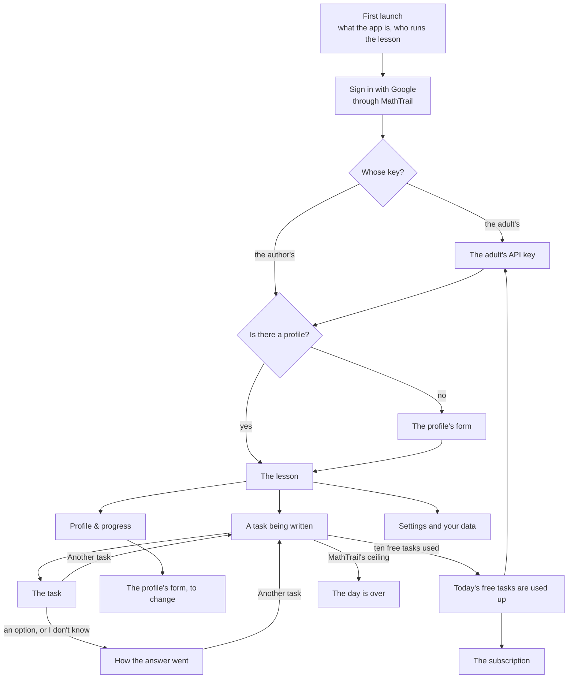

### 2.2 First launch

**What the adult sees.**
- One screen says what the app is: olympiad maths for grades 1–6, a task at a time, each checked by MathTrail before the child sees it.
- It says who runs the lesson: the adult, with the child beside them, answering on the card.
- It says what is kept about the child, and where: a pseudonym and a grade, never a real name, an age or a school, in one file in the adult's own Google Drive.
- One button goes on to sign in.

**Tools.** None.

### 2.3 Sign-in

**What the adult sees.** "Sign in with Google" opens the system's browser, not a view inside the app.
1. On a browser that has not approved the app before, MathTrail's consent page names the app and its address, says what Google will be asked for, and links to MathTrail's privacy policy and terms.
2. Google's screen then asks for access to the files MathTrail makes in Drive (`drive.file`). The adult ticks it.
3. If they leave it unticked, MathTrail's page asks them to go back and tick it.
4. The browser hands the adult back to the app.

The sign-in lasts while the app is used at least once in 30 days, and at most 90 days. After that, the adult signs in again.

**Behind it.**
- The sign-in is not a tool. It is MathTrail's authorization server: `/oauth/authorize`, the consent page, Google, `/oauth/callback`, and `/oauth/token` for the tokens.
- Renewal goes through `/oauth/token` with the refresh token.
- The service's [sign-in diagram](https://github.com/MathTrail/mathtrail-standalone/blob/main/docs/architecture/02-auth.md) shows the whole of it.
- After the sign-in the app calls `get_profile`. Its `screen` is `first_run` when there is no profile, and `profile` when there is one.

### 2.4 The adult's API key

This screen appears only when the adult chooses to use their own key.

**What the adult sees.**
- A field for a Claude API key, with a link to the [Claude Console](https://platform.claude.com/settings/keys), where keys are made (read 2026-11-11).
- A line that the adult pays Anthropic for each task written, refused tries included, and that ALT EdTech is paid nothing.
- The app tries the key once with a small call before keeping it. A key that fails is named as failing, and nothing is kept.
- In the settings, the key can be replaced or removed. Removing it moves the app to the author's key, with its ten free tasks.

**Tools.** None of MathTrail's. Where the key is kept, on the device or on a server, is section 3. Wherever it is, it is never sent to MathTrail.

### 2.5 The profile

**Making it.** The adult sees a form in place of the chat's questions.
1. A tick: "I am this child's parent or tutor". It is required, as the chat asks for it first.
2. A pseudonym, at most 32 characters, under a line that it must not be the child's real name.
3. A grade from 1 to 6, under a line that it only says where the first tasks start.
4. Optional fields, as the widget's form has them: interests (up to ten); skills the child has not met yet, such as division; the language of the lessons, which follows the device's language unless set; the country, and the state in the United States; and the tick "Don't count the country I sign in from".
5. The form has no free notes about the child, as the widget's form has none.

The form calls `save_profile` with what was filled in. `edit_profile` cannot be used here, because it never makes a profile ("Nothing was saved: there is no profile to change."). A refusal comes back with `problems`, a field and a code for each, and the form shows each under its field.

**Changing it.** From "Profile & progress", the same form, filled in. It calls `edit_profile` with the fields that changed and no others, so that a change made meanwhile in the chat is kept.

**When the file cannot be read.** Any tool can fail with a sentence that the profile cannot be read: damaged, in Drive's bin, or written by a newer version. The app then shows a screen with what the adult can do, by the case:
- a damaged file: "Put back the latest version that can be read", which calls `save_profile` with `restore` alone;
- a file in Drive's bin: "Restore it from the bin", which opens Drive;
- a file written by a newer version of MathTrail a moment ago, as a release does: "Try again in a few minutes";
- in every case: "Start a new profile", which calls `save_profile` with `start_over`. The old file is set aside under a new name and never deleted.

Telling these cases apart needs a code the failure does not carry today (2.12).

`get_profile` lists other files that hold a profile in `location.others`, so that the adult can delete them.

### 2.6 The lesson

**Starting.** "Start the lesson" asks MathTrail for a task with `next_task`, given the lesson's language. What comes back decides the screen:
- `screen: task` — a task written ahead and kept was handed out, and is on the card at once;
- `screen: coming` — a request was opened, and its task is to be written;
- `screen: first_run` — there is no profile, so the form opens;
- `status: limited` — the day is over (2.7).

A task left on the card without an answer when `next_task` is called again is recorded as skipped.

**A task being written.** The adult sees the steps: the topic and the difficulty picked, the task being written, every answer checked, then the task. A try that did not pass the checks says so, and that a new one is being written. Behind it:
1. `get_package` gives the brief, the reference tasks and the writing guide for the request.
2. The model writes the task, its solver and its self-check.
3. `submit_task` checks them. A refusal lists every reason, and the model writes again: three attempts in all.
4. After the third refusal, the card says this task did not work out and that a new one can be asked for. The request counts as failed for the day.

Who runs this loop — the app's own code, or the Claude API's MCP connector — is section 3.

**The task.**
- The card shows the wording, the picture when there is one, the five options with their letters, and the buttons "Hint", "I don't know" and "Another task".
- After the trial series it also shows "Topic".
- Its head shows the pseudonym and the grade, and "Profile & progress".
- "Hint" opens the hint in place, with no call: the hint came with the task. That it was opened goes with the answer.

**Writing the next task ahead.** Once a task is on the card, the app asks for the next one while the child works: `prepare_task`, then the model, then `submit_task`. MathTrail keeps that task sealed in the profile, and it is not counted against the day until it is handed out. The adult sees nothing of it. The next "Another task" puts it on the card at once.

**The answer.**
- Pressing an option calls `submit_answer` with the task's `task_id`, the letter, whether the hint was opened (`hint_used`), and how far the device's clock runs from UTC (`utc_offset`), so that the day ends at the family's midnight.
- "I don't know" calls `submit_answer` with `?`. It counts as a wrong answer and shows the solution.
- The card then turns into how the answer went, in the same place. It shows the verdict; the trap of a wrong option, and whether the mistake has come up before; the picture of the solution and its total; the solution step by step; the type of the task; and how the rating in its topic moved.
- During the five tasks of the trial series, the card shows "Trial series 2 of 5" in place of the rating.
- An answer already recorded is shown as it was recorded.

**Another task.** "Another task", on the task or under how the answer went, calls `next_task` again.

**The topic.**
- After the trial series, "Topic" opens the choice: "The coach chooses" (MathTrail's rule), the topics the review suggests, and every topic in its group.
- A choice saves the topic of the lessons with `edit_profile` (`lesson_topic`), and then asks for the next task with `next_task`.
- Every task after it keeps to that topic until "The coach chooses" gives the choice back. In the chat the adult can also ask for one task on a topic; the app has no such request, as the card has none.
- During the trial series there is no "Topic", and a topic chosen before waits until the series is over.

### 2.7 The day's quota and the subscription

**On the author's key**, the lesson's screen shows how many of the day's ten free tasks are used: "3 of 10 free tasks today".
- After the tenth, the app does not call `next_task`. It shows "Today's free tasks are used up", with four ways on:
  - subscribe;
  - use your own API key, which is free;
  - look at the progress;
  - come back tomorrow, after the family's midnight.
- The app also does not write a task ahead after the tenth free task without a subscription, since nobody would get it and the author would pay for it.

**With a subscription**, tasks go on past ten, up to MathTrail's own ceiling.

**MathTrail's ceiling** holds in every mode, the subscription included: 50 tasks or 10 failed requests a day. When it is reached, `next_task` answers `status: limited`, `code: limit_reached`. The adult sees the widget's night card, "Make a wish for tomorrow", with "That's all the tasks for today — it's the daily limit. New ones will come tomorrow." Under it the app offers the progress meanwhile, as MathTrail tells the chat's model to. The subscription cannot lift this ceiling, and the subscription's screen says so. The ceiling counts tasks taken in the chat too.

**On the adult's key** there is no quota of the app's, only MathTrail's ceiling.

**The subscription's screen.**
- It says what the subscription gives: tasks beyond ten a day, up to MathTrail's ceiling.
- It shows the price (section 8).
- It has a purchase through the store, or in the browser (sections 8 and 9), restoring a purchase made on another device, and a link to manage or cancel it.

No MathTrail tool stands behind it.

### 2.8 Progress

"Profile & progress", from the head of any lesson card or from the lesson's screen, reads the progress with `read_progress`. It is the same payload as `get_progress`. The adult sees:
- the pseudonym and the grade;
- the overall rank, such as "Rank 3 of 11", with a bar of how far it is to the next rank;
- a switch between the last task and the past week;
- the topics, each with its rank, ahead of or behind the overall one, or paused;
- the review: the strong topics, the ones to develop, the ones too early to judge, mistakes that repeat, and what to do next;
- the recent answers, and how many tasks were skipped;
- the profile, with "Edit" and "Your data".

During the trial series it shows only how many of its five tasks are done, and that ranks come after five tasks. A topic's name opens its page on the site `mathtrail.app`. A link from the app to the free site is allowed: what is restricted is the other direction.

### 2.9 Settings and your data

**Settings.**
- The language of the lessons, saved with `edit_profile` (`ui_language`).
- Whose key: the adult's or the author's (2.4).
- The subscription (2.7).

**Your data.**
- **Where the file is.** The folder, the file and a link to it in Drive, from `get_profile` (`location.folder`, `location.file`, `location.link`). Downloading that file is the export.
- **Sign out.** It asks MathTrail to end the grant with `/oauth/revoke`. Google ends all of the parent's grants to MathTrail together, so signing out of the app also disconnects MathTrail in Claude and ChatGPT (R114). The screen says so before it signs out, and the file is not touched. A sign-out that leaves the grant is the alternative in 2.12.
- **Delete the child's data.** The app deletes what it keeps itself: the key, and its record of the subscription. Then, for the profile, it opens the file in Drive and says how to delete it and empty the bin. No MathTrail tool deletes the file today. Whether the stores accept that is section 9, and a tool that deletes it would be a change in section 12.
- **What stays elsewhere.** The parent's Google account lists MathTrail under its linked apps; removing it there cuts every app off. And Anthropic keeps what the API received under its own terms (section 9).

### 2.10 When something goes wrong

| What happened | What MathTrail returns | What the adult sees |
|---|---|---|
| A try did not pass the checks | `submit_task`: `status: rejected`, the reasons | "A try didn't pass the checks; a new one is being written." |
| Three tries refused | `submit_task`: `status: rejected`, `code: attempts_exhausted`, `attempts_left: 0` | "This task didn't work out", and "Another task" |
| Too many calls in a short time | `isError`, a sentence, no payload | Nothing, at first: the app waits a moment and makes the same call again; if that keeps failing, "MathTrail is busy, try again in a minute" |
| The sign-in has ended, or access was taken back | `401` with a challenge, or `isError` with `mcp/www_authenticate` | "Sign in again", which starts 2.3 |
| Drive is full | `isError`, a sentence | "Your Google Drive is full: nothing was saved, the answer included. Free up space and try again" |
| The profile cannot be read | `isError`, a sentence | The screen of 2.5 |
| Drive did not answer | `isError`, a sentence | "Google Drive did not answer. Try again in a minute" |

### 2.11 Every scenario and its tools

| Scenario | MathTrail tools and endpoints | Screens |
|---|---|---|
| First launch | none | what the app is |
| Sign-in | `/oauth/authorize`, the consent page, Google, `/oauth/token`; then `get_profile` | the system's browser, then the profile's form or the lesson |
| The adult's key | none | the key |
| Making the profile | `save_profile` | the form |
| Changing the profile | `edit_profile` | the form |
| A profile that cannot be read | `save_profile` with `restore` or `start_over` | what to do with the file |
| Starting a lesson, another task | `next_task`; with no task kept, `get_package` and `submit_task` | a task being written, then the task |
| Writing ahead | `prepare_task`, `submit_task` | none |
| The answer, "I don't know" | `submit_answer` | how the answer went, in the task's place |
| The topic | `edit_profile` (`lesson_topic`), then `next_task` | the choice, then a new task |
| Ten free tasks used | none: the app's own count | today's free tasks are used up |
| MathTrail's ceiling | `next_task` with `status: limited` | the day is over |
| The subscription | none | the subscription |
| Progress | `read_progress` | Profile & progress |
| Your data, sign-out | `get_profile` (`location`), `/oauth/revoke` | your data |

### 2.12 Notes for the later parts

These came up while the screens were written. Each belongs to a later part.

- **For section 3.** Do tasks taken in the chat count against the ten free tasks of the author's key, or only the app's own? Where is the ten counted, and does its day end at the family's midnight, as MathTrail's does (R293)? Do refused tries and failed requests count against the ten? Every one of them costs the author tokens. *Answered in 3.5.*
- **For sections 3 and 5.** The app must declare MCP Apps when it connects, or be known by MathTrail in some other way to draw the cards. Otherwise MathTrail treats it as a chat of words: its instructions change, and no task solved from its picture comes to it (R305, R322). *Answered in 5.7.*
- **For section 12.** A failure reaches the app as one English sentence and `isError`. The reasons are a damaged profile, a profile in the bin, a full Drive, or Drive not answering, and they carry no code. To show the screens of 2.5 and 2.10 in the adult's language, the app needs a code it can read. It would have to guess from English words otherwise.
- **For sections 4 and 12.** The widget's card has no "I don't know". If the app shows MathTrail's own card (section 4), the button is a change to the card, hidden in the chat, where the adult says it in words. *Answered in 4.4.*
- **For section 9.** What the stores ask of deleting an account in the app, and whether opening the profile's file in Drive meets it. The profile is a file in the adult's own Drive, which no tool deletes. If it does not meet it, MathTrail needs a tool that deletes the file (section 12).
- **For sections 5 and 9.** Signing out of the app ends the parent's grant at Google, and so disconnects MathTrail in their chats too (R114). The alternative is a sign-out that only forgets the app's tokens and leaves the grant, which the adult then removes in their Google account. Which of the two the app does, and what the stores ask of a sign-out, is still to be decided. *Answered in 5.5: both, as two choices.*
- **For section 14.** "MathTrail" is used by MathTalk PBC for a maths trail for children in Cambridge, Massachusetts, and its domain `mathtrail.com`. That concerns the free MathTrail as well as the app.

## 3. Architecture

Every page cited here was read on 2026-11-11. Every fact about MathTrail was read in its code on the same day, at commit `7025812`, and is cited by file. The recommendation is in 3.6: the phone keeps the sign-in, and the app's server writes every task. The author chose it on 2026-11-11.

### 3.1 What decides it

| Fact | Where it is stated | What follows |
|---|---|---|
| A page in a browser can neither sign in to MathTrail nor call its `/mcp`. `/mcp`, `/oauth/token` and `/oauth/revoke` send no CORS headers, an `OPTIONS` request is answered `405`, and `/mcp` answers a foreign `Origin` with `403` | [`address.go`](https://github.com/MathTrail/mathtrail-standalone/blob/main/internal/transport/http/middleware/address.go), [`router.go`](https://github.com/MathTrail/mathtrail-standalone/blob/main/internal/transport/http/router.go); SPEC 9.2 and its remark 51 | The web version needs a server of its own between the page and MathTrail, or MathTrail changes (5.6) |
| A phone can sign in today. A redirect address may be `https` on any host. A request without an `Origin` header, which is what an app's HTTP client sends, passes | [`redirect.go`](https://github.com/MathTrail/mathtrail-standalone/blob/main/internal/transport/oauth/redirect.go), `address.go` | The phone needs no server to reach MathTrail |
| Access tokens last 15 minutes and refresh tokens 30 days from each issue, within a sign-in of 90 days. A refresh token stays good to its own end after it is used. `/mcp` checks neither the client nor the address a token comes from. MathTrail cannot end one client's tokens: `/oauth/revoke` ends the parent's whole grant at Google (R114) | [`grants.go`](https://github.com/MathTrail/mathtrail-standalone/blob/main/internal/transport/oauth/grants.go), [`access.go`](https://github.com/MathTrail/mathtrail-standalone/blob/main/internal/transport/oauth/access.go); SPEC 9.3 | A refresh token opens the child's profile for up to 90 days, and only Google can stop it. The fewer places hold one, the better |
| The sign-in and the renewal of tokens take 20 requests a minute from one address on each instance, 6 at once (R219). That is about 200 families in a lesson at once through one address | [`ratelimit.go`](https://github.com/MathTrail/mathtrail-standalone/blob/main/internal/ratelimit/ratelimit.go); SPEC 10.2 and its remark 60; [docs/catalogs.md](https://github.com/MathTrail/mathtrail-standalone/blob/main/docs/catalogs.md) §8.1 | A server that renews every family's tokens meets this limit. Phones that renew their own do not |
| The day's 50 tasks and 10 failed requests are counted in the profile, for every client together, with no count per client (R291) | [`task.go`](https://github.com/MathTrail/mathtrail-standalone/blob/main/internal/domain/profile/task.go), [`limits.go`](https://github.com/MathTrail/mathtrail-standalone/blob/main/internal/transport/mcp/limits.go) | The ten free tasks on the author's key are a count of the app's own (3.5) |
| A client cannot tell from MathTrail which family it serves. The tokens are sealed and carry no email. No tool returns an identifier of the account | `grants.go`; SPEC 7 | A server that counts each family's free tasks needs an identifier MathTrail does not give yet (3.5) |
| Anthropic: "Call the Claude API from your own back end". App Attest serves iOS and macOS alone. It goes through a Swift package in beta that "requires the OS 27 betas", sends no beta headers, and carries "no end-user identity". Android and the browser have no such path. Third parties may not offer a sign-in with a Claude plan | [authentication](https://platform.claude.com/docs/en/manage-claude/authentication), [App Attest](https://platform.claude.com/docs/en/manage-claude/app-attest), [the Swift package](https://platform.claude.com/docs/en/cli-sdks-libraries/libraries/apple-foundation-models), [legal and compliance](https://code.claude.com/docs/en/legal-and-compliance) | The author's key needs a server: on Android and in the browser always, and on iOS too while App Attest is in beta |
| The answer is sealed in the profile and never travels in a tool's result. But whoever runs the model holds the task the model wrote, the answer with it | `TestTheAnswerStaysSealed` in [`task_test.go`](https://github.com/MathTrail/mathtrail-standalone/blob/main/internal/transport/mcp/task_test.go) | The answer is wherever the loop of 3.4 runs |
| Apple: "An app may not store credentials or tokens to social networks off of the device". Its rule on keys the user brings is likely to refuse the mode on the adult's key on iOS | 9.3 | A server that keeps MathTrail's tokens has to argue its case in the review notes. The adult's key on iOS is a risk in every approach |

### 3.2 The approaches

Each approach is drawn with the same parts: the device the adult holds, the app's server where there is one, MathTrail with the parent's Drive, the Claude API, and the stores. The two modes are the adult's own API key and the author's key with its ten free tasks.

#### A. The app's server does everything

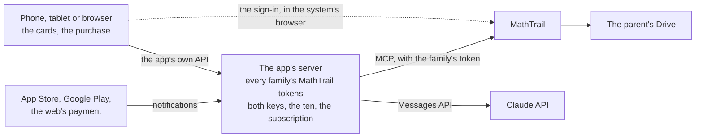

The device talks only to the app's server. The server receives the code of each sign-in, keeps every family's tokens, calls every MathTrail tool, writes the tasks and counts the quota.

- **For:** the device is thin and the same on every platform. The browser works without a change to MathTrail. The answer never reaches the device before the child answers.
- **Against:**
  - the server holds every family's refresh tokens, each good for up to 90 days, and nobody but Google can end one (3.1);
  - Apple's rule on tokens off the device weighs on it;
  - every renewal comes from the server's addresses, so about 200 families in a lesson at once is the ceiling until R219 raises it;
  - the server relays every call of every lesson, so it costs the most to run and has the most to do.

#### B. The device goes straight to MathTrail and to the Claude API

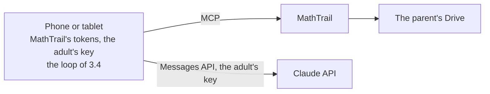

The device signs in, keeps its tokens and runs the loop itself. There is no server.

- **For:** it costs the author nothing to run. Each family renews its tokens from its own address. No third party holds a token.
- **Against:**
  - it serves the adult's key alone. The author's key cannot be put on a device (3.1), so the paid mode still needs a server;
  - in the browser it needs MathTrail to change: CORS and the app's origin on `/mcp`, `/oauth/token` and `/oauth/revoke`, and the refresh token kept in the page (5.6);
  - the task the model wrote, its answer included, is in the memory of the device the child uses. It is never shown, but it is there;
  - a change to the prompt or the model waits for a release in two stores, and old versions keep running for months.

#### C. Mixed: the phone keeps the sign-in, the server writes the tasks

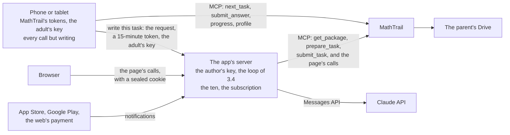

- **On a phone**, the app signs in itself and keeps MathTrail's tokens in the system's secure store. It calls MathTrail itself for everything but writing a task: `next_task`, `read_task`, `submit_answer`, the progress and the profile.
- **To write a task**, the phone sends the server a job: the request's id, its current access token, which lasts 15 minutes at most, and, in that mode, the adult's key. The server checks the family, the quota, the subscription and the country, then runs the loop of 3.4. It keeps neither the token nor the key, and never renews a token.
- **In the browser**, the page cannot call MathTrail (3.1), so the same server is its back end. It receives the code of the page's sign-in and seals the tokens into the page's cookie, which no script can read. It keeps nothing at rest and makes the page's calls to MathTrail. This is how MathTrail itself keeps Google's tokens ([02-auth](https://github.com/MathTrail/mathtrail-standalone/blob/main/docs/architecture/02-auth.md)).
- **For:**
  - on a phone, no refresh token leaves the device. The server holds an access token for minutes, for one job;
  - the loop lives in one place, and a change to the prompt or the model is a deployment of the server, not a release in the stores;
  - the answer never reaches the device before the child answers;
  - the browser works without a change to MathTrail;
  - phones renew their tokens from their own addresses, so only the browser's families count against R219 on the server's addresses.
- **Against:**
  - the browser is served differently from the phones, so the server has two jobs: writing tasks and acting as the page's back end;
  - the adult's key passes through the author's server with each job. The app's privacy policy has to say that it is used for that job alone and never kept;
  - the free mode depends on the author's server. The author accepted that on 2026-11-11.

**C′: on the adult's key the phone writes the task itself.** Then the free mode needs no server and the key never leaves the phone. The price is a second loop on the phone, a release in the stores for every change of the prompt, and the answer in the phone's memory. The author allowed the free mode to depend on the server, so C′ is not recommended.

#### Rejected

- **The author's key inside the app or the page.** Anthropic: "Anyone who uses a webpage can read an API key in that page's code" ([authentication](https://platform.claude.com/docs/en/manage-claude/authentication)), and a key in an app's package is read the same way. No device can keep a count of ten tasks that the family cannot reset, and the whole spend of the key would be open to anyone who took it.
- **App Attest for the author's key on iOS.** It lets an iOS app reach the API on the author's account without a server, but its package is in beta on the OS 27 betas and "is **not** a general-purpose Messages API client". Its tokens "carry no end-user identity", so nothing in it counts a family's ten tasks, and Android and the browser need the server anyway. To look at again when the package leaves beta.
- **The Claude API's MCP connector** as the one who writes the task: 3.4.

### 3.3 The approaches side by side

| | A. The server does everything | B. Straight from the device | C. Mixed (chosen) |
|---|---|---|---|
| **The author's key** | On the server | Not possible | On the server |
| **The adult's key** | On the server, or sent with each job | On the device | On the device, sent with each job, never kept |
| **MathTrail's tokens** | On the server, every family's | On the device | On the phone. For the browser, sealed in the page's cookie |
| **The answer before the child answers** | The server and Anthropic | The device's memory and Anthropic | The server and Anthropic |
| **The ten free tasks** | The server counts them | No author's key, so no ten | The server counts them |
| **The subscription** | The server keeps its state | None | The server keeps its state |
| **The browser** | Works | Needs MathTrail to change, and the page holds a refresh token | Works, through the server |
| **Renewals against R219** | Every family's, from the server's addresses | Each family's own address | The browser's families only, from the server's addresses |
| **A change to the prompt or the model** | A deployment of the server | A release in the stores | A deployment of the server |
| **The server** | Relays every call and holds every family's tokens | None | Writes tasks, and is the page's back end |
| **The stores (9.9)** | Tokens off the device, under Apple 5.1.1(v) | The adult's key on iOS, under 3.1.1 | An access token for one job only. The adult's key on iOS is the same risk in every approach |
| **Changes to MathTrail** | 3.6, items 1–5 | 3.6, items 1, 3, 4 and 5, and CORS and the origin for the browser | 3.6, items 1–5 |

**Cost.**
- **The model** costs the same in every approach: the tokens of the tasks, which T112.5 measures. Only the connector of 3.4 would add to them.
- **The server** costs little beside the model. Cloud Run bills an instance while "at least one request is being processed", rounded up to 100 ms, and requests open at once share it ([Cloud Run pricing](https://cloud.google.com/run/pricing)). A job keeps its request open while the model writes. One job alone for 60 seconds on one vCPU and half a GiB costs about $0.0015 past the free tier, at $0.000024 a vCPU-second and $0.0000025 a GiB-second. That is an estimate from the prices, not a measurement.
- **The free tier is shared by a billing account.** "The free tier usage is aggregated across projects by billing account" (the same page). On MathTrail's billing account, the app's server would spend the free tier that MathTrail's own 12,000–18,000 tasks a month rely on ([docs/load.md](https://github.com/MathTrail/mathtrail-standalone/blob/main/docs/load.md)). So the server belongs on a billing account of its own, which is section 8's question.
- **The database** of 3.5: Firestore's free quota is "1 GiB … 50,000 per day" reads and "20,000 per day" writes, for one database per project ([Firestore pricing](https://cloud.google.com/firestore/pricing)). A job reads a family's record and writes its count, so the free quota holds thousands of jobs a day.

**Difficulty.**
- A puts the most on the server: a sign-in for every family, a store of their tokens and a relay of every tool. The device does least.
- B puts everything on the device: the loop, an MCP client and the sign-in. It needs no server, and it has no paid mode.
- C splits the work. The phone signs in and has an MCP client. The server has the loop, the metering and the page's back end. C has more parts than A, because the phone and the server both call MathTrail. But each part is simpler, and the parts that change most often, the prompt and the model, are in one place.

### 3.4 Who runs the loop

The loop is SPEC 5.10's: take the request's package, have the model write a task, hand it in, and write again from the reasons of a refusal, three attempts in all. There are two ways to run it. One is the app's own code. The other is the Claude API's MCP connector, which lets the model call MathTrail's tools itself.

**The app's own code, on the server.** One task, in C:
1. The phone calls `next_task`. It answers `screen: coming` with a `request_id`. When a task written ahead was kept, it answers `screen: task` with the card at once, and there is nothing to write.
2. The phone sends the server the job (3.2, C).
3. The server calls `get_package` with the request. The package arrives as words, its JSON after the line `Package:` ([`getpackage.go`](https://github.com/MathTrail/mathtrail-standalone/blob/main/internal/transport/mcp/getpackage.go)), and the server reads it out of them until MathTrail gives it structured (3.6).
4. The server asks the model for the task, its solver and its self-check, with the guide that comes in the package. MathTrail's instructions to a chat's model are about talking to the adult and are not sent. How the model is asked is section 6's.
5. The server hands it in with `submit_task`. An accepted task comes back with its card, which has no answer. A refusal comes back with `reasons`, each with its code and messages, and `attempts_left`. The reasons go back to the model in the same conversation, so its earlier turns are read from the cache.
6. After the third refusal, `code: attempts_exhausted` closes the request, and the day counts one failed request.
7. While the server writes, it tells the phone each step over the job's connection: "the task is being written", "a try did not pass", "the task is on the card". If the connection drops, the phone asks `read_task` with the request, which says whether the task is still being written, how many tries were turned down, or that it is on the card.

**Writing ahead** (R235). Once a task is on the card, the phone asks the server to write the next one. The server calls `prepare_task`, which opens the request and answers with its package, in words, with the request's id inside them ([`preparetask.go`](https://github.com/MathTrail/mathtrail-standalone/blob/main/internal/transport/mcp/preparetask.go)). The server then writes the task in the same loop, and `submit_task` keeps it sealed: `code: task_kept`. The next `next_task` hands it out at once. On the author's key the server writes ahead only while the day's ten have room, or under a subscription (2.7).

**A hand-in whose answer was lost.** A repeat of `submit_task` after an accepted task is safe: it answers `stale_request` with the same card, and nothing is counted twice. A repeat after a refusal is not: it is judged again and spends another attempt ([`submittask.go`](https://github.com/MathTrail/mathtrail-standalone/blob/main/internal/transport/mcp/submittask.go)). So the loop first asks `read_task`. If the task is on the card, it is done. If the count of refused tries went up, the reasons are lost, and the loop writes again from what it has.

**The connector.** The model is given MathTrail's address and a token, and calls the tools itself ([MCP connector](https://platform.claude.com/docs/en/agents-and-tools/mcp-connector), beta `mcp-client-2026-09-15`):
- it supports "only [tool calls]", over Streamable HTTP, to a public `https` server. The caller obtains and refreshes the token: "API consumers are expected to handle the OAuth flow and obtain the access token prior to making the API call, and to refresh the token as needed";
- tools can be enabled one by one, so the model can be given `get_package` and `submit_task` alone. But the model decides the calls, and how many attempts to make. Opus 5.5 and Sonnet 5.5 refuse a forced choice of tool: "`any` and `tool` return a 400 error" ([define tools](https://platform.claude.com/docs/en/agents-and-tools/tool-use/define-tools));
- a tool's result is defined as text: "`content: string or array of BetaTextBlock`" ([Messages API](https://platform.claude.com/docs/en/api/beta/messages/create)). Nothing says that `structuredContent` reaches the caller, so the card from `submit_task` would have to be fetched again with `read_task`;
- "The MCP connector is not covered by ZDR arrangements", and the family's MathTrail token passes through Anthropic;
- which name and capabilities it sends MathTrail, and which version of the protocol it speaks, are not documented. Claude's own hosts call themselves "`claude-ai`" or "`Anthropic`" ([testing](https://claude.com/docs/connectors/building/testing)). MathTrail would then label the app's lessons `claude` ([`labels.go`](https://github.com/MathTrail/mathtrail-standalone/blob/main/internal/transport/mcp/labels.go)), and count them as Claude's in the log, the report and the public numbers. If it declares no MCP Apps, MathTrail closes every request for a task solved from its picture, and the connector meets `stale_request` (R322, 5.7).

**Recommendation: the app's own code, on the server.** The connector would spare the loop's code. The price is a wrong label, no tasks solved from the picture, a token handed to another party, and an order no code holds to. The own loop also lets the server tell the phone each step, as screen 2.6 shows them.

### 3.5 The ten free tasks and the subscription

**What counts.** A task the server wrote on the author's key, which MathTrail accepted. A task written ahead counts when it is accepted, because it cost the author the same. A refused try does not count, as in MathTrail (О-35). But every try costs the author tokens, so the failed requests on the author's key, three refusals each, are counted apart, against a ceiling of their own. Its number is section 8's. Tasks taken in the chat, or on the adult's key, do not count: they cost the author nothing. This answers the first note of 2.12.

**Where and until when.** The server counts, because only the server uses the author's key. The day ends at the family's midnight, by the offset from UTC the phone sends with each job. A new offset takes effect from the next day, as in MathTrail (R293), so moving the device's clock buys no tasks. MathTrail's own ceiling of 50 stays above the ten, in its profile. The two counts never meet: the adult meets the ten first, unless the chat took tasks that day.

**Which family.** The server needs an identifier of the family that a new installation or a new sign-in does not reset. MathTrail gives none today (3.1). Three ways:
1. **MathTrail names the account to each client apart.** `get_profile` would return an identifier made from the parent's identifier and the client's, like OpenID Connect's pairwise subject: two clients receive different identifiers, and neither leads back to the parent. The server calls `get_profile` itself with the token the phone lends it, so the phone cannot forge it. This is a change to MathTrail (3.6), and the recommended way.
2. **Until then, the profile's file.** `get_profile` returns the file's link in Drive (`location.link`). Its digest survives new installations and new sign-ins. A new profile (`start_over`) makes a new file, and so another ten, but it also starts the child's ratings from nothing. The weakness: the field exists for the export, not as an identity. MathTrail's contract would have to keep it stable for this use.
3. **An account of the app's own**, with a second sign-in. Rejected: it is one more account for the adult, and a login of its own brings Apple's rule on an equivalent login with it (9.3).

A family with several Google accounts gets ten tasks on each. Each account costs the author at most ten tasks a day. The backstop for all of them is a spend limit at Anthropic: "Spend limits set a maximum monthly cost an organization can incur for API usage", and a workspace may have its own, except the default one ([rate limits](https://platform.claude.com/docs/en/api/rate-limits)). Past it, a request is refused "and states when access resumes". So the server writes in a workspace of its own, under a limit no number of families can pass.

**The subscription.** It is bought in the App Store, on Google Play or on the web (sections 8 and 9). The server keeps its state from the stores' notifications and the web payment's, and every device reads that one state. That is what Apple asks of a subscription "available across all of the user's devices" (3.1.2(a), 9.3).
- Apple's server notifications say when a subscription renews or expires: "Use the data in the notifications to update your user-account database" ([App Store Server Notifications](https://developer.apple.com/documentation/appstoreservernotifications)).
- Google's say only that something changed, and the server "must call the Google Play Developer API … to get the complete status" ([real-time notifications](https://developer.android.com/google/play/billing/rtdn-reference)).
- A purchase is tied to the family when it is made. On iOS this is `appAccountToken`, "a UUID to associate the purchase with an account in your system" ([Apple](https://developer.apple.com/documentation/storekit/product/purchaseoption/appaccounttoken(_:))). On Android it is `setObfuscatedAccountId`, at most 64 characters and with no personal data ([Google](https://developer.android.com/reference/com/android/billingclient/api/BillingFlowParams.Builder)). Both are made from the family's identifier.

The server therefore needs a small database: each family's subscription and its day's counts.

**The country.** Anthropic's API is offered in its supported regions alone (9.6), and it sees the server's address, never the family's. So the server checks the country of the phone's address with each job, in both modes, from a GeoIP database such as the one MathTrail reads at start. MathTrail learns the country at sign-in, but keeps it sealed in its token, and the app needs no change for it. This answers the first note of 9.10.

### 3.6 Recommendation

**Recommendation: C, with the app's own loop on the server.** On a phone, the refresh tokens stay on the device. One loop serves both keys, and changes without a release in the stores. The answer never reaches the device before the child answers. The browser is served by the same server, and MathTrail keeps its rule on origins.

One task, on a phone:

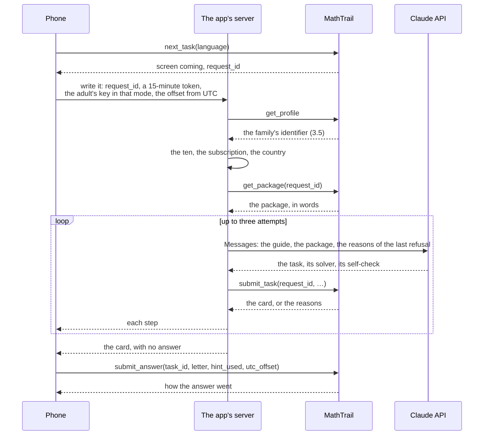

**What it needs from MathTrail.** These go to section 12, where T112.7 orders them:
1. **A label of its own** for the app's lessons in the log, the report and the counts kept for years. Under its own name it lands in `other` today (5.7). Whether its children count in the public numbers is T112.7's question.
2. **An identifier of the account for each client apart** (3.5).
3. **The package and the request written ahead, structured.** Today `get_package` and `prepare_task` answer in words alone, and the task's schema is not served (5.10).
4. **A code on every failure.** Today a failure is one English sentence (2.12).
5. **A contract on the fields of 5.10**, held by tests, with a version and a period of notice before a field goes.
6. **Optional:** a repeated hand-in of the same attempt answered with its first verdict, so that a lost answer costs no attempt (3.4).

C needs no change to MathTrail's origins, limits or sign-in. Its daily ceiling stays shared (5.8).

**Chosen on 2026-11-11: C**, with the app's own loop on the server.

### 3.7 Notes for the later parts

- **For section 4.** The app may declare MCP Apps only if it draws the tasks' pictures, by itself or with MathTrail's card (5.7). *Answered in 4.5: it draws them with MathTrail's card, and declares it.*
- **For section 6.** The loop of 3.4 is what T112.5 measures: on the server, the reasons of a refusal going back to the model in the same conversation, with the package's guide and no chat instructions.
- **For section 8.** The server's cost and its database, the ceiling of failed requests on the author's key, and whether the app's server shares Cloud Run's free tier with MathTrail (3.3).
- **For section 11.** The phone needs an MCP client of the 2026-07-28 protocol and the system's sign-in (5.3) in the chosen technology. The server's loop is one piece of code. *Answered in 11.2 and 11.6.*
- **For section 13.** The review notes say why a server holds a family's token for minutes (Apple 5.1.1(v)), and why Google is the only login (4.8).

## 4. Cards

Every page cited here was read on 2026-11-11. MathTrail's card was read in its code on the same day, at commit `441acc6`, and is cited by file under [`web/`](https://github.com/MathTrail/mathtrail-standalone/tree/main/web). Sizes were measured on the widget that commit builds. The paths are lettered A to C within this section alone; section 3's approaches are lettered apart. The recommendation is in 4.5: the app takes MathTrail's own card as a package and mounts it itself.

### 4.1 What decides it

| Fact | Where it is stated | What follows |
|---|---|---|
| The card already works without a chat host. The site's home page mounts the widget's own task card and the card of a task being written, and gives them three things: a `Service` that records an answer, says how a task stands, reads the progress and saves a change to the profile; a `Host`; and one language's words. The site draws its still cards from the same components | [`web/src/demo/hero.tsx`](https://github.com/MathTrail/mathtrail-standalone/blob/main/web/src/demo/hero.tsx), [`web/src/demo/service.ts`](https://github.com/MathTrail/mathtrail-standalone/blob/main/web/src/demo/service.ts), [`web/src/widget/service.ts`](https://github.com/MathTrail/mathtrail-standalone/blob/main/web/src/widget/service.ts), [`web/src/widget/bridge.ts`](https://github.com/MathTrail/mathtrail-standalone/blob/main/web/src/widget/bridge.ts); R170, R188, R197 | The card can be reused as a component, with no MCP Apps frame around it |
| The widget is one HTML file of 1,981,419 bytes, 528 KB compressed with gzip. Its 64 dictionaries take 1,544,833 bytes of it, 78 %. One language's dictionary is 17 KB (`zh-Hans`) to 41 KB (`ta`). The demo's script is 105 KB, 38 KB compressed, and the page hands it one language's words | `internal/widget/widget.html`; SPEC 8.6 | A card that carries one language weighs a fraction of the widget |
| The card is 17,560 lines of TypeScript and Preact, its tests left out: 8,545 in `web/src/design/`, 5,858 of them the pictures, 8,235 in `web/src/widget/` and 780 in `web/src/i18n/`. A picture is a pure function of its description, drawn as SVG with no measurement in a browser. The format has grown from twelve kinds to seventeen since R272, four of them for tasks solved from the picture (R316) | [`web/src/design/picture/`](https://github.com/MathTrail/mathtrail-standalone/tree/main/web/src/design/picture) | Drawing the cards anew is writing all of that again, and keeping it in step |
| A tool's payload carries ids and codes, and the card says them in its own words | SPEC 7.3 | Every path needs the card's dictionaries, even one that draws its own cards |
| The card leans on a chat. "Another task" puts the words "Another task" in the chat, for the model to answer. It has no "I don't know", since the adult says that in the chat. 17 of its 326 English texts send the adult to the chat | [`TaskCard.tsx`](https://github.com/MathTrail/mathtrail-standalone/blob/main/web/src/widget/TaskCard.tsx), [`ResultCard.tsx`](https://github.com/MathTrail/mathtrail-standalone/blob/main/web/src/widget/ResultCard.tsx), [`choices.ts`](https://github.com/MathTrail/mathtrail-standalone/blob/main/web/src/widget/choices.ts), [`web/locales/en.json`](https://github.com/MathTrail/mathtrail-standalone/blob/main/web/locales/en.json) | Every path needs changes to the card (4.4) |
| Apple: an app may not "download, install, or execute code which introduces or changes features or functionality", and HTML5 and JavaScript mini apps fall under 4.7. Google: a web view of content its owner allows is allowed | 9.3, 9.4 | On iOS, a card fetched from MathTrail while the app runs is a risk. A card bundled into the app is not |
| MathTrail sends a task solved from its picture only to a client that declares MCP Apps | 5.7; R322 | The app declares it only if it draws all seventeen kinds |
| The stable MCP Apps spec: "All View content MUST be rendered in sandboxed iframes with restricted permissions", and a host that is a web page talks to the view "through an intermediate Sandbox proxy" on another origin. The draft, since release 2.1.0 of 10 November 2026, "does not require Hosts to use any one particular framing mechanism", but still: "If the Host is a web page, it MUST wrap the View in an iframe", and "The Host and the iframe MUST have different origins". Claude itself, on a phone, "renders apps in a native WebView … rather than a sandboxed iframe" | [stable spec](https://github.com/modelcontextprotocol/ext-apps/blob/main/specification/2026-01-26/apps.mdx), [draft](https://github.com/modelcontextprotocol/ext-apps/blob/main/specification/draft/apps.mdx), [release 2.1.0](https://github.com/modelcontextprotocol/ext-apps/releases/tag/v2.1.0), [Claude's design guidelines](https://claude.com/docs/connectors/building/mcp-apps/design-guidelines) | A host of MCP Apps on a phone may use a web view. In the browser it needs an iframe on an origin of its own |

### 4.2 The three paths

#### A. The app draws the cards itself

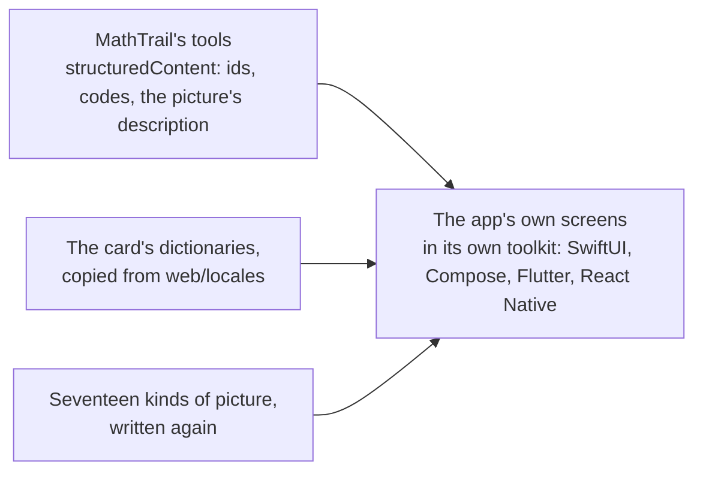

The app reads the payloads of `next_task`, `submit_answer`, `read_task`, `read_progress` and the profile's tools, and draws every screen with its own toolkit. It copies the words from `web/locales/*.json`, and draws the pictures again from their format.

- **For:**
  - the cards look and behave as the platform's own;
  - any technology of section 11 will do, and no web view is needed;
  - Apple's 4.2 on apps made of web pages does not arise.
- **Against:**
  - about 17,600 lines are written again, the 5,900 of the pictures among them. They are written once for each toolkit the app uses: twice with native Swift and Kotlin, and once more for the browser;
  - every change to MathTrail's card is made again in the app: a new kind of picture, a new screen, a new key. Until it is, MathTrail can send a task the app cannot draw;
  - the checks of the layout are written again: every screen in 64 languages and the pseudo-language, at 320 px, with the pictures' words measured (SPEC 8.6);
  - the app may declare MCP Apps only once all seventeen kinds are drawn. Until then no task solved from its picture comes to it (5.7).

#### B. MathTrail's widget in a web view, with the app as its host

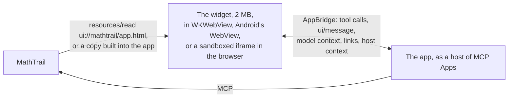

The app shows `ui://mathtrail/app.html` as Claude and ChatGPT do. It reads the widget from MathTrail with `resources/read`, or bundles a copy when it is built. It plays the host's side with the library's `AppBridge`, "a proxy between the host application and a view running in an iframe" ([AppBridge](https://apps.extensions.modelcontextprotocol.io/api/classes/app-bridge.AppBridge.html)). That means it answers the widget's tool calls (`submit_answer`, `read_task`, `read_progress`, `edit_profile`), its messages, its lines to the model and its links, and hands it the theme, the locale and the safe area.

- **For:**
  - the card is exactly the one Claude and ChatGPT show: every screen, the seventeen kinds and the 64 languages at once;
  - MathTrail changes nothing for the lesson's core;
  - a widget fetched from MathTrail follows every change to the card with no work in the app.
- **Against:**
  - a widget fetched while the app runs is code that changes the app's features without a review, under Apple's 2.5.2 and 4.7 (9.3). A copy bundled at build time passes, but then the app follows the card only with its own releases, and the advantage of the line above is gone;
  - each view carries 2 MB, every dictionary included;
  - "Another task" reaches the host as a chat message in the card's language. The host has to read any message as a request for a task. The 17 texts that send the adult to the chat stay, and "I don't know", "Report this task" and the note that AI wrote the task are missing;
  - the widget expects a card for each tool's call, and the host to hand it each result. The app would play a chat host that has no chat, and the lines the widget tells the model go nowhere;
  - in the browser, the spec asks for an iframe on another origin. That is one more origin for the app's server to serve.

#### C. MathTrail's card as a component from a package

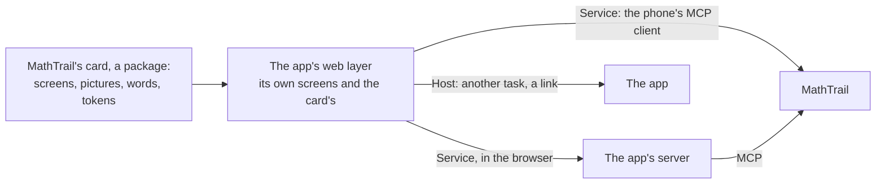

MathTrail publishes its card's components, pictures, dictionaries and tokens as an npm package with a version. The app mounts the card's screens as the site's demo does, and gives them its own `Service`, its own `Host` and one language's words.

- **For:**
  - every screen, the seventeen kinds and the 64 languages, as in path B, without playing a host of MCP Apps and without an iframe;
  - one language's words at a time. The widget less its other 63 dictionaries comes to about 460 KB, and a package without the bridge to a chat host weighs less still. This is arithmetic, not a measurement: the package does not exist yet;
  - the card is built into the app, so it passes 2.5.2 on iOS. On Android it is its owner's content in a web view (9.4);
  - the same components serve the phone's web view and the browser's page;
  - the app follows the card by raising the package's version, and its own checks run on the card it ships;
  - the seams are already in the code, and two of MathTrail's own pages use them (R170, R197).
- **Against:**
  - MathTrail has to publish the package and keep it. Its interface has to stay stable: the `Service`, the `Host`, the words and each screen's properties, with a version and a note of every change (section 12). The card becomes an interface others rely on;
  - the cards are web code. On React Native, Flutter, Kotlin Multiplatform or native, the card runs in a web view beside native screens (section 11);
  - the changes of 4.4 are still needed in MathTrail's card.

### 4.3 The paths side by side

| | A. The app draws them | B. The widget, the app as its host | C. The card as a package |
|---|---|---|---|
| **64 languages** | The words copied, the layout made again | At once | At once, one language loaded |
| **Seventeen kinds of picture** | Drawn again, kept in step by hand | At once | At once |
| **Every screen** | Drawn again | At once | At once |
| **Weight** | The app's own | 2 MB in each view | About 460 KB at most, by arithmetic |
| **iOS review (9.3)** | Clear | Fetched: 2.5.2 and 4.7. Bundled: clear | Clear: bundled |
| **The browser** | A third version of the cards | An iframe on an origin of its own | The same components |
| **Changes to MathTrail** | None but the card's dictionaries as a source | The changes of 4.4 | The package, and the changes of 4.4 |
| **When MathTrail's card changes** | The app writes it again | Fetched: at once. Bundled: with the app's release | With the app's release, by raising the version |
| **Technologies it allows (section 11)** | Any | Any with a web view | Any with a web view; one code base only with a web app |
| **MCP Apps declared (5.7)** | Only once all seventeen kinds are drawn | Yes | Yes |

### 4.4 What the card lacks, on any path

On paths B and C these are changes to MathTrail's card, and on path A the app draws them itself. Each is drawn only when the host asks for it, so the card in Claude and ChatGPT stays as it is. They go to section 12.

- **"Another task" as the host's own action.** In the chat it stays a message to the model. In the app, the `Host` is told, and the app calls `next_task`.
- **"I don't know"** on the task's card. It records the answer `?`, as the chat does when the adult says so. This answers the note of 2.12.
- **"Report this task"**, which both stores ask of content written by AI (9.3, 9.4). The card shows the control, and the `Host` sends the report to the app's server.
- **A note that AI wrote the task**, which Article 50 of the EU AI Act asks for (9.5). The machine-readable mark in the task's data is MathTrail's to add (9.10).
- **Words for a host with no chat.** The 17 texts that send the adult to the chat need wordings without it, in all 64 dictionaries. Among them are "Ask for a task in the chat" and "This card can't be shown here. The chat says the same in words."
- **The lines to the model.** The `Host` of an app ignores them. This needs no change.

### 4.5 Recommendation

**Recommendation: path C, MathTrail's card as a package.**
- Path C gives the app every screen, picture and language, as path B does. It does so without playing a chat host, without 2 MB a view, and without a fetched widget's risk on iOS.
- Path A would write the card again, once for each toolkit and again for each change MathTrail makes to it.
- The app declares MCP Apps (5.7), since it draws every picture with MathTrail's own code.
- The card looks as it does in the chats: the same tokens and colours. The author chose that on 2026-11-11. The app's own name shows in its icon, its mark and its own screens, and those screens take their colours from the same `tokens.css`.

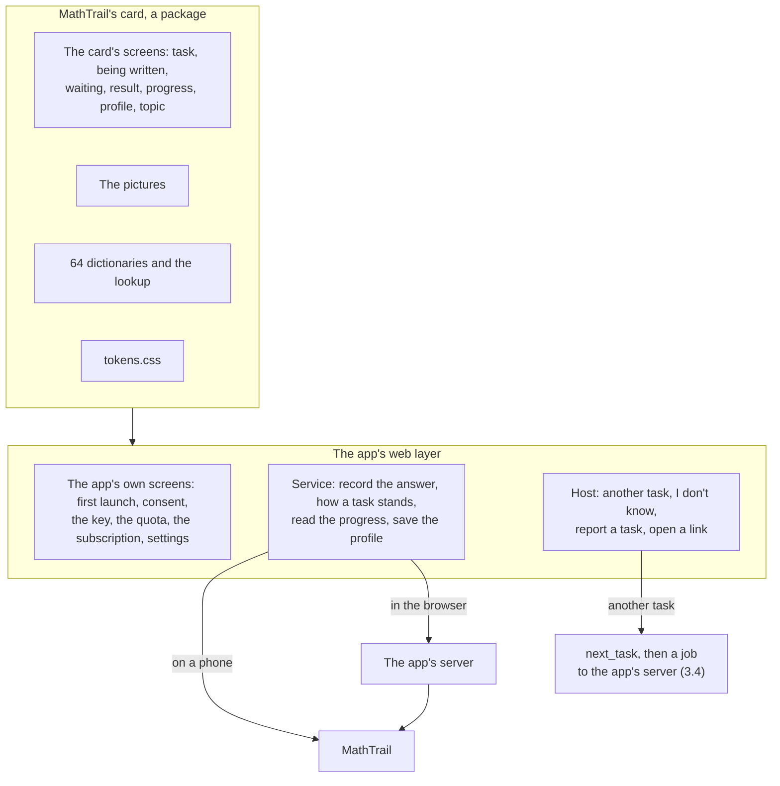

**Chosen on 2026-11-11: path C**, MathTrail's card as a package.

### 4.6 Notes for the later parts

- **For section 11.** Path C makes the cards web code. A web app carries them in one code base. Any other technology carries them in a web view beside its own screens.
- **For section 12.** The package itself: what it holds, its name, its version and its licence, MIT as the rest of `web/`. The host's choices of 4.4, and the 17 wordings without the chat in 64 languages. The machine-readable mark of AI in the task's data.
- **For section 13.** The app's own checks run the card's layout on its own screens too: every language and the pseudo-language, at 320, 360 and 640 px, in Chromium and WebKit, as `just web-layout` does for the card.

## 5. Connecting to MathTrail

In C, the phone and the app's server are both clients of MathTrail, on behalf of the same family. This section says what each of them sends and keeps, and what it may rely on. MathTrail's code and pages were read on 2026-11-11, as in section 3. The service is at `https://mcp.mathtrail.app/mcp`.

### 5.1 The MCP client

MathTrail speaks MCP 2026-07-28 with no sessions ([`server.go`](https://github.com/MathTrail/mathtrail-standalone/blob/main/internal/transport/mcp/server.go)). Each call is one `POST` to `/mcp` with one JSON-RPC message, and there is no handshake ([basic protocol](https://modelcontextprotocol.io/specification/2026-07-28/basic/index), [Streamable HTTP](https://modelcontextprotocol.io/specification/2026-07-28/basic/transports/streamable-http)):
- `Authorization: Bearer` with the access token;
- `MCP-Protocol-Version: 2026-07-28`, which "**MUST** match" the version in the message, together with the `Mcp-Method` header and, for a tool's call, `Mcp-Name`;
- in the message's `params._meta`, on every call: `io.modelcontextprotocol/protocolVersion`, `io.modelcontextprotocol/clientCapabilities` and `io.modelcontextprotocol/clientInfo`. "Every request supplies this metadata in its `_meta` field", because the server "**MUST NOT** rely on prior requests". MathTrail reads the client's name and capabilities there, call by call ([`boundary.go`](https://github.com/MathTrail/mathtrail-standalone/blob/main/internal/transport/mcp/boundary.go)).

The phone and the server send the same `clientInfo` and the same capabilities: they are two halves of one client, and MathTrail judges each call by what that call says (5.7).

### 5.2 The Client ID Metadata Document

The app is registered by a document on its own domain, as Claude is (R03, R105). For example:

```json
{
  "client_id": "https://app.example/oauth/client.json",
  "client_name": "The app",
  "redirect_uris": [
    "https://app.example/oauth/app",
    "https://app.example/oauth/web"
  ],
  "token_endpoint_auth_method": "none",
  "grant_types": ["authorization_code", "refresh_token"],
  "response_types": ["code"]
}
```

What MathTrail asks of it ([`internal/infra/cimd/`](https://github.com/MathTrail/mathtrail-standalone/tree/main/internal/infra/cimd), [`clients.go`](https://github.com/MathTrail/mathtrail-standalone/blob/main/internal/transport/oauth/clients.go)):
- **The address.** `https` on port 443, with a path that is neither empty nor `/`, no `.` or `..` segment, no fragment, and at most 1,024 characters. Every address its name resolves to must be public. MathTrail never follows a redirect and reads only a `200` of at most 64 KB, within 10 seconds, tried twice.
- **The fields.**
  - `client_id` equals the document's address exactly.
  - `client_name` is not empty and has at most 100 characters. The consent page shows it: "Connect {name} to MathTrail?".
  - `redirect_uris` holds 1 to 32 addresses, each `https` on any host, or the computer's loopback. An address that breaks the rules is dropped, and a document with none left is refused.
  - There is no `client_secret`, and `token_endpoint_auth_method` names no secret. `private_key_jwt` is read as a public client.
  - Every other field is ignored, `logo_uri` and `jwks_uri` among them.
- **The copy.** MathTrail keeps a copy for the document's `max-age` less its `Age`, at least 5 minutes and at most 24 hours, in each instance's memory. A change to the document reaches every instance within a day at most.
- **No list of allowed clients** exists (R105): the consent page is the check a person makes. The host of a redirect address need not be the document's.

One document serves the phones and the web. The refresh token is bound to the client that received it ([`token.go`](https://github.com/MathTrail/mathtrail-standalone/blob/main/internal/transport/oauth/token.go)), and a phone and a page never trade tokens, so nothing is gained by two. The two redirect addresses differ, for the reason in 5.4.

### 5.3 Signing in on a phone

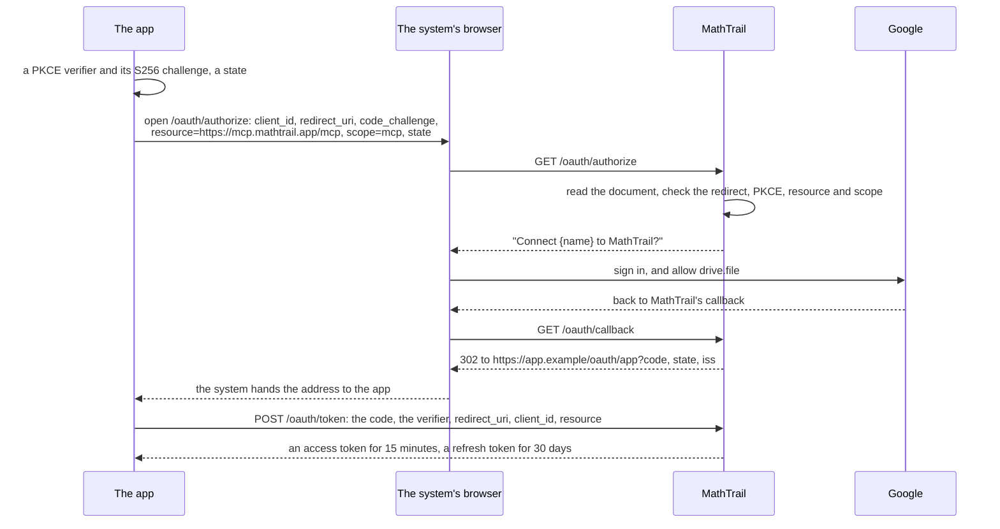

- **The parameters** are those of [02-auth](https://github.com/MathTrail/mathtrail-standalone/blob/main/docs/architecture/02-auth.md) and SPEC 9.3. PKCE is S256 alone. `resource` is MathTrail's address exactly. The one scope is `mcp`, and any other is refused with `invalid_scope` ([`authorize.go`](https://github.com/MathTrail/mathtrail-standalone/blob/main/internal/transport/oauth/authorize.go)). The code lasts 60 seconds. The app checks that `iss` is MathTrail's issuer.
- **The system's browser, never a view inside the app.** Google refuses its sign-in in a view embedded in an app: "The authorization endpoint is displayed inside an embedded user-agent disallowed by Google's OAuth 2.0 Policies" ([Google](https://developers.google.com/identity/protocols/oauth2/native-app)). The consent page is skipped next time when the system's browser keeps MathTrail's cookie.
- **iOS.** `ASWebAuthenticationSession` with the callback `.https(host:path:)`, from iOS 17.4: "The host must be a member of a domain associated with the app" ([Apple](https://developer.apple.com/documentation/authenticationservices/aswebauthenticationsession/callback/https(host:path:))). The domain serves `apple-app-site-association` "using `https://` with a valid certificate and with no redirects" ([associated domains](https://developer.apple.com/documentation/xcode/supporting-associated-domains)). By a forum post, the system asks for the `webcredentials` service for this ([thread](https://developer.apple.com/forums/thread/763621)); Apple's pages do not name it, and AppAuth-iOS says the same (11.2). So the app needs iOS 17.4 or later.
- **Android.** Chrome's Auth Tab, from Chrome 137: "For redirects using the https schema, the browser verifies that the redirect domain and client app are owned by the same publisher using Digital Asset Links" ([Auth Tab](https://developer.chrome.com/docs/android/custom-tabs/guide-auth-tab)). Where there is no Auth Tab, "an Auth Tab intent automatically launches a Custom Tab instead". The app then receives the address as a verified App Link, declared with `android:autoVerify="true"` and `assetlinks.json` ([App Links](https://developer.android.com/training/app-links/verify-android-applinks)). AppAuth recommends "a fallback page … at the same address" for a link not verified ([AppAuth](https://github.com/openid/AppAuth-Android)).
- **Why `https`.** MathTrail refuses a scheme of the app's own (SPEC 9.3), and RFC 8252 prefers `https` anyway: "the identity of the destination app is guaranteed to the authorization server by the operating system. For this reason, native apps SHOULD use them" ([§7.2](https://www.rfc-editor.org/rfc/rfc8252#section-7.2)).
- **The store's reviewer** signs in by the password on MathTrail's consent page (R222, 9.3), with no Google account to type.

### 5.4 Signing in in the browser

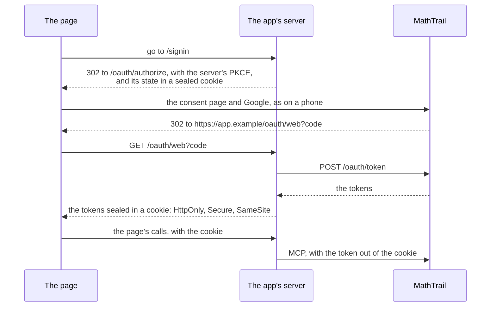

- The server keeps nothing at rest. The cookie carries both tokens sealed with the server's key, and the page cannot read it. When the access token nears its end, the server renews it and sets the cookie again. A browser keeps about 4 KB in a cookie, so the server measures the sealed tokens against that before it relies on one cookie, and splits them in two if it must.
- This is the back end for the front end of [RFC 10017](https://www.rfc-editor.org/rfc/rfc10017), a best current practice since August 2026. It presents its patterns "in decreasing order of security", this one first, and "strongly recommended for … applications that handle personal data".
  - Its back end keeps the tokens "in the context of a cookie-based session, avoiding the direct exposure of any tokens to the browser-based application". It "MUST enable the Secure flag" and "the HttpOnly flag", and "SHOULD enable the SameSite=Strict flag".
  - The cookie that keeps the sign-in's state is `SameSite=Lax` instead: the return from MathTrail is a navigation from another site, and a strict cookie would not come with it.
  - The RFC's back end "interacts with the authorization server as a confidential OAuth client". MathTrail has public clients alone (R106), so the server signs in as one, with PKCE.
- **The two redirect addresses.** The phone's, `/oauth/app`, is claimed by the app in `apple-app-site-association` and `assetlinks.json`. The page's, `/oauth/web`, is left out of both. Otherwise a sign-in on the web, on a phone that has the app, would open the app.

### 5.5 Tokens

| Token | How long it lasts | On a phone | For the browser | On the app's server |
|---|---|---|---|---|
| Access | 15 minutes, and never past the end of the Google token inside it less 3 minutes, nor past the sign-in's end | In memory, and in the secure store | Sealed in the page's cookie | Lent for one job, and never kept |
| Refresh | 30 days from each issue, and never past the sign-in's end | The system's secure store, on this device alone and not in backups: the Keychain on iOS, a key in the Android Keystore | Sealed in the page's cookie | Never, but for the page's cookie |
| The sign-in | 90 days from the sign-in. A renewal after that is `invalid_grant` | — | — | — |

Sources: [`grants.go`](https://github.com/MathTrail/mathtrail-standalone/blob/main/internal/transport/oauth/grants.go); SPEC 9.3.

**Renewing.**
- The app renews by `expires_in`, before the access token ends, as Claude does (02-auth). It keeps the newest refresh token.
- The token it presented stays good to its own end, so a renewal whose answer was lost can be made again with it, and two renewals at once both succeed. Only the client that received a token may renew it.
- The renewal answers `429` with `Retry-After` when the address's pace is used up, and `503 temporarily_unavailable` with `Retry-After` when the parent's renewals at Google are (5.8). The app waits and tries again. Neither is a reason to sign in again.
- The app knows when it signed in, so it can tell the adult a week before the 90 days end.

**Google keeps at most 100 refresh tokens per account for MathTrail's client**, and the oldest is dropped silently past that (02-auth). Every sign-in takes one, in the app or in a chat, on any device. An app that signs in again and again could disconnect the parent's chat. So the app signs in only when MathTrail says the grant is gone: `invalid_grant`, or a call answered `401` with `error="invalid_token"`.

**Lending the token to the server.** The phone sends its access token with each job, over TLS. The server uses it for that job alone, keeps it in memory, never writes it to a log and never renews it. A job lasts a few minutes at most, so the phone renews a token that has less than ten minutes left before it lends it.

**Signing out.** Two choices, as 2.12 asked:
- **"Sign out"** forgets the tokens on this device. On the web, the server clears the cookie. The grant stays, and the other devices and the chats go on.
- **"Disconnect MathTrail everywhere"** calls `/oauth/revoke` with the refresh token and the `client_id`. Google ends the whole grant, so every app and chat of the parent's is disconnected at once (R114). The screen says so before it does it. A token already issued keeps working for a while: an access token to its end, and a renewal while the Google token inside it lasts (SPEC, remark 55). This is the "mechanism to revoke" of Apple's 5.1.1(v).

**When access is gone.** A call answered `401` with a challenge, or a failure whose `_meta["mcp/www_authenticate"]` holds one, means the grant ended at Google or its Google token ran out ([`challenge.go`](https://github.com/MathTrail/mathtrail-standalone/blob/main/internal/transport/mcp/challenge.go)). The app renews once. If the renewal is `invalid_grant`, the adult signs in again (2.3).

### 5.6 The origin of the browser's calls

**The page talks only to the app's server, on its own origin.** The server calls MathTrail from its own process, with no `Origin` header, and `/mcp` lets such a call through ([`address.go`](https://github.com/MathTrail/mathtrail-standalone/blob/main/internal/transport/http/middleware/address.go)). MathTrail does not change.

**The other way: MathTrail opens itself to the app's origin.** It would send CORS headers for that origin on `/mcp`, `/oauth/token` and `/oauth/revoke`, answer `OPTIONS`, and accept that origin beside its own. The protocol allows it: "Servers **MUST** validate the `Origin` header", and a list of origins is a validation ([Streamable HTTP](https://modelcontextprotocol.io/specification/2026-07-28/basic/transports/streamable-http)). But the page would then keep the refresh token where any script on the page can read it. A token taken from there opens the child's profile for up to 90 days, and nobody but Google can end it (3.1). The author kept the rule in T47 (SPEC, remark 51), and C gives no new reason to change it.

### 5.7 The client's name and MCP Apps

**The name.** MathTrail labels a client by words in its `clientInfo.name`, in any case ([`labels.go`](https://github.com/MathTrail/mathtrail-standalone/blob/main/internal/transport/mcp/labels.go)): `claude` or `anthropic` make it Claude, `chatgpt` or `openai` ChatGPT, `inspector` and `mathtrail-load` the service's own tools. The app's name contains none of them. Today it then lands in `other`, counted among the children with every client nobody knows. A label of its own is a change to MathTrail (3.6, item 1). The name is also what decides the answer to a lost grant: every client but ChatGPT gets the `401` of 5.5 ([`challenge.go`](https://github.com/MathTrail/mathtrail-standalone/blob/main/internal/transport/mcp/challenge.go)).

**MCP Apps.** A client that draws the cards declares the extension in every call:

```json
"io.modelcontextprotocol/clientCapabilities": {
  "extensions": {
    "io.modelcontextprotocol/ui": { "mimeTypes": ["text/html;profile=mcp-app"] }
  }
}
```

MathTrail checks only that the key is there ([`chat.go`](https://github.com/MathTrail/mathtrail-standalone/blob/main/internal/transport/mcp/chat.go)). It sends a task solved from its picture only to a client that declares it (R322). The server's calls must declare it too. A `get_package` or `submit_task` that leaves it out, while a request for such a task is open, is answered `stale_request`, and the request is closed ([`ahead.go`](https://github.com/MathTrail/mathtrail-standalone/blob/main/internal/transport/mcp/ahead.go)). The rest of what MathTrail sends a client that declares nothing differs only in its words, not in its payload (R305).

The app declares it only if it draws the tasks' pictures, by its own code or with MathTrail's card. That is section 4's to decide. An app that cannot draw them declares nothing, and receives tasks in words alone.

### 5.8 Limits

| Limit | Number | Counted by | Who meets it in C | What the app does |
|---|---|---|---|---|
| The address's pace: the sign-in, `/oauth/token`, `/oauth/revoke`, the two documents | 20 a minute, 6 at once, on each instance (R219) | The address | A phone: its own address. The browser's families: the server's addresses, about 200 in a lesson at once | Waits for `Retry-After`, 3 seconds, and tries again. The first refusal is R219's sign to raise the number |
| Renewals that go to Google | 12 a minute, 4 at once | The parent | Phone or server, whichever renews | Waits for `Retry-After` |
| Calls | 60 a minute, 20 at once | The parent | The phone and the server together, for one family | A failure in words: "MathTrail received too many calls in a short time". The app waits a moment and makes the same call again |
| Each instance's doors, the sign-in's and the lessons' | 200 a minute each | The instance | Everyone, the chats included | The same failure. The app's lessons slow the chats' when many crowd into one minute (SPEC 10.2) |
| The day | 50 tasks and 10 failed requests (R291) | The child's profile, for every client together | Everyone | `next_task` answers `status: limited`, `code: limit_reached`, and the night card of 2.7 shows |
| The ten free tasks | 10 tasks, and the failed requests' own ceiling (3.5) | The app's server | Only the author's key | The screen of 2.7 |

Sources: [`internal/ratelimit/`](https://github.com/MathTrail/mathtrail-standalone/tree/main/internal/ratelimit), [`limits.go`](https://github.com/MathTrail/mathtrail-standalone/blob/main/internal/transport/mcp/limits.go), [`config.go`](https://github.com/MathTrail/mathtrail-standalone/blob/main/internal/config/config.go); SPEC 10.2. The paces are counted in each instance's memory, so with several instances they let in more (SPEC 10.4).

Cloud Run's calls leave from "a regional pool of dynamic IP addresses shared across all serverless workloads" ([static outbound IP](https://cloud.google.com/run/docs/configuring/static-outbound-ip)). So the server's renewals for the browser are not tied to one address, and other services may share its address. A fixed address would need Cloud NAT, and C does not need one.

**Chosen on 2026-11-11: MathTrail's ceiling stays shared** by the chat and the app, as it is now (question 5 of T112).
- The subscription gives tasks beyond the ten up to these 50, and the tasks taken in the chat that day count among them. The subscription's screen says so (2.7).
- MathTrail does not change. A ceiling of the app's own would have needed MathTrail to know the app by something a client cannot simply claim, and would have let one family take more of Cloud Run's free tier.

### 5.9 Errors and retries

The aim is that no task is handed out twice and no attempt is spent for nothing.

| Call | When its answer is lost or times out | What the app does |
|---|---|---|
| `next_task` that opened a request | A repeat within the request's 15 minutes returns the same request, `already_open: true`, and writes nothing | Calls again |
| `next_task` that handed out a task written ahead | A repeat finds that task on the card without an answer, records it as skipped, and opens a new request (R246) | First asks `read_task` with the request written ahead, whose id the server named when it wrote the task. If its task is on the card, shows it |
| `prepare_task` | A repeat returns the same request, and its package again | Calls again |
| `get_package`, `read_task`, `get_profile`, `read_progress` | They only read | Calls again |
| `submit_task` | Safe after an accepted or kept task. After a refusal, a repeat spends another attempt | 3.4: `read_task` first |
| `submit_answer` | A repeat shows the answer as it was recorded, `already_answered: true`, whatever letter it carries | Calls again |
| `save_profile`, `edit_profile` | A repeat sets the same fields again. `restore` puts nothing back over a file that reads. `start_over` sets another file aside | Calls again, but first asks `get_profile` whether a `start_over` was done |

Sources: [`nexttask.go`](https://github.com/MathTrail/mathtrail-standalone/blob/main/internal/transport/mcp/nexttask.go), `submittask.go`, [`submitanswer.go`](https://github.com/MathTrail/mathtrail-standalone/blob/main/internal/transport/mcp/submitanswer.go), and their tests.

**A failure of MathTrail's own** is a result with `isError` and one English sentence, with no code ([`failure.go`](https://github.com/MathTrail/mathtrail-standalone/blob/main/internal/transport/mcp/failure.go)).
- `timeout` and a conflict that lost three times say "make the same call again".
- `busy`, the solver's slots being full, spends no attempt, and the call is made again after a moment.
- A full Drive, Drive not answering, a damaged file, a file in the bin and a newer file have their screens in 2.5 and 2.10.
- Today the app tells these apart only by the English sentence. A code is a change to MathTrail (3.6, item 4).

**The job to the server.** If the phone's connection to the server drops, the server finishes the job, and the phone learns how it ended from `read_task`. If the server is down, the request stays open for its 15 minutes. The next `next_task` returns it, `already_open`, and the phone sends the job again.

**The chat and the app at the same time.** They share the request, the card and the task written ahead. A `next_task` in one hands back the other's request, or skips the other's task left without an answer. The settings say so, in a sentence: a lesson in the chat and one in the app at the same moment take each other's tasks.

### 5.10 The fields the app relies on

| Tool | The app sends | The app reads |
|---|---|---|
| `next_task` | `language` | `screen`, `status`, `code`, `request_id`, `already_open`, `task`, `child`, `last_answer`, `topic_choice` |
| `get_package` (server) | `request_id` | The words: the package's JSON after `Package:` |
| `prepare_task` (server) | `language` | The words: the request's id and the package |
| `submit_task` (server) | `request_id`, `task`, `solver`, `self_check` | `screen`, `status`, `code`, `reasons[].code`, `reasons[].messages`, `attempt`, `attempts_left`, `task` |
| `read_task` | `request_id`, `refused` | `screen`, `refused`, `code`, `another_waits`, `task` |
| `submit_answer` | `task_id`, `answer`, `hint_used`, `utc_offset` | `result` with `correct`, `correct_answer`, `trap`, `solution`, `rating`, `trial`, `already_answered`, `solution_picture`, `solution_total`; `task`, `topic_choice` |
| `read_progress` | — | The payload of `get_progress` |
| `get_profile`, `save_profile`, `edit_profile` | The profile's fields; `restore`, `start_over`; `lesson_topic`, `ui_language` | `screen`, `profile`, `problems[]`, `location`, `changed` |
| Any failure | — | `isError`; `_meta["mcp/www_authenticate"]` |

Sources: `internal/transport/mcp/`, the payload of each tool. The card on `task` carries exactly `hint`, `id`, `language`, `options`, `picture`, `question` and `topic`, as `TestTheAnswerStaysSealed` holds.

**What holds these fields today.**
- Every tool but `get_package` and `prepare_task` declares an `outputSchema` in `tools/list`, built from its Go types. That is the one contract MathTrail serves to a machine.
- Tests hold some fields: the card's keys, the closed lists of `screen` and `code` ([`labels_internal_test.go`](https://github.com/MathTrail/mathtrail-standalone/blob/main/internal/transport/mcp/labels_internal_test.go)), the day's limit, the answer recorded once. No test holds a tool's whole payload for an outside client.
- `read_task`, `read_progress` and `edit_profile` are marked for the card alone (`ui.visibility: ["app"]`). Nothing enforces it, and the app calls them as the card does. The contract has to say so.

**What MathTrail would add** (3.6, item 5).
- A contract test for each tool: the fields of this table, their types, and the closed lists of `screen`, `status` and `code`.
- A version of the contract, served with the tools.
- A period of notice before a field the app reads goes away.
- On its side, the app's repository checks MathTrail's live `tools/list` against what it reads, in its own CI.

### 5.11 Notes for the later parts

- **For section 4.** Declaring MCP Apps depends on drawing the pictures (5.7). *Answered in 4.5.*
- **For section 6.** The model is given the package's guide, and none of MathTrail's instructions to a chat's model (3.4).
- **For section 11.** iOS 17.4 or later, for the `https` callback (5.3). On Android, Chrome's Auth Tab, or a Custom Tab with a verified App Link. An MCP client of the 2026-07-28 protocol, and the secure stores of 5.5. *Answered in 11.1 and 11.2.*
- **For section 12.** The changes of 3.6, and the period of notice of 5.10.

## 6. The model and the measurement

Every page cited here was read on 2026-11-11. The loop below was measured on the night of 2026-11-11 to 12, against MathTrail at commit `d23cfbb` run on a laptop, not in production. The recommendation is in 6.6: Haiku 5.5 at medium effort.

### 6.1 What the model is given

The server writes each task in a conversation of its own with the model, the loop of 3.4. The conversation holds:

- **The system prompt.** It is the server's own instruction, quoted below, followed by the package's `guide`. The guide is the same in every package. A task in words gets one text, and a task solved from its picture gets a longer one ([`task_writing.md`](https://github.com/MathTrail/mathtrail-standalone/blob/main/content/instructions/task_writing.md), [`task_writing_picture.md`](https://github.com/MathTrail/mathtrail-standalone/blob/main/content/instructions/task_writing_picture.md)).
- **The first message.** It holds the words MathTrail answered `get_package` or `prepare_task` with, and the package without its guide: the brief, the idea, the child, three reference tasks, the solver templates, the pictures, the traps, the prohibitions and the limits.
- **One tool, `submit_task`.** It is MathTrail's own, from `tools/list`, with one change: `task` and `self_check` are declared as objects. MathTrail declares them as any JSON value, a string included (6.2).
- **Not MathTrail's instructions to a chat's model.** Those are about talking to the adult, and the app has no conversation (3.4).

The instruction, as measured:

> You write olympiad-style maths tasks for MathTrail, for a child of grades 1 to 6 whose parent runs the lesson in an app. Each request brings a package from MathTrail: the brief, the idea to build the task on, the child, reference tasks, sample solvers, examples of pictures, every trap, what the task may not use, and the limits it is held to. The guide below says how the task is written, handed in and checked. Follow it exactly.
>
> Write one task to the package, with its solver and its self-check, and hand it in by calling submit_task with the request id the package names. The call takes the task, the solver and the self-check as three arguments of their own: task and self_check are JSON objects, not strings, and solver is a string. Write nothing else: only the call reaches MathTrail, and nobody reads any other text.
>
> When MathTrail refuses the task, its answer lists every reason. Fix all of them, keep what passed, and hand the whole task in again with submit_task. A request allows three attempts.
>
> The guide follows.

**The request** to the [Messages API](https://platform.claude.com/docs/en/api/messages/create):
- `tool_choice` is `auto`, with one call at a time. Forcing the tool is not an option. On Haiku 5.5, with a forced call "the response starts with the tool call and has no thinking block" ([migration guide](https://platform.claude.com/docs/en/models/haiku-5-5/migration-guide)), and Sonnet 5.5 refuses a forced choice (3.4).
- Thinking is adaptive, at the effort of 6.3. `max_tokens` is 32,000, and the answer is streamed.
- **The cache.** A breakpoint ends the system prompt, and the automatic one follows the conversation as it grows ([prompt caching](https://platform.claude.com/docs/en/build-with-claude/prompt-caching)). The tool and the system prompt come to about 6,700 tokens, the same for every request on one model, so every request after the first reads them from the cache. Each request writes its own package to the cache, about 4,600–5,300 tokens. A later attempt reads the whole conversation before it.

### 6.2 The loop

1. **The request.** The first task of a lesson comes from `next_task`, which opens a request, and then from `get_package`. Every task after it is written ahead: `prepare_task` opens the request and hands back its package, while the child works on the card (R235).
2. **The hand-in.** The server passes the model's call to `submit_task` as it is, with two exceptions.
   - It sets `request_id` itself, so a mistyped id costs nothing.
   - **It unpacks a call the model packed into one string.** Sonnet 5.5 opened the value of `task` with a quote, and wrote into that string the task, then the solver and the self-check. It did so in 34 of its 72 hand-ins. Put back behind `{"task":`, the string is exactly the call that was meant, so the server rebuilds it. Haiku 5.5 did the same twice in 156 hand-ins. Neither the tool's objects nor the instruction's sentence about three arguments stopped it: the 34 came with both. Without unpacking, MathTrail refuses such a call before any check, with "missing properties: solver, self_check". It spends no attempt, but it costs another call to the model.
3. **A refusal** goes back to the model in the same conversation, as the result of its call, in MathTrail's words: each reason with its code and messages. Three attempts in all. After the third, `attempts_exhausted` closes the request and the day counts one failed request (SPEC 5.10).
4. **Arguments MathTrail does not check**, such as a call with a field missing, go back to the model the same way, marked as an error. MathTrail spends no attempt on them. The server allows two such calls in a request.
5. **A failure MathTrail asks to repeat** ("hand in the same task again", "make the same call again") is repeated after three seconds, with no call to the model.
6. **A turn with no call.** One reminder, then the request is given up. A turn cut off at `max_tokens` is asked again once, and a `refusal` stop gives the request up. A request given up stays open for MathTrail's 15 minutes. The server should write it again in a new conversation, since its attempts are left (5.9). Of these, only turns cut off at `max_tokens` came up: five turns of Haiku 5.5 at high effort, on tasks solved from the picture (6.5). Each of their requests still ended in a task.

**Time.** A call of the model is limited to ten minutes, and a request to MathTrail's window of 15 minutes. The longest request measured took 140 seconds for a task in words and 403 for one solved from the picture (6.3, 6.5).

### 6.3 The measurement

**Method.**
- **The server.** `just play-server` at commit `d23cfbb`, with the development sign-in and profiles in memory, one server for each configuration. MathTrail's own report, `go run ./cmd/report`, added up its log. The report agrees with the measurement's records on every count of requests, hand-ins, refusals and attempts below, and on the times within a few seconds.
- **The client** called itself `mathtrail-app-measure`, which MathTrail labels `other`, and declared MCP Apps, as the app will (4.5).
- **The configurations.** Haiku 5.5 at medium and at high effort, and Sonnet 5.5 at medium. Haiku 4.5 and Sonnet 5 were left out: Haiku 4.5 costs ten times what Haiku 5.5 does, and Sonnet 5 costs what Sonnet 5.5 does, with a dearer cache read. Opus 5.5 was left out too ([pricing](https://platform.claude.com/docs/en/about-claude/pricing), [models](https://platform.claude.com/docs/en/about-claude/models/overview)). These were the author's choices of 2026-11-11.
- **The families.** Each configuration taught five new profiles a free day each: ten tasks handed out. Each profile had its own language and grade: Spanish at grade 1, Hindi at 2, English at 3, Russian at 5 and Chinese (`zh-Hans`) at 6. That covers all three levels, and three scripts besides Latin. The first five answers are the trial series, so six of each day's ten tasks were chosen during it.
- **The child's answers.** They were right but for the third, sixth and ninth task, the same for every configuration, so that MathTrail's rule led each the same way. The rule chose every topic itself.
- **The price** of each call is computed from its `usage` and the prices of 2026-11-11, per million tokens:

| Model | Input | Cache write, 5 minutes | Cache read | Output |
|---|---|---|---|---|
| Haiku 5.5, prompts up to 100,000 tokens | $0.10 | $0.125 | $0.01 | $0.50 |
| Sonnet 5.5 | $2 | $2.50 | $0.10 | $10 |

- **The script** lives outside the repository, as the task asks. It is a Go module on [`anthropic-sdk-go`](https://github.com/anthropics/anthropic-sdk-go) 2.9.0 and the MCP [Go SDK](https://github.com/modelcontextprotocol/go-sdk) 1.8.0. The tasks it wrote were kept there for reading by eye, and no task's text is in this document.
- **A pilot** of three tasks a configuration came first and found the packed call of 6.2. Its tasks are not counted.

**Results.** `n` is the number of requests, and the intervals are Wilson's, at 95 %.

| | Haiku 5.5, medium | Haiku 5.5, high | Sonnet 5.5, medium |
|---|---|---|---|
| Requests | 51 | 51 | 50 |
| Ended in a task | 50: 98 % (90–100) | 50: 98 % (90–100) | 50: 100 % (93–100) |
| Accepted at the first attempt | 26: 51 % (38–64) | 35: 69 % (55–80) | 28: 56 % (42–69) |
| Out of attempts | 1 | 1 | 0 |
| Attempts per accepted task | 1.60 | 1.38 | 1.44 |
| Hand-ins MathTrail judged | 83 | 72 | 72 |
| Seconds per call of the model, median and 90th percentile, and the calls counted | 21 and 39, of 83 | 37 and 74, of 73 | 14 and 22, of 72 |
| Seconds from the package to the accepted task, median and 90th percentile, of 50 | 33 and 58 | 54 and 84 | 18 and 30 |
| The longest | 71 | 140 | 62 |
| Tokens per accepted task: cache write, cache read, output | 9,239, 14,988, 8,084 | 9,742, 13,325, 13,425 | 6,180, 11,614, 2,754 |
| Of the output, thinking | 5,736 | 11,199 | 1,146 |
| Input tokens outside the cache, per task | 5 | 5 | 5 |
| **Cost per accepted task**, failed requests included | **$0.0053** | **$0.0081** | **$0.0442** |
| Cost of the one failed request | $0.0050 | $0.0141 | — |
| Spent in all, for 50 tasks | $0.27 | $0.40 | $2.21 |
| Tasks that came with a drawing, of 50 | 16 | 21 | 5 |

What the numbers say:
- **Every configuration ends nearly every request in a task.** The three shares overlap entirely: 50 tasks can tell 90 % from 70 %, not 98 % from 100 %.
- **Haiku 5.5 at medium costs an eighth of Sonnet 5.5.** Its tasks take more attempts and more tokens, but its tokens cost a twentieth.
- **Most of the price is output.** On Sonnet 5.5, output is 62 % of a task's price and writing the package to the cache 35 %. Reading the guide and the conversation from the cache costs almost nothing.
- **Sonnet 5.5 is the fastest.** Haiku 5.5 thinks more: at high effort its thinking doubles, its first attempts pass more often, and each task still takes longer and costs more.

### 6.4 Refusals

Each refused hand-in can carry several codes (SPEC 5.9). The counts are hand-ins refused with each code, of the hand-ins in the table above.

| Code | Haiku 5.5, medium | Haiku 5.5, high | Sonnet 5.5, medium |
|---|---|---|---|
| `solver_error` | 13 | 15 | 4 |
| `near_duplicate` | 8 | 1 | 4 |
| `drawing_mismatch` | 6 | 4 | 3 |
| `bad_structure` | 4 | 2 | 12 |
| `drawing_format` | 4 | 0 | 1 |
| `distractor_explanations` | 1 | 0 | 3 |
| `readability` | 1 | 1 | 1 |
| `solver_disagrees` | 1 | 0 | 0 |
| `wrong_language` | 1 | 0 | 0 |

- **Haiku 5.5 fails mostly in its solver.** A `solver_error` is a program that does not run, or returns no list of options. It fixes the solver within its attempts: only one request a configuration ran out of them.
- **Sonnet 5.5 fails mostly in the task's format**, with `bad_structure`.
- **Haiku 5.5 at medium repeats a reference task or a past one most often:** `near_duplicate`, 8 times.
- The solver and the task's own answer disagreed once in the 227 hand-ins (`solver_disagrees`), and MathTrail refused that task.

### 6.5 By language, by the trial series, by the picture

Each cell is one profile's ten tasks, so most differences between the languages of one configuration are within the noise. A cell gives the share accepted at the first attempt, the cost per task, and the median seconds from the package to the accepted task.

| Language | Haiku 5.5, medium | Haiku 5.5, high | Sonnet 5.5, medium |
|---|---|---|---|
| Spanish, grade 1 | 55 %, $0.0048, 23 | 80 %, $0.0064, 46 | 60 %, $0.0334, 14 |
| Hindi, grade 2 | 60 %, $0.0047, 24 | 55 %, $0.0097, 38 | 70 %, $0.0371, 17 |
| English, grade 3 | 50 %, $0.0051, 33 | 60 %, $0.0068, 47 | 70 %, $0.0358, 15 |
| Russian, grade 5 | 60 %, $0.0058, 37 | 70 %, $0.0088, 70 | 50 %, $0.0591, 22 |
| Chinese, grade 6 | 30 %, $0.0063, 40 | 80 %, $0.0087, 66 | 30 %, $0.0554, 25 |

The first attempt is out of 10 requests, or 11 where one request failed: Haiku 5.5 at medium in Spanish, and at high in Hindi.

- **No language fails.** All 15 cells ended at least 10 requests of 11 in a task.
- **Chinese at grade 6** passed at the first attempt three times in ten, on both Haiku 5.5 at medium and Sonnet 5.5. It is the one cell low on two models, and the one worth watching. Grade 6 tasks are longer, so it may be the grade, not the language.
- **Russian and Chinese** cost more on Sonnet 5.5: their tasks, at grades 5 and 6, are longer.

**The trial series.** Haiku 5.5 passed fewer first attempts on the tasks chosen during the series than on those after it. At medium it was 42 % of 31 against 65 % of 20, and at high 61 % of 31 against 80 % of 20. Sonnet 5.5 passed as many: 57 % of 30 and 55 % of 20. Every request of the series but one in each Haiku configuration still ended in a task.

**Tasks solved from the picture.** MathTrail's rule chose only 1 or 2 of them in a configuration's 50 tasks, since none comes during the trial series (R322). They were measured apart, by asking for their two topics, `counting.figures` and `geometry.cubes_paper`, by name: two profiles, English at grade 3 and Russian at grade 5, five tasks each, for each configuration.

| Tasks solved from the picture | Haiku 5.5, medium | Haiku 5.5, high | Sonnet 5.5, medium |
|---|---|---|---|
| Requests, and those ended in a task | 10, 10 | 10, 10 | 10, 10 |
| Accepted at the first attempt | 5 | 5 | 3 |
| Attempts per accepted task | 1.6 | 1.6 | 1.7 |
| Seconds from the request to the accepted task, by MathTrail's report: median, 90th percentile, longest | 49, 84, 90 | 76, 297, 403 | 31, 45, 55 |
| Output per task, and of it thinking | 12,532, 9,624 | 31,489, 27,817 | 4,811, 1,773 |
| Calls cut off at 32,000 tokens | 0 | 5, in 3 requests | 0 |
| Cost per task | $0.0081 | $0.0190 | $0.0750 |

- **They cost more than a task in words:** half as much again on Haiku 5.5 at medium, 1.7 times as much on Sonnet 5.5 and 2.3 times on Haiku 5.5 at high. They take longer too: Haiku 5.5 at medium writes one in 49 seconds, against 33 for a task in words.
- **Haiku 5.5 at high effort thinks past the limit.** Five of its calls ran out of 32,000 tokens before they handed anything in. Its slowest request took nearly seven minutes.
- Sonnet 5.5 packed 7 of its 17 calls into one string here too (6.2).

### 6.6 The default model

**The rule, set before the measurement.** If Haiku 5.5, at either effort, ends as many requests in a task as Sonnet 5.5, within the noise of 50, and no language clearly fails, the default is Haiku 5.5 at that effort, since it costs about a twentieth per token. Otherwise it is Sonnet 5.5 at medium.

**Recommendation: Haiku 5.5 at medium effort, for every task.**
- It ends 98 % of requests in a task (90–100), against Sonnet 5.5's 100 % (93–100). No language fails.
- A task costs $0.0053, against $0.0442 on Sonnet 5.5. That makes a free day of ten tasks about $0.05.
- At high effort, Haiku 5.5 passes more first attempts but costs half as much again, and takes 54 seconds where medium takes 33. On tasks solved from the picture it ran out of 32,000 tokens five times, and one request took nearly seven minutes.
- A task solved from the picture costs $0.0081 on Haiku 5.5 at medium, and takes 49 seconds.
- The price is time. The median task takes 33 seconds to write, against Sonnet 5.5's 18, and nine in ten take 58 seconds or less. Writing ahead hides that whenever the child spends longer on a task than its writing takes. Only the first task of a lesson is waited for.

**An option: Sonnet 5.5 for the first task of a lesson.** The child waits for it, and Sonnet 5.5 writes it in 18 seconds where Haiku 5.5 takes 33. On a day of ten tasks this adds about $0.04. Each model keeps a cache of its own. Sonnet 5.5's stays warm only while lessons start at least every five minutes; otherwise the first task pays $0.016 more, to write the guide again (6.7).

**Chosen by the author on 2026-11-12: Haiku 5.5 at medium effort, for every task.**

**What the measurement does not say.**
- It says nothing of how good a task is beyond MathTrail's checks: whether it is interesting, or the right step for the child. The tasks are kept outside the repository, for the author to read.
- 50 tasks a configuration tell a large difference, not a small one. A shift of a few points in the share of requests that end in a task needs hundreds of tasks, which production's log will give (section 12).
- It ran on a laptop against one server per configuration, with nothing else to share it with.

### 6.7 Notes for the later parts

- **For section 8.**
  - A task costs $0.0053 on Haiku 5.5 at medium, failed requests included, and a failed request $0.0050 (n = 1). On Sonnet 5.5 a task costs $0.0442. A task solved from the picture costs $0.0081 and $0.0750 (n = 10 each). The rule chose 1 or 2 of them among the 20 tasks after the trial series. How many come on a family's later days was not measured.
  - The guide is read from the cache only while a request comes at least every five minutes. After a quiet spell, the first request writes it again: about 6,700 tokens, $0.0008 on Haiku 5.5 and $0.016 on Sonnet 5.5. A one-hour cache costs twice the base price to write.
  - The last task of a lesson written ahead stays kept in the profile, and the next lesson hands it out unless it no longer fits (R235). It is rarely written for nothing.
- **For section 12.**
  - `submit_task` declares `task` and `self_check` as any JSON value. Through the API, Sonnet 5.5 sent nearly half its calls, 34 of 72, with everything packed into `task`. The chats do not: in production's log for the 30 days to 2026-11-12, none of the 164 calls of `submit_task` from Claude or the 119 from ChatGPT was refused for its arguments (`tool_call` lines with `outcome: invalid`). The app's server unpacks such a call itself (6.2). MathTrail could declare both fields as objects, or unpack the call the same way, so that every client of the API is spared it.
  - MathTrail's log does not keep why the arguments of a call were refused.
- **For section 13.** `anthropic-sdk-go` is under the Apache License 2.0 since version 2 ([migration guide](https://platform.claude.com/docs/en/api/migration-2026-10-21)), no longer MIT.

## 9. Law and the stores

Every page cited here was read on 2026-11-11, unless a line says otherwise. A rule that rests on a search summary, because its page refused to load, says so. This is not legal advice: it reports what the texts say, and where they leave a question open it says that too. Each rule ends with what it means for the app, and 9.9 lists which approach of section 3 or technology of section 11 each rule closes or makes dearer.

### 9.1 What the app hands on, and to whom

The laws below turn on what the app collects, from whom, and who receives it. In both modes:
- **From the adult:** the Google sign-in, through MathTrail; in one mode their Claude API key; in the other, their store's subscription.
- **From the child**, through the card: the option tapped, whether the hint was opened, and when.
- **From MathTrail's tools:** the profile and the progress, with the pseudonym, the grade, the interests, the country if given, the answers and the ratings. The file stays in the adult's Drive.
- **To Anthropic**, in every request for a task: the brief, the grade, the interests, the topic, the language and the reference tasks of MathTrail's package. Never the pseudonym, which never goes into a task.
- **Kept by the app**, on the device or on its server (section 3): the tokens, the key, the day's count of free tasks and the state of the subscription.

### 9.2 Developer accounts

**Chosen on 2026-11-11: both accounts are ALT EdTech LLC's**, as the directories' are (О-65). Whether the company already has a D-U-N-S number is not known; it is looked up for free in [Apple's tool](https://developer.apple.com/enroll/duns-lookup/) (an Apple sign-in) or at [Dun & Bradstreet](https://www.dnb.com/duns-number/lookup.html).

| | App Store | Google Play |
|---|---|---|
| **What the company needs** | A legal entity ("We don't accept DBAs, fictitious businesses, trade names, or branches"), a D-U-N-S number, a person with "the legal authority to bind your organization", a work email "associated with your organization's domain name", and a public, working website on that domain ([enrollment](https://developer.apple.com/help/account/membership/program-enrollment/), [requirements](https://developer.apple.com/programs/enroll/)) | A D-U-N-S number: "You will not be able to create a developer account for an organization without one", and a verified phone number ([registration](https://support.google.com/googleplay/android-developer/answer/6112435), [verification](https://support.google.com/googleplay/android-developer/answer/10841920)) |
| **Cost** | 99 USD a year | US$25 once |
| **Wait** | "allow up to 5 business days to receive your number from D&B", then "up to 2 business days for Apple" ([D-U-N-S](https://developer.apple.com/help/account/membership/D-U-N-S/)). Apple publishes no time for its own check | D-U-N-S: "This process can take up to 30 days". Payment verification: "up to 5 days" |
| **What a buyer sees** | The company as the seller | "your legal name, legal address, developer email address, and developer phone number" ([account information](https://support.google.com/googleplay/android-developer/answer/13628312)) |
| **EU trader status** | Required of a paid app. The address of the D-U-N-S number is shown, with a phone and an email checked by codes. Without it an app has been removed from the EU store since 17 February 2025 ([DSA](https://developer.apple.com/help/app-store-connect/manage-compliance-information/manage-european-union-digital-services-act-trader-requirements/), [news](https://developer.apple.com/news/?id=einwn76m)) | To be declared by 1 February 2027, by a new account at once. From 1 March 2027 a trader's D-U-N-S number is shown too ([trader status](https://support.google.com/googleplay/android-developer/answer/17594752)) |
| **Testing before release** | None | The closed test of 12 testers for 14 days is written for "personal accounts created after November 13, 2023" ([testing](https://support.google.com/googleplay/android-developer/answer/14151465)). No Google page says outright that an organization is exempt; it is simply not named |

**What it means.**
- A personal account would show the author's name everywhere, and on Google Play, once the app is paid, the author's "full address". The company's account shows the company's.
- **Apple asks for a work email on the company's domain.** The company's mailbox is a Gmail address today (`altedtech.info@gmail.com`). An address on `mathtrail.app` or on the app's own domain is needed before enrolling.
- The website can be `mathtrail.app`, which the company holds since T77. Its pages still do not name the app (R198): Apple asks that the site be the company's, not that it speak of the app.

### 9.3 The App Store

The [App Review Guidelines](https://developer.apple.com/app-store/review/guidelines/), as revised on 16 October 2026 ([news](https://developer.apple.com/news/?id=92th7e5i)), unless another page is named.

**The Kids Category, and an app for parents** (1.3, 2.3.8, 5.1.4).
- The category is chosen: "If you want to participate in the Kids Category". Its apps "must not include links out of the app, purchasing opportunities, or other distractions to kids unless reserved for a designated area behind a parental gate", and "may not send personally identifiable information or device information to third parties". Once in it, an app keeps to its rules "even if you decide to deselect the category".
- Outside it: "Use of terms like 'For Kids' and 'For Children' in app metadata is reserved in the App Store for the Kids Category" (2.3.8), and "Apps not in the Kids Category cannot include any terms in app name, subtitle, icon, screenshots or description that imply the main audience for the app is children" (5.1.4).
- In any category, "Apps intended primarily for kids should not include third-party analytics or third-party advertising", and an app that collects personal information from a minor "must comply with all applicable children's privacy statutes" (5.1.4).
- **What it means:** the app stays outside the Kids Category. Its name, subtitle, icon, screenshots and description speak to the adult who runs the lesson, and the grades are named as the lessons' level, never as the audience. It carries no third-party analytics or advertising in any case. Inside the category, the purchase, the link to Drive and the topics' pages on the site would each need a parental gate. And Anthropic receives the grade and the interests, which the category allows only with a parent's explicit consent ([Kids](https://developer.apple.com/app-store/kids-apps/)).

**The age rating.** The ratings are 4+, 9+, 13+, 16+ and 18+ since 2025. Apple asks developers to "consider how all app features, including AI assistants and chatbot functionality, impact the frequency of sensitive content" ([news](https://developer.apple.com/news/?id=ks775ehf)). "Unrestricted Web Access", browsing any page inside the app, rates 16+ ([definitions](https://developer.apple.com/help/app-store-connect/reference/app-information/age-ratings-values-and-definitions)). **What it means:** 4+ is in reach, if links to Drive and to the site open in the system's browser rather than a browser inside the app.

**Content written by AI** (1.2, 5.1.2(i)).
- Since 16 October 2026, 1.2 covers "Apps that enable users to create, generate, upload, share, or otherwise contribute content … This includes social media, user-generated content platforms, and AI content creation apps". Such apps "must include: A method for filtering objectionable material … A mechanism to report offensive content and timely responses … The ability to block abusive users … Published contact information."
- 5.1.2(i): "You must clearly disclose where personal data will be shared with third parties, including with third-party AI, and obtain explicit permission before doing so." It dates from 13 November 2025, by search summaries. Apple does not define "explicit permission".
- **What it means:** the card needs "Report this task", and the reports need somewhere to go and someone to answer them. MathTrail's checks and the model's own safety are the filter. No user reaches another, so blocking has nothing to block. Before the first task, a screen names Anthropic and what it receives (9.1), and asks the adult to agree, in both modes.

**Paying** (3.1.1, 3.1.1(a), 3.1.2, 3.1.3(b)).
- "If you want to unlock features or functionality within your app … you must use in-app purchase. Apps may not use their own mechanisms to unlock content or functionality, such as license keys". A subscription's period "must last at least seven days and be available across all of the user's devices" (3.1.2(a)).
- A purchase made on the web may be honoured in the app, "provided those items are also available as in-app purchases within the app" (3.1.3(b)).
- **Links to a web purchase, by storefront:**
  - **United States:** links and buttons need no entitlement (3.1.1(a)). The Ninth Circuit held on 11 December 2025 that Apple may charge "a commission based on costs that are genuinely and reasonably necessary" for linking, and no more ([Fenwick](https://www.fenwick.com/insights/publications/ninth-circuit-largely-upholds-ruling-in-epic-v-apple)); no rate had been set. The Supreme Court hears the case on 11 January 2027 ([docket 25-1311](https://www.supremecourt.gov/search.aspx?filename=/docket/docketfiles/html/public/25-1311.html)), so the rule may change again.
  - **The EU**, from 1 October 2026: in-app purchase 26 % (15 % for small developers and for a subscription after its first year), another payment inside the app 20 % (10 %), a link out 15 % (10 %) on sales within 7 days of the tap. An app under 3.1.3(b) must still offer a payment inside the app ([EU payment options](https://developer.apple.com/support/payment-options-on-the-app-store-in-the-eu/)).
  - **Japan** since 17 December 2025 and **Brazil**: a link out at 15 % (10 %) ([Japan](https://developer.apple.com/support/app-distribution-in-japan/), [Brazil](https://developer.apple.com/support/payment-options-on-the-app-store-in-brazil/)). **South Korea**: another payment inside the app only, at 26 %, in a separate build ([Korea](https://developer.apple.com/support/storekit-external-entitlement-kr/)). **The UK**: the CMA proposed allowing links on 30 June 2026, not yet imposed ([CMA](https://www.gov.uk/cma-cases/apples-mobile-platform)).
  - **Everywhere else:** no button, link or call to buy anywhere but in the app (3.1.1(a)).
- **What it means:** on iOS the subscription is an in-app purchase, and the same subscription bought on the web must be honoured on every device. So the state of a subscription has to live somewhere every device reads. The fees are section 8's.

**The adult's own API key** (3.1.1).
- No guideline names a key the user brings. App Review has cited 3.1.1's "license keys" against such apps: from 31 October 2026 a developer reported three rejections with "API keys can only be used to unlock content if those API keys can be purchased with In-App Purchase in this or the associated app by the API provider on the App Store" (Apple Developer Forums, by search summary; the thread is behind a bot check).
- Such apps are on the store all the same: [Pal Chat](https://apps.apple.com/us/app/pal-chat-ai-chat-client/id6447545085), [OpenCat](https://apps.apple.com/us/app/-/id6445999201) and [Open Chat Inference](https://apps.apple.com/us/app/open-chat-inference/id6758454746), each 18+, and [Rover!](https://apps.apple.com/us/app/rover/id6760636208) at 4+, which takes "your Anthropic API key".
- **What it means:** the mode on the adult's key is the most likely to be refused on iOS, because in it the key lifts the ten tasks the subscription sells. The review notes should explain that the key is the adult's own account at Anthropic, which pays ALT EdTech nothing. The first iOS release may have to ship without it.

**Signing in with Google** (4.8, 5.1.1(v)).
- An app that uses Google for "the user's primary account" must also offer an equivalent login that collects only a name and an email and can hide the email. Two of the exceptions may fit: "Your app exclusively uses your company's own account setup and sign-in systems", since the sign-in is MathTrail's own authorization server; and "Your app is a client for a specific third-party service and users are required to sign in to their mail, social media, or other third-party account directly to access their content", since the profile is the adult's own file in their Google Drive. Apple does not say whether Drive is such a service.
- 5.1.1(v) also asks for "a mechanism to revoke social network credentials", and says "An app may not store credentials or tokens to social networks off of the device".
- **What it means:** Google alone, with Sign in with Apple left out because it cannot reach Drive. The review notes say why. A server that holds MathTrail's tokens, which seal the Google grant, is open to a reviewer's reading of "tokens to social networks"; the device keeping them is not.

**Deleting the account** (5.1.1(v), [Apple's page](https://developer.apple.com/support/offering-account-deletion-in-your-app/)).
- "If your app supports account creation, you must also offer account deletion within the app." Apple asks to "Offer to delete the entire account record, along with associated personal data". A link straight to a page that finishes the deletion is allowed; a phone call or an email is not. A subscriber is told that "billing will continue through Apple" until cancelled.
- Neither page speaks of data in a service the user owns, such as their own Drive.
- **What it means:** "Delete" in the app has to delete the profile's file, not only point to it, and end the grant. The app cannot do that itself, because the Drive grant is MathTrail's. It needs a MathTrail tool that deletes the file (section 12). The adult is told first that the file is the one their chats use too. The note in 2.12 is answered: opening the file in Drive is not enough.

**Privacy labels and manifests** ([privacy details](https://developer.apple.com/app-store/app-privacy-details/), [SDKs](https://developer.apple.com/support/third-party-SDK-requirements/)). Data "collected" is data sent off the device and kept "longer than what is necessary to service the transmitted request in real time", so what reaches Anthropic (kept 30 days, 9.6) and the app's server is declared. "Tracking" is joining data with others' for advertising, which the app does not do. A privacy manifest is required for listed SDKs, among them Capacitor, Flutter, GoogleSignIn, AppAuth and GTMAppAuth. **What it means:** the label lists the grade, the interests, the answers and the purchase, none of them for tracking.

**Apps made of web pages** (4.2, 4.2.2, 2.5.2, 2.5.6, 4.7).
- "Your app should include features, content, and UI that elevate it beyond a repackaged website" (4.2), and no app is primarily "web clippings" (4.2.2). "Websites served in an iOS app, web content that is not formatted for iOS, and limited web interactions do not make a quality app" ([App Review](https://developer.apple.com/distribute/app-review/)).
- Apps "should be self-contained in their bundles … nor may they download, install, or execute code which introduces or changes features or functionality" (2.5.2). Software "not embedded in the binary, specifically HTML5 and JavaScript mini apps" falls under 4.7, which makes the developer answer for it.
- Apple says nothing of Capacitor or other hybrid apps by name.
- **What it means:** a card bundled into the app passes. MathTrail's card fetched from the service at run time, as a chat host fetches it, is code that changes without a review: it falls under 2.5.2 and 4.7. A wrapper of the web version needs the app's own native parts to pass 4.2: the purchase, the sign-in, the age signal (9.5).

**The review itself** (2.1(a)). An app with a login gives the reviewer a demo account, or a demo mode "with prior approval by Apple". Half of all apps are reviewed within a day ([App Review](https://developer.apple.com/distribute/app-review/)). **What it means:** MathTrail's own sign-in for reviewers (R222) serves here too. It is a password on MathTrail's consent page, which the app's sign-in passes through, and it reaches only the demo profile, with no Google code to type. The review notes give the password. Its words say "for a directory" today, which a store's reviewer can follow all the same. The forum case above shows a reviewer who never typed the test key the notes gave, so the author's key is the mode a reviewer sees.

### 9.4 Google Play

**The target audience and Families** ([Families](https://support.google.com/googleplay/android-developer/answer/9893335), [target audience](https://support.google.com/googleplay/android-developer/answer/9867159)).
- "If one of the target audiences for your app is children, you must comply with the following requirements". Google judges for itself: "Regardless of what you identify in the Google Play Console, if you choose to include imagery and terminology in your app that could be considered targeting children, this may impact Google Play's assessment of your declared target audience."
- "If your app is not primarily designed for children under 13 but your listing contains marketing elements that suggest otherwise (such as youthful animation or young characters in the graphic assets), Google Play may reject your app."
- An app for children "must not contain any APIs or SDKs that are not approved for use in primarily child-directed services. For example, an API Service using OAuth technology … whose terms of service states that it is not approved for use in child-directed services." An app for children and adults may use them only "behind a neutral age screen".
- The Families page has no rule on generative AI.
- **What it means:** the audience is declared as adults, "18 and over", and the listing's pictures show the lesson and the card, not cartoon children. A reviewer may still judge the app mixed, because its tasks are for grades 1–6. Then the Families rules bind it, and Anthropic's API must count as allowed for children; Anthropic does allow products for minors under its guidelines (9.6).

**Content written by AI** ([policy](https://support.google.com/googleplay/android-developer/answer/13985936), [guide](https://support.google.com/googleplay/android-developer/answer/14094294)). "Apps that generate content using AI must contain in-app user reporting or flagging features that allow users to report or flag offensive content to developers without needing to exit the app." The guide's examples are chatbots and image generators. It leaves out apps that "merely host AI-generated content" and productivity apps that use AI "to improve an existing feature". A task written for the lesson is neither. **What it means:** the same "Report this task" as on iOS, sent without leaving the app.

**Paying** ([Payments](https://support.google.com/googleplay/android-developer/answer/9858738), [fees](https://support.google.com/googleplay/android-developer/answer/16954621)).
- Google Play Billing is required for digital goods and subscriptions "unless Section 3, 8, or 9 applies": a country's programme of alternative billing or of links out.
- A new fee structure started in the EEA, the UK and the US on 30 June 2026, in Australia and Japan on 30 September 2026, and comes to South Korea on 31 December 2026 and everywhere else on 30 September 2027. Auto-renewing subscriptions pay 10 %.
- **United States:** since 29 October 2025, under the court's injunction, Google does not forbid telling users of a price outside the store, and does not require Play Billing. Alternative billing and links out each pay their own fee: 10 % on a subscription bought within 24 hours of a link ([US](https://support.google.com/googleplay/android-developer/answer/15582165), [links](https://support.google.com/googleplay/android-developer/answer/16470497)). A settlement with Epic of 4 March 2026 is still before the court, by Google's page. Secondary sources say it was withdrawn on 15 July 2026.
- **The EEA and the UK:** a programme of billing choice since 30 June 2026 ([choice](https://support.google.com/googleplay/android-developer/answer/17161464)). **South Korea and India:** user choice billing, its fee "Reduced by 4%" ([user choice](https://support.google.com/googleplay/android-developer/answer/13821247)).
- **What it means:** Play Billing in the app. Whether a subscription bought on the web may unlock the Android app outside these programmes, the policy does not say; section 8 has to settle it. The fees are section 8's.

**Deleting the account** ([deletion](https://support.google.com/googleplay/android-developer/answer/13327111), [User Data](https://support.google.com/googleplay/android-developer/answer/10144311)).
- "If your app enables account creation, you must: provide users with an in-app path to delete their app accounts and associated data; and provide a web link resource where users can request app account deletion and associated data deletion." An app creates an account when it "directs the user to an app account creation flow outside of the app", as the sign-in through MathTrail does.
- "All user data indicated as collected in your data safety section is within scope", and "If your app relies on service providers to process user data, you should delete the data from your own servers and request the service provider to do the same." Freezing an account "does not qualify".
- **What it means:** the in-app deletion of iOS, and a page on the app's own site where the deletion is asked for without the app.

**Data safety and consent** ([Data safety](https://support.google.com/googleplay/android-developer/answer/10787469), [User Data](https://support.google.com/googleplay/android-developer/answer/10144311)).
- Everything the app sends off the device is declared, "irrespective of whether data is transmitted to you or a third-party server". Data handed to "a 'service provider' that processes it on behalf of the developer" is not "sharing". Neither is data sent "based on a specific user-initiated action, where the user reasonably expects the data to be shared".
- Data a user would not expect to leave needs a disclosure "within the app itself" and "affirmative user action (for example, tap to accept, tick a check-box)". "These requirements also apply to third-party AI integrations (such as products, services, code) and you remain responsible".
- **What it means:** Anthropic is a service provider on the author's key, under its processing addendum (9.6). The same consent screen as iOS's serves both stores.

**Web views** ([Spam](https://support.google.com/googleplay/android-developer/answer/9899034), [functionality](https://support.google.com/googleplay/android-developer/answer/9898783)). "We don't allow apps whose primary purpose is to drive affiliate traffic to a website or provide a webview of a website without permission from the website owner or administrator." Apps with "limited functionality and content" are refused. **What it means:** the company owns both the app and MathTrail, so showing MathTrail's card has the owner's permission. Google's rule against downloaded code ("an app may not download executable code (such as dex, JAR, .so files) from a source other than Google Play") "does not apply to code that runs in a virtual machine or an interpreter where either provides indirect access to Android APIs" ([Device and Network Abuse](https://support.google.com/googleplay/android-developer/answer/9888379)), so a card fetched at run time into a web view is not refused on Android as it may be on iOS.

**Age signals** ([age laws](https://support.google.com/googleplay/android-developer/answer/16569691), [API](https://developer.android.com/google/play/age-signals/overview)). Google says that "Texas' App Store Accountability Act, Texas SB 2420, is now in effect", and that "It is your responsibility to determine how these laws apply to your app". The Play Age Signals API is in beta, and its data serves only "age-appropriate content and experiences in compliance with laws".

**The adult's own API key.** No Play policy names it. [GPTMobile](https://play.google.com/store/apps/details?id=dev.chungjungsoo.gptmobile), whose description speaks of its "own API key" for Anthropic's Claude, is on the store.

### 9.5 Laws about the child's data

The service's own research has read these texts before ([privacy-law notes](https://github.com/MathTrail/mathtrail-standalone/blob/main/research/literature/privacy-law.md)). Its finding holds here too: none of them turns on who holds the account.

**COPPA** (16 CFR Part 312 as amended in 2025, in force since 23 June 2025 and binding since 22 April 2026; [eCFR](https://www.ecfr.gov/current/title-16/chapter-I/subchapter-C/part-312), read through its API because the page asks for a browser check; [90 FR 16918](https://www.federalregister.gov/documents/2025/04/22/2025-05904/childrens-online-privacy-protection-rule)).
- A service "directed to children" is judged by "its subject matter … child-oriented activities", and also by "evidence regarding the intended audience, including marketing or promotional materials". A "mixed audience" service is directed to children "but … does not target children as its primary audience". Once it has asked ages neutrally, it "shall not be deemed directed to children with regard to any visitor not identified as under 13".
- Collecting includes "Requesting, prompting, or encouraging a child to submit personal information online". Personal information includes "A persistent identifier that can be used to recognize a user over time", and "Information concerning the child … that the operator collects online from the child and combines with an identifier".
- A parent must be able to consent to collection without consenting to disclosure, "unless such disclosure is integral to the website or online service" (§ 312.5(a)(2)). The FTC: disclosures "necessary to provide the product or service the consumer is asking for are integral", and those "to train or otherwise develop artificial intelligence technologies, are not" (90 FR 16950).
- The operator keeps "a written data retention policy", and gives it in the notice (§ 312.10).
- No text says whether a lesson the adult runs, the child tapping beside them, is collection "from a child".
- **What it means:** a maths lesson for grades 1–6 is likely to be judged directed to children, and at best mixed audience. The safe reading is to treat the adult's sign-in as the parent's, and to get the parent's verifiable consent (§ 312.5(b) lists the methods) before the first answer is recorded. Today's tick "I am this child's parent or tutor" is a statement, not that consent. Sending the task's brief to Anthropic is integral. Anthropic does not train on the API's data (9.6), which keeps it so. The app's privacy policy carries the retention policy.

**The GDPR** ([Regulation (EU) 2016/679](https://eur-lex.europa.eu/legal-content/EN/TXT/HTML/?uri=CELEX:32016R0679)).
- Article 8 asks for a parent's consent when consent is the basis and a service is offered "directly to a child", under 16 or a member state's lower age, never under 13. The controller "shall make reasonable efforts to verify" that consent.
- Legitimate interests are weighed against the person's rights "in particular where the data subject is a child" (Article 6(1)(f)).
- A controller outside the EU that offers services in it (Article 3(2)) names a representative in the EU (Article 27), unless an exception applies. The UK GDPR has the same rule.
- On the author's key, the company is Anthropic's customer, and Anthropic's [processing addendum](https://www.anthropic.com/legal/data-processing-addendum) says: "Customer is the controller and Anthropic is Customer's processor". On the adult's key, the adult is the customer. Whether the GDPR's exemption for "a purely personal or household activity" (Article 2(2)(c)) then covers them is for a lawyer.
- **What it means:** the app is offered to the adult, so its basis can be the contract with the adult rather than a child's consent. The company is the app's controller, and may need a representative in the EU and in the UK.

**The UK's children's code** ([ICO](https://ico.org.uk/for-organisations/uk-gdpr-guidance-and-resources/childrens-information/childrens-code-guidance-and-resources/age-appropriate-design-a-code-of-practice-for-online-services/)).
- It covers services "likely to be accessed by children", where likely means "more probable than not"; the child's lesson is one.
- The standards that bind the app: a data protection impact assessment; explanations "in clear language suited to the age of the child … at the point that use is activated"; settings "'high privacy' by default"; collecting only the minimum the elements "in which a child is actively and knowingly engaged" need; profiling off by default unless it is intrinsic to the service; no nudges toward giving more data.
- Standard 11: "If your online service allows a parent or carer to monitor their child's online activity …, provide an obvious sign to the child when they are being monitored."
- The Data (Use and Access) Act 2025 adds "children's higher protection matters" to the design duty, in force since 5 February 2026 ([s. 81](https://www.legislation.gov.uk/ukpga/2025/18/section/81)).
- **What it means:** the ratings are the service, so they stay on. The card can say, in the child's words, that the adult sees the progress. A data protection impact assessment is written before release.

**US state laws on app stores and age.**
- **Texas** SB 2420 ([text](https://capitol.texas.gov/tlodocs/89R/billtext/html/SB02420F.htm)) is enforceable: a court stopped it on 23 December 2025, the Fifth Circuit lifted that stop, and the Supreme Court refused to step in on 6 July 2026 ([CCIA](https://ccianet.org/litigation/ccia-v-paxton-w-d-tex/)). A developer rates each app and each in-app purchase, tells the store of any significant change, and verifies each user's age category and a minor's parental consent from the store's data, which it then deletes. Relying on the store's data "in good faith" protects it.
- **Utah** moved its law to 6 May 2027 and **Louisiana** to 1 July 2027 ([Loeb](https://www.loeb.com/en/insights/passle/2026/05/update-on-utah-app-store-law--another-waiting-game), [Alston](https://www.alstonprivacy.com/louisiana-delays-app-store-accountability-effective-date-to-july-2027/)).
- **California** AB 1043, amended by AB 1856, from 1 January 2027: a developer requests an age signal from the system or the store when the app is downloaded and launched, and is then deemed to know the user's age range; websites ask the browser for it ([AB 1856](https://calmatters.digitaldemocracy.org/bills/ca_202520260ab1856); the statute's own page refused to load).
- Apple's [Declared Age Range](https://developer.apple.com/support/age-assurance/) gives an age band, never a birth date. Google's Play Age Signals API gives an age range and a parent's approval.
- **What it means:** the app reads the age signal on both platforms. A family that installs it on the child's own tablet hands it a signal that the device's user is a child. The app then knows it, for these laws and for COPPA's "actual knowledge". The app has to say what it does then: ask the adult to run the lesson from their own device, or take the parent's consent through the store.

**The EU AI Act**, Article 50 ([Regulation (EU) 2024/1689](https://eur-lex.europa.eu/legal-content/EN/TXT/HTML/?uri=CELEX:32024R1689), from 2 August 2026).
- A system "intended to interact directly with natural persons" tells them so, "unless this is obvious" (50(1)). The provider of a system "generating synthetic … text content" marks its output "in a machine-readable format and detectable as artificially generated" (50(2)).
- The Omnibus ([Regulation (EU) 2026/1744](https://eur-lex.europa.eu/legal-content/EN/TXT/HTML/?uri=OJ:L_202601744)) did not postpone it. It gave 50(2) a grace period to 2 December 2026 for systems placed on the market before 2 August 2026, which the app is not.
- By a law firm's summary of the Commission's guidelines of 20 July 2026 ([Paul Weiss](https://www.paulweiss.com/insights/client-memos/eu-finalises-transparency-rules-for-ai-generated-content)), the "obvious" exception is read narrowly, more so "where the reasonably foreseeable audience may include children". 50(2) also reaches "application layer providers … that use third-party models".
- **What it means:** the card says the task was written by AI and checked by a program, and the task's data carries a machine-readable mark.

**Brazil's ECA Digital** (Lei 15.211/2025, in force since 17 March 2026; [text](https://www2.camara.leg.br/legin/fed/lei/2025/lei-15211-17-setembro-2025-797997-publicacaooriginal-176498-pl.html), [Lefosse](https://lefosse.com/noticias/alerta/eca-digital-entra-em-vigor-em-17-de-marco-como-se-preparar/)).
- It covers every product "direcionado a crianças e a adolescentes no País ou de acesso provável por eles, independentemente de sua localização".
- It asks for the most protective defaults (Arts. 7–8), for apps that read the store's age signal (Art. 14), and for parental tools (Art. 17). A foreign supplier keeps a legal representative in Brazil (Art. 40). Fines reach 10 % of the revenue in Brazil, up to R$50 million an infraction.
- **What it means:** offering the app in Brazil needs a representative there. The first release can leave Brazil out until one is named.

### 9.6 Anthropic's terms

**Products that serve minors.**
- The [Usage Policy](https://www.anthropic.com/legal/aup), in force from 12 November 2026: "Products serving minors, including organizations providing minors with the ability to directly interact with products that incorporate our API(s), must comply with the additional guidelines outlined in our Support article and all applicable laws." A minor is anyone "under the age of 18 years old, regardless of jurisdiction".
- The [guidelines](https://support.claude.com/en/articles/9307344) ask for age verification, moderation, monitoring and reporting, educational resources, and Anthropic's child-safety system prompt where there is one. COPPA compliance "should be clearly stated on the organization's website", and "Organizations must disclose to their users that they are interacting with an AI system". Anthropic audits, and failure may suspend the account.
- **What it means:** the trigger is "products serving minors", and direct interaction is only one example, so the guidelines bind the app although the child never talks to the model. That holds on the author's key. On the adult's key the adult is the customer, but the product that serves the child is still the company's. The app's site states its COPPA compliance, and the requests carry the child-safety prompt.

**The commercial terms** ([Commercial Terms](https://www.anthropic.com/legal/commercial-terms), in force since 17 June 2025).
- They let a customer "power products and services Customer makes available to its own customers and end users ('Users')" (A.1). Users must keep to the Usage Policy and to the Supported Regions Policy (D.2).
- The customer "must notify its Users, that factual assertions in Outputs should not be relied upon without independently checking their accuracy" (D.3). MathTrail's terms already say a task may be wrong.
- The terms forbid reselling the services "except as expressly approved by Anthropic" (D.4). The subscription sells lessons, not access to the API.
- "Customer is responsible for all activity under its account" (D.5).
- An individual may hold an API account: "individuals and hobbyists are welcome to use the Claude API" ([help](https://support.claude.com/en/articles/8987200)). No Anthropic page read names an age for a Console account. Guides by others say the sign-up asks to confirm 18 or over (search summary).

**Keys on a device** ([authentication](https://platform.claude.com/docs/en/manage-claude/authentication)).
- "Call the Claude API from your own back end, not from code that runs in your users' browsers. Anyone who uses a webpage can read an API key in that page's code." A browser's request needs the header `anthropic-dangerous-direct-browser-access: true`.
- **App Attest** "authenticates iOS and macOS apps that call the Claude API directly from the device". Each installation proves it is "a genuine, unmodified build of an app you registered", and Anthropic gives it "a short-lived access token that bills usage to your workspace". Tokens "expire after 1 hour, and authorize only Messages API calls". The page names no such path for Android or a browser.
- **What it means:** the author's key never ships in an app or a page. On iOS there is a way to the API on the author's account without a server; on Android and in the browser there is none.

**What Anthropic keeps.** Inputs and outputs are deleted "within 30 days"; content flagged by its safety systems is kept up to two years ([retention](https://privacy.claude.com/en/articles/7996866)). Zero retention is agreed per organization with sales ([data retention](https://platform.claude.com/docs/en/manage-claude/api-and-data-retention)), and such an organization "cannot call the Claude API directly from a browser". "Anthropic may not train models on Customer Content from Services" (Commercial Terms, B).

**Where the API may be used** ([Supported Regions Policy](https://www.anthropic.com/supported-countries), in force from 12 November 2026).
- "Any country or region not listed is unsupported. This includes: Use by persons while physically located in an unsupported region, including users and personnel of otherwise supported entities." The Usage Policy forbids giving end users access in breach of it.
- Not listed: Russia, China, Hong Kong, Macau, Belarus, Iran, Cuba, North Korea, Syria and Venezuela. Ukraine is listed "except Crimea, Donetsk, Kherson, Luhansk, and Zaporizhzhia regions".
- **What it means:** "offered worldwide" becomes "offered where Anthropic's API is", in both modes, since the adult's key is Anthropic's too. The stores' lists of countries leave those out, and the web version needs a check of its own. The 64 languages stay: a family that speaks Russian outside Russia is served. The free MathTrail in the chats is not touched, since the chat's provider answers for it.

**Who Anthropic's customer is.** On the author's key, ALT EdTech LLC, with Anthropic, PBC. On the adult's key, the adult, with Anthropic Ireland if they live in the EEA, Switzerland or the UK.

### 9.7 MathTrail's privacy policy and terms

The [privacy policy](https://github.com/MathTrail/mathtrail-standalone/blob/main/site/content/en/privacy.md) and the [terms](https://github.com/MathTrail/mathtrail-standalone/blob/main/site/content/en/terms.md) speak of a chat throughout. The terms open "By adding MathTrail to your chat", and say every task "is written by the chat's own model". The policy has "an app you add to your own Claude or ChatGPT", "the token the service hands to your chat", "What reaches the chat's model", "What you can see, and what the chat shows" and "disconnect MathTrail in your chat's own settings". Its logs already count "the chat (Claude, ChatGPT or another)".

What changes when an app connects. Each change goes to section 12, in all ten languages of the site, the English text first:
- **Clients beside the chats.** Both texts say that other apps can reach MathTrail as the chats do, each under its own terms and privacy policy, and that MathTrail treats such an app as it treats a chat: the same tools, the same day and the same rules about the child's data. They name no app. R198 keeps the name of a paid product to the page "Coach", and the directories forbid an indirect upsell.
- **What reaches the model** becomes what reaches the client and the model it uses.
- **The call log** of a chat, where the answer can be read, is a chat's alone, and the policy says so.
- **Deleting the profile** gains the tool section 9.3 asks for, once it exists.
- **The promise stays MathTrail's.** "It is free, and it stays free" is said of MathTrail, and stays true. An app on MathTrail may charge for what it adds, which the MIT licence already allows: "You may use, change and sell them". The terms need not say more than that.

**The app has a policy and terms of its own**, on its own domain. Both stores require a privacy policy linked in the listing and inside the app. It covers the app's server, Anthropic, the store's billing, the consent of 9.5, the retention policy and the report of a task. Writing it is section 13's.

### 9.8 Names and trademarks

The three names were searched in the stores on 2026-11-11: the App Store through Apple's public search, in the US, UK, German, Indian, Brazilian, Japanese and French storefronts, and Google Play through its search pages for the US.

| Name | App Store | Google Play | What follows |
|---|---|---|---|
| **MathPeak** | No app of the name. The nearest is "Peak – Brain Training", a brain-training brand | No app of the name | Free in the stores. Whether a PEAK mark in classes 9 or 41 stands in the way is for the registers |
| **MathHike** | [MathHike](https://apps.apple.com/us/app/mathhike/id6819455720), Education, free, since 2026-10-30, in every storefront searched: an "expedition" through maths and programming | No app of the name | Taken. Apple asks for "a unique app name" (2.3.7), and another developer has used the name in education first |
| **MathTrail** | [MathTrail](https://apps.apple.com/us/app/mathtrail/id1517560724), Education, $1.99, since 2026-10-15: maths for high school. MathTalk PBC's own app is [Measure! Everything!](https://apps.apple.com/us/app/measure-everything/id1480238670) | No app of the name | A third user of the name in education, beside MathTalk's trail and the free MathTrail. This corrects section 1.4, which found none |

**The registers** are searched by hand, because USPTO, TMview and Justia answer a program with a browser check. The author searches TMview (the US, the EU, the UK, WIPO and national offices together), the USPTO and the WIPO Global Brand Database for MathPeak, Math Peak, MathHike, Math Hike, MathTrail and Math Trail, in classes 9 (software), 41 (education) and 42 (software as a service), live and dead. Not yet done: В23 and В24 wait for it.

**What it means:** MathHike drops out. MathPeak is the candidate left, once the registers clear it.

### 9.9 What each rule closes or makes dearer

The approaches are section 3's: the app's own server, the device going straight to the Claude API and to MathTrail, a mix of the two, and the author's key inside the app. The technologies and the ways to show a card are section 4's and 11's.

| Rule | Closes | Makes dearer | Leaves alone |
|---|---|---|---|
| Anthropic: keys not in a page or an app; App Attest on iOS and macOS only (9.6) | The author's key inside the app or the web page, and so, on Android and in the browser, the author's key without a server | — | On iOS and macOS, a direct path on the author's account through App Attest. It counts nothing per family, so the ten free tasks still need a counter |
| Anthropic's supported regions (9.6) | Russia, China, Hong Kong and the rest, in both modes | Every approach: the stores' country lists, and a check of the web version's country | The languages |
| Anthropic's guidelines for products serving minors (9.6) | — | Every approach: the child-safety prompt, moderation, reports, a public COPPA statement | — |
| Apple 5.1.1(v): no social network tokens off the device (9.3) | — | A server that holds MathTrail's tokens, which seal the Google grant; argued in the review notes | The device keeping the tokens |
| Apple 4.8: an equivalent login (9.3) | — | — | Google alone, under two exceptions, argued in the review notes |
| Apple 3.1.1 and Play Billing (9.3, 9.4) | — | Every store build: StoreKit and Play Billing, and one state of the subscription that every device reads, which wants a server or a billing service | The web version and a PWA, which are in no store and sell through their own payment |
| Apple 3.1.1 on keys the user brings (9.3) | — | The adult's key on iOS: likely refused; the first iOS release may ship without it | The adult's key on Android and on the web |
| Apple 2.5.2, 4.7 and 4.2 (9.3) | — | The card fetched from MathTrail at run time on iOS, as a chat host fetches it; a wrapper with no native parts of its own | A card built into the app: drawn by the app, or MathTrail's card from a package bundled at build time |
| Google's web views (9.4) | — | — | MathTrail's card in a web view, by its owner's permission |
| Apple 1.2 and Google's AI content (9.3, 9.4) | — | Every approach: "Report this task" on the card, and somewhere for reports to go and be answered | — |
| Apple 5.1.2(i) and Google's consent (9.3, 9.4) | — | Every approach: a consent screen before the first task | — |
| Deleting the account, in both stores (9.3, 9.4) | Pointing to the file in Drive as the deletion | Every approach: a MathTrail tool that deletes the profile's file and ends the grant; a page on the app's site; a server's own records deleted too | — |
| The Kids Category and Families (9.3, 9.4) | Third-party analytics and advertising SDKs, which some templates bring | A listing kept to the adult; a reviewer may still judge it mixed | — |
| The age-signal laws (9.5) | — | Every technology: Declared Age Range and Play Age Signals, which a cross-platform app reaches through plugins; and what the app does on a child's own device | — |
| COPPA, the UK code, the GDPR, Brazil (9.5) | Brazil, until a representative is named | Every approach: the parent's verifiable consent, an assessment, representatives in the EU and the UK | — |
| The EU AI Act, Article 50 (9.5) | — | Every approach: "written by AI" on the card, and a machine-readable mark in the task's data | — |
| The company's accounts (9.2) | Google's closed test | A work email on the company's domain, and the D-U-N-S number | — |

### 9.10 Notes for the later parts

- **For section 3.** App Attest gives iOS and macOS a way to the Claude API on the author's account without a server. Android and the browser have none, and nothing in it counts a family's ten free tasks. Where the country is checked against Anthropic's regions is section 3's too: MathTrail learns the country at sign-in, but keeps it sealed in its own token. *Answered in 3.2 and 3.5.*
- **For sections 3 and 5.** Apple's rule on "tokens to social networks off of the device" weighs on a server that keeps MathTrail's tokens. *Answered in 3.2 and 5.5: in C the phone keeps them.*
- **For sections 4 and 11.** On iOS, MathTrail's card fetched at run time falls under 2.5.2 and 4.7, while a card bundled into the app does not. *Answered in 4.2 and 4.5: the card is built into the app.*
- **For section 12.** A tool that deletes the profile's file and ends the grant, which both stores' deletion needs. The edits to MathTrail's policy and terms of 9.7. Perhaps a machine-readable mark of AI in the task's payload, for Article 50.
- **For section 13.** The parent's verifiable consent under COPPA and its method; the representatives in the EU, the UK and Brazil; the app's own policy and terms; a work email on the company's domain; the D-U-N-S number; where reports of a task go and who answers them.
- **For section 14.** Two findings touch the free MathTrail as well as the app: whether it needs a representative in the EU and the UK, and whether Brazil's ECA Digital reaches it. A third: the App Store has had another app named MathTrail since 15 October 2026 (В24).

## 10. 64 languages

Every page cited here was read on 2026-11-11, and MathTrail's code at commit `441acc6`. The first release speaks the 64 languages of the card (the author's decision). This section says where each of the app's words comes from, how the words that are new are translated and checked, and what the stores and the phones do with the 64.

### 10.1 What words the app has, and where each comes from

| Words | How many | Where they come from | Who wrote them, and what checks them |
|---|---|---|---|
| **The card's** | 326 keys in each of 64 dictionaries | The card's package (4.5) | `en` and `ru` were written by people. The other 62 are machine translations nobody who speaks the language has read (SPEC 8.7). The card's tests and its layout check hold them |
| **The card's texts for a host with no chat** | 17 keys, in 64 dictionaries | MathTrail's dictionaries, as a change to the card (4.4) | Translated as the card's are (10.2) |
| **The names of the topics and skills** | One for each id of the catalogs | The card's dictionaries (`topic.<id>`, `skill.<id>`) | As the card's |
| **The app's own screens**: first launch, the adult's key, the consent to send data to Anthropic, the day's quota, the subscription, settings and data, the failures of 2.10, reporting a task, the age check | Of the order of 150 keys. This is an estimate from the screens of section 2, not a count | The app's own dictionaries, in the card's format, read by the card's lookup | 10.2 |
| **The task**: its wording, options, hint, trap and solution | — | Claude writes them in the lesson's language (section 6) | MathTrail's checks know the scripts, sentence ends and conjunctions of the 64 (R285) |
| **The listing in the stores** | Name, subtitle, description, keywords, screenshots | Translated for the listing (10.3) | 10.3 |
| **The app's privacy policy and terms** | Two documents | Written for the app (9.7) | In English first, which prevails over a translation, as MathTrail's do ([`pages.go`](https://github.com/MathTrail/mathtrail-standalone/blob/main/internal/transport/oauth/pages.go)) |
| **Others' screens** | — | Google's sign-in, the stores' purchase sheets and the system's age prompt follow the device's language. MathTrail's consent page is in English whatever the browser reads: "the page that takes the agreement speaks the language the agreement is kept in" (`pages.go`) | Not the app's |

### 10.2 How the app's own words are translated and checked

They are made as the card's dictionaries were made in T66b.3–T66b.5, in the service's [plan](https://github.com/MathTrail/mathtrail-standalone/blob/main/docs/plan/phase-13.md), by R288:
- **The source.** English, with Russian written beside it by a person, never translated by a machine.
- **A note for every key**, in the format of [`web/locales/notes/`](https://github.com/MathTrail/mathtrail-standalone/tree/main/web/locales/notes): whom the text is for, where it stands, how long it may be and how it speaks to its reader. The polite "you" goes to the adult where the language has one, and nothing shows the child's gender.
- **Translation by families of languages**, each family by one helper, and each dictionary read again by another helper, as the site's pages were in T66b.7.
- **The tests the card's dictionaries pass** ([`dictionaries.test.ts`](https://github.com/MathTrail/mathtrail-standalone/blob/main/web/src/widget/dictionaries.test.ts)): the keys of English and their order, each wording's placeholders, the CLDR plural categories of its language, no invisible characters, and the polite form by language.
- **The pseudo-language** `en-XA`, at least as long as the longest translation of each key, letters counted as a reader sees them (SPEC 8.6).
- **The layout** of every screen of the app, in every language and the pseudo-language, at 320, 360 and 640 px, in Chromium and WebKit, as `just web-layout` measures the card. A script new to the project is looked at once by eye.

**What a paid product changes.** In the free MathTrail a wrong word is a bug like any other, mended by editing one file (SPEC 8.7). In the app a family pays for the lessons, and a store's reviews are public. A wrong word in a language nobody has read stays until someone who reads it complains. Having a speaker read the card's and the app's words before a language is sold costs money, which section 8 counts. Whether to wait for that reading is a question for section 14 (10.6).

### 10.3 The listing in the stores

**Which of the 64 a listing can be written in.** The App Store takes 50 languages ([locale shortcodes](https://developer.apple.com/documentation/appstoreconnectapi/managing-metadata-in-your-app-by-using-locale-shortcodes), [localizations](https://developer.apple.com/help/app-store-connect/reference/app-store-localizations)), and Google Play takes 86 codes ([translations](https://support.google.com/googleplay/android-developer/answer/9844778)).

| | Languages | Count |
|---|---|---|
| **Both stores** | `ar`, `bn`, `ca`, `cs`, `da`, `de`, `el`, `en`, `es`, `fi`, `fr`, `gu`, `he`, `hi`, `hr`, `hu`, `id`, `it`, `ja`, `kn`, `ko`, `ml`, `mr`, `ms`, `nb`, `nl`, `pa`, `pl`, `pt`, `ro`, `ru`, `sk`, `sv`, `ta`, `te`, `th`, `tr`, `uk`, `ur`, `vi`, `zh-Hans`, `zh-Hant` | 42 |
| **Google Play alone** | `am`, `az`, `bg`, `fa`, `fil`, `hy`, `ka`, `kk`, `lt`, `sr`, `sw` | 11 |
| **The App Store alone** | `or` | 1 |
| **Neither** | `bs`, `ckb`, `ha`, `ig`, `ku`, `mai`, `ps`, `uz`, `yo`, `zu` | 10 |

So the App Store can carry 43 of the 64, and Google Play 53.
- Some codes differ from the card's. Apple writes Norwegian `no` and Bengali `bn-BD`. Google writes Hebrew `iw-IL`, Norwegian `no-NO`, and Chinese `zh-CN` and `zh-TW`.
- Both stores split Portuguese and Spanish by country, and the card has one of each. One translation serves both variants of a store.

**A language the store does not take.** In App Store Connect, "screenshots and the properties for the new language default to those of the primary language, except for the description and keywords" ([localize](https://developer.apple.com/help/app-store-connect/manage-app-information/localize-app-information)). The primary language here is English. On Google Play, a user can read an automated translation of a listing written in another language, but "Automated translations aren't available in Armenian, Raeto-romance, Tagalog, and Zulu". Play's own free machine translation of a listing reaches ten languages alone.

**The fields** have limits of their own:

| Field | App Store | Google Play |
|---|---|---|
| Name | 30 characters | 30 |
| Subtitle, short description | 30 | 80 |
| Promotional text | 170 | — |
| Description | 4,000 | 4,000 |
| Keywords | "up to 100 bytes" | — |
| What's new | 4,000 | — |

Sources: [app information](https://developer.apple.com/help/app-store-connect/reference/app-information/app-information), [version information](https://developer.apple.com/help/app-store-connect/reference/app-information/platform-version-information), [Play's limits](https://support.google.com/googleplay/android-developer/answer/9859152). Apple counts keywords in bytes. A script of India takes three bytes a letter in UTF-8, so its keywords get about 33 letters.

**Screenshots.** Apple asks for at least one iPhone screenshot "with Dynamic Island", and one of a 13-inch iPad when the app runs on iPad, as this one does ([specifications](https://developer.apple.com/help/app-store-connect/reference/app-information/screenshot-specifications)). A localization without screenshots of its own shows the primary language's.

**Recommendation.**
- Write the listing in every language a store takes: 43 in the App Store and 53 on Google Play.
- Translate it as the site's pages are translated (T66b.7, R298): by the brief [`site/notes/README.md`](https://github.com/MathTrail/mathtrail-standalone/blob/main/site/notes/README.md) and a glossary for each language. Glossaries exist for eight: `es`, `pt`, `de`, `fr`, `ja`, `zh-Hans`, `ar` and `hi`. Every other language gets its glossary first, as each of the site's languages did.
- Photograph the screenshots from the app's own preview in each language, as `just listing-shots` photographs the card for Claude's directory.
- Keep the app's name the same in every language. Translate the subtitle.
- The ten languages that no store takes see an English listing, and the app itself still speaks them.

### 10.4 Right to left, long words and 320 px

- **Direction.** The card takes it from the language's script, so a language added later needs no code. Six of the 64 are written right to left: `ar`, `ckb`, `fa`, `he`, `ps` and `ur` ([`lookup.ts`](https://github.com/MathTrail/mathtrail-standalone/blob/main/web/src/i18n/lookup.ts)). A picture is always laid out left to right (SPEC 8.8). The app's own screens set their direction by the same lookup.
- **Long words.** The pseudo-language and the layout check of 10.2 cover the app's screens too.
- **320 px.** The card works from 320 px and never scrolls sideways, and its wide layout starts at 640 px (SPEC 8.4). The app's screens keep to the same widths: a narrow phone at 320 px, and a tablet in the wide layout.
- **Screens that are not the app's** follow the device's language, not the lesson's: the purchase sheet, Google's sign-in and the age prompt. A family whose lessons are in Hausa sees them in the language its phone is set to.
- **Fonts.** The card uses the system's fonts alone ([`tokens.css`](https://github.com/MathTrail/mathtrail-standalone/blob/main/internal/widget/tokens.css)). T66b looked at the new scripts in Noto, in a test browser, never on a phone.
  - **iOS.** Apple's list of system fonts names an iOS font for Ethiopic (Kefa), Bengali, Devanagari, Gujarati, Gurmukhi, Kannada, Malayalam, Odia, Tamil, Telugu, Thai, Hebrew and Arabic, and Urdu's Nastaliq ([system fonts](https://developer.apple.com/fonts/system-fonts/)). It names no iOS system font for Armenian or Georgian, although the SF family has "SF Armenian" and "SF Georgian" ([fonts](https://developer.apple.com/fonts/)).
  - **Android** ships a Noto family for each of these scripts, Armenian and Georgian among them. Its Arabic is Naskh, and it has no Nastaliq, so Urdu reads in Naskh there ([`fonts.xml`](https://android.googlesource.com/platform/frameworks/base/+/refs/heads/main/data/fonts/fonts.xml)).
  - **What it means:** a release is accepted only after every script of the 64 has been seen on a real iPhone and a real Android phone. The author has both. Armenian (`hy`), Georgian (`ka`) and Amharic (`am`) come first.

### 10.5 What the first release leaves out

- **Voice**, in any language (section 7).
- **MathTrail's consent page in the adult's language.** It stays in English by MathTrail's own rule (10.1). The app's screen before the sign-in says, in the adult's language, that the next page is in English and what it asks.

### 10.6 Notes for the later parts

- **For section 8.** Readers who speak the languages, the glossaries the listing needs, and the screenshots in 43 and 53 languages.
- **For section 12.** The 17 wordings without the chat, in 64 dictionaries. The card's lookup goes into the package with the dictionaries.
- **For section 13.** Every script seen on a real iPhone and Android phone before a release. The listing's languages.
- **For section 14.** Is a language sold before someone who speaks it has read the card's and the app's words? The author left it to section 14 on 2026-11-11, once section 8 has priced the reading (В27 in the service's plan).

## 11. Technologies

Every page cited here was read on 2026-11-11, and MathTrail's code at commit `441acc6`. Versions are those current that day. The recommendation is in 11.7: one web app, which the browser shows and Capacitor carries into the stores, with MathTrail's card from its package and a small native plugin of the app's own.

### 11.1 What the technology must carry

| Need | Why | Section |
|---|---|---|
| MathTrail's card, as a component | It is the cheapest way to every screen, picture and language | 4.5 |
| An MCP client of the 2026-07-28 protocol on the phone | The phone calls MathTrail itself for everything but writing a task | 3.6, 5.1 |
| Calls to MathTrail that carry no foreign `Origin`, and that read the answer as soon as it comes | `/mcp` answers a foreign `Origin` with `403`. `submit_answer`, and `next_task` handing out a task written ahead, answer before their write to Drive, and hold the request open until it is done, for up to 31 seconds (SPEC 7.6; R255) | 3.1 |
| The sign-in in the system's browser, back to an `https` address | `ASWebAuthenticationSession` with `.https` from iOS 17.4. On Android, Chrome's Auth Tab, or a Custom Tab with a verified App Link | 5.3 |
| The refresh token in the Keychain and the Android Keystore | It opens the child's profile for up to 90 days | 5.5 |
| StoreKit and Play Billing, and a payment on the web | Both stores ask for their own payment inside the app | 3.5, 9.3, 9.4 |
| The age signals: Apple's Declared Age Range and Google's Play Age Signals | The laws on app stores and age | 9.5 |
| No third-party analytics or advertising | The Kids Category and Families | 9.3, 9.4 |
| The browser's version, served by the app's server | A page cannot reach MathTrail | 5.4 |

### 11.2 The technologies

#### 1. A web app: in the browser, and in Capacitor in the stores

One code base: a Vite and Preact app, as `web/` is. It is built for the browser and served by the app's server, and the same build is packed into [Capacitor](https://capacitorjs.com/docs/updating/8-0) for iOS and Android. Capacitor 8 needs iOS 15 and Android 7 (API 24). Capacitor 9 is in beta since 28 October 2026, and "on-track to release … general availability at the end of November". It needs iOS 16 and Xcode 27 ([beta](https://ionic.io/blog/the-capacitor-9-beta-is-here), [9.0](https://capacitorjs.com/docs/next/updating/9-0)).

- **From `web/`: everything.** The card's package, the pictures, the dictionaries and their lookup, the tokens, and the way the card is previewed and its layout measured.
- **The MCP client.** The TypeScript SDK, Tier 1, whose version 2 "implements the MCP spec up to 2026-07-28" ([TypeScript SDK](https://ts.sdk.modelcontextprotocol.io), [tiers](https://modelcontextprotocol.io/docs/sdk)). The widget already uses `@modelcontextprotocol/client` 2.4.0. Its transport takes a "Custom fetch implementation used for all network requests" (`StreamableHTTPClientTransportOptions.fetch`, read in the package).
- **The origin, and an answer that comes at once.**
  - A call made from Capacitor's web view carries the web view's origin: `capacitor://localhost` on iOS and `https://localhost` on Android ([config](https://capacitorjs.com/docs/config), [issue 4546](https://github.com/ionic-team/ionic-docs/issues/4546)). MathTrail answers it with `403`.
  - Capacitor's own `CapacitorHttp` "provides native http support via patching `fetch` and `XMLHttpRequest` to use native libraries" ([CapacitorHttp](https://capacitorjs.com/docs/apis/http)). Its native request adds no `Origin`: this was read in Capacitor's source, and its documentation does not say it.
  - But it reads the whole answer before it hands any of it over: "CapacitorHttp seems block stream response until it's finished?" ([issue 7890](https://github.com/ionic-team/capacitor/issues/7890), open). The child would then wait out MathTrail's write to Drive after every answer, the very wait R255 took away.
  - So the app's own native plugin makes MathTrail's calls: `URLSession` on iOS, an HTTP client on Android. It streams each event to the web layer as it arrives, and is handed to the SDK as its `fetch`. MathTrail does not change. A plugin that streams an answer exists, [`capacitor-stream-http`](https://github.com/chatboxai/capacitor-stream-http) (MIT), but it states no Capacitor version.
  - The other way is for MathTrail to accept the two web view origins and answer CORS. That proves nothing about the caller, since every Capacitor app sends the same two origins. It is a change to the rule of 5.6, and it is not needed.
- **The sign-in.** No free plugin was found that opens `ASWebAuthenticationSession` with an `https` callback.
  - `@capacitor/browser` opens `SFSafariViewController` on iOS, which is not a sign-in session ([Browser](https://capacitorjs.com/docs/apis/browser)).
  - Capawesome's OAuth plugin does it ("To use an `https` redirect URI … add the **Associated Domains** capability"), but "This plugin is only available to Capawesome Insiders", from $99 a month ([OAuth](https://capawesome.io/plugins/oauth/), [pricing](https://capawesome.io/insiders/pricing/)).
  - `@capgo/capacitor-social-login` takes a custom scheme alone on a phone.
  - So the app's own native plugin signs in as well, in about a hundred lines of Swift and Kotlin: `ASWebAuthenticationSession` with `.https`, and the Auth Tab with a Custom Tab where there is none (5.3). This is an estimate. "Plugins in Capacitor enable JavaScript to interface directly with Native APIs" ([creating plugins](https://capacitorjs.com/docs/plugins/creating-plugins)).
- **The tokens.** [`capacitor-secure-storage-plugin`](https://github.com/martinkasa/capacitor-secure-storage-plugin) 0.13.0 or [`@aparajita/capacitor-secure-storage`](https://github.com/aparajita/capacitor-secure-storage) 8.0.1, both MIT and for Capacitor 8: the Keychain, and the Android Keystore. On the web the tokens stay in the server's sealed cookie (5.4). The second plugin's web side keeps values "**unencrypted** in `localStorage`", which the web version must not use.
- **The payment.** [`@revenuecat/purchases-capacitor`](https://www.npmjs.com/package/@revenuecat/purchases-capacitor) 14.1.0, MIT, for Capacitor 8. Its web side is a stub, so the browser uses RevenueCat's [web SDK](https://www.revenuecat.com/docs/web/web-billing/web-sdk). 11.4 weighs RevenueCat against code of the app's own.
- **The age signals.** [`@capawesome/capacitor-age-signals`](https://capawesome.io/docs/sdks/capacitor/age-signals/) 0.5.1, Apache-2.0, free: "the Play Age Signals API (Android) and DeclaredAgeRange (iOS)".
- **Building, testing, releasing.**
  - The web app, its tests (Vitest in happy-dom, Playwright in Chromium and WebKit) and the Android build run in the devcontainer.
  - The iOS build runs on macOS (11.5).
  - The native plugin is tested by XCTest and JUnit in CI, and by hand on the author's devices.
- **The review.** Apple publishes nothing on Capacitor by name. "Your app should include features, content, and UI that elevate it beyond a repackaged website" (4.2). A vendor's guide of October 2026 says that an app "that bundles its web code locally and uses real native features is a different thing, and it can pass" ([Capgo](https://capgo.app/blog/how-to-pass-app-store-review-2026/)). This app's native parts are the sign-in, the calls, the Keychain, the purchase and the age signal.
- **For:**
  - one code base for three platforms;
  - the card whole;
  - an MCP client of Tier 1;
  - nearly everything is checked in a browser, which suits an author with no Mac (11.5).
- **Against:**
  - a native plugin of the app's own to write and keep, in Swift and Kotlin;
  - a web app's feel inside the stores, which the review may question under 4.2.

**A PWA** is the same web app, installed from the browser.
- On iOS, an app added to the Home Screen gets Web Push since 16.4 ([WebKit](https://webkit.org/blog/13878/web-push-for-web-apps-on-ios-and-ipados/)). Such apps "have their own counter of days of use" for Safari's rule that deletes a site's storage "after seven days of Safari use without user interaction" ([WebKit](https://webkit.org/blog/10218/full-third-party-cookie-blocking-and-more/)).
- "Currently, the Apple App Store doesn't accept listings of PWAs, but Google Play does" ([Ionic](https://ionic.io/blog/take-your-web-app-further-with-capacitor), 2023), through a Trusted Web Activity ([Chrome](https://developer.chrome.com/docs/android/trusted-web-activity)).
- A PWA sells through the web's payment, never StoreKit.
- So it is a way to install the web version that costs a manifest and a service worker. It does not replace the stores.

#### 2. React Native with Expo

One code base for iOS, Android and the web: [Expo SDK 58](https://expo.dev/changelog/sdk-58), on React Native 0.88, iOS 16.4 and Xcode 26.4. Expo for web renders through React Native for Web.

- **From `web/`:** the dictionaries and the tokens' values.
  - The card can run as a [DOM component](https://github.com/expo/expo/blob/main/docs/pages/guides/dom-components.mdx), `'use dom'`. On a phone, "It re-exports a wrapped `react-native-webview` behind the scenes", and on the web it is plain DOM.
  - A DOM component's root is React. The card is Preact, so a React wrapper mounts the card's root into an element of its own, the way Expo's example mounts a D3 chart ([Expo](https://expo.dev/blog/dom-component-use-case)). No source says this works for Preact.
  - Props must be serializable. "Native actions are always asynchronous and accept only serializable arguments", and new props "re-render the entire React tree". The card's `Service` then crosses a bridge for every call.
- **The MCP client.** The TypeScript SDK, on React Native's own networking: "there is no concept of CORS in native apps" ([React Native](https://reactnative.dev/docs/network)). Since SDK 52, `expo/fetch` "supports download streaming" ([SDK 52](https://expo.dev/changelog/2024-11-12-sdk-52)), and "On Android and iOS, `expo/fetch` is also installed as the global `fetch`" ([Expo](https://docs.expo.dev/versions/latest/sdk/expo/)). The origin and the late answer of 11.1 do not arise.
- **The sign-in.** `expo-web-browser` uses `ASWebAuthenticationSession`, and an `https` callback on iOS 17.4 with `preferUniversalLinks` ([WebBrowser](https://docs.expo.dev/versions/latest/sdk/webbrowser/)). Its changelog fixed `https` callbacks "silently failing on iOS 17.4+" lately. On Android it opens Custom Tabs. Neither the Auth Tab nor an `https` redirect is documented there.
- **The tokens:** `expo-secure-store`: the Keychain, and values "encrypted with Android's Keystore system". **The payment:** `react-native-purchases`, in a development build.
- **The build.** Expo's build service builds for iOS with no Mac: 15 iOS builds a month free, in a low-priority queue ([pricing](https://expo.dev/pricing)).
- **For:**
  - one code base;
  - native screens of the app's own;
  - no origin or streaming problem;
  - iOS builds with no Mac.
- **Against:**
  - two kinds of screen, React Native's own and the card in a web view;
  - the app's own screens cannot use the card's components, so they are drawn again in React Native, and the look splits between the two;
  - the card's Preact inside a React DOM component is not documented;
  - the most moving parts: Metro, Expo's services and native modules.

#### 3. Flutter

One code base for iOS, Android and the web: [Flutter 3.50](https://docs.flutter.dev/release/archive).

- **From `web/`:** the dictionaries and the tokens' values. The card runs only in a web view, through [`webview_flutter`](https://pub.dev/packages/webview_flutter), which does not serve the web build. Otherwise it is drawn again in Dart, which is path A.
- **The MCP client.** [`mcp_dart`](https://github.com/leehack/mcp_dart) 2.4.3, by the community and absent from MCP's list of SDKs. It claims "the complete core client/server wire surface of the locked MCP 2026-07-28 specification".
- **The sign-in.** [`flutter_web_auth_2`](https://github.com/ThexXTURBOXx/flutter_web_auth_2) 5.x: `ASWebAuthenticationSession`, "Chrome Auth Tab on Android", Universal Links, iOS 17.4. **The tokens:** `flutter_secure_storage`. **The payment:** `purchases_flutter`.
- **The web.** Flutter draws onto a canvas through CanvasKit or Skwasm ([renderers](https://docs.flutter.dev/platform-integration/web/renderers)). For a letter its fonts lack, it fetches fonts from `https://fonts.gstatic.com/s/` by default ([initialization](https://docs.flutter.dev/platform-integration/web/initialization)). A switch meant to stop that does not stop it ([issue 163554](https://github.com/flutter/flutter/issues/163554), open). With 64 languages, every family's browser would call Google for fonts. Its accessibility on the web is off until a user or the app turns it on ([accessibility](https://docs.flutter.dev/ui/accessibility/web-accessibility)).
- **For:**
  - one code base;
  - the best sign-in plugin of the five, with the Auth Tab.
- **Against:**
  - the card is foreign to it;
  - an MCP client outside MCP's own SDKs;
  - the weakest web version for a card of text in 64 scripts.

#### 4. Kotlin Multiplatform with Compose Multiplatform

Shared Kotlin, and shared screens through Compose Multiplatform 1.12.2. Its iOS side is "Stable", and its web side, on Kotlin/Wasm, is "Beta" ([platforms](https://kotlinlang.org/docs/multiplatform/supported-platforms.html)).

- **From `web/`:** the dictionaries and the tokens' values. The card runs only in a web view, or is drawn again.
- **The MCP client.** The [Kotlin SDK](https://github.com/modelcontextprotocol/kotlin-sdk) 0.16.0 is Tier 3. Its newest protocol is `2025-11-25`, and 2026-07-28 is an open tracking issue ([842](https://github.com/modelcontextprotocol/kotlin-sdk/issues/842)). The app would write its own client of the protocol, or wait.
- **The sign-in.** [`kotlin-multiplatform-oidc`](https://github.com/kalinjul/kotlin-multiplatform-oidc) 0.18.4: "Https redirect uris are supported on Android (verified App Links…), iOS 17.4+… and Web". **The payment:** RevenueCat's [`purchases-kmp`](https://github.com/RevenueCat/purchases-kmp) 4.1.0, for Android and iOS, not the web.
- **For:**
  - shared logic;
  - native screens.
- **Against:**
  - no MCP client of the protocol;
  - a web version in beta;
  - the card is foreign to it;
  - iOS needs Xcode on macOS for every build.

#### 5. Native: Swift with SwiftUI, Kotlin with Jetpack Compose

Two code bases, and a third for the web.

- **From `web/`:** the dictionaries. The card runs in `WKWebView` and Android's `WebView`, served from the app with a scheme handler ([`WKURLSchemeHandler`](https://developer.apple.com/documentation/webkit/wkurlschemehandler)) or [`WebViewAssetLoader`](https://developer.android.com/reference/androidx/webkit/WebViewAssetLoader). Otherwise it is drawn again, twice.
- **The MCP client.** The [Swift SDK](https://github.com/modelcontextprotocol/swift-sdk) 0.12.1 is Tier 3 and speaks `2025-11-25`. Its support for 2026-07-28 is an open pull request ([314](https://github.com/modelcontextprotocol/swift-sdk/pull/314)). The Kotlin SDK is as above.
- **The sign-in.** [AppAuth-iOS](https://github.com/openid/AppAuth-iOS) 3.0.0 uses `ASWebAuthenticationSession`. It says: "HTTPS redirects require iOS 17.4+, an Associated Domains entitlement for the redirect host using the `webcredentials` service… An `applinks` (Universal Links) association alone is not enough". That confirms the forum post of 5.3. [AppAuth-Android](https://github.com/openid/AppAuth-Android) takes App Links, but not the Auth Tab.
- **The payment:** StoreKit 2 and Play Billing directly, or RevenueCat.
- **For:**
  - the closest fit to each platform;
  - the least to argue under 4.2.
- **Against:**
  - the most code: two apps and a web version;
  - two MCP clients that lack the protocol;
  - for an author with no Mac, native iOS work without Xcode at hand is the hardest of the five.

### 11.3 The technologies side by side

| | 1. Web app in Capacitor | 2. React Native, Expo | 3. Flutter | 4. Kotlin Multiplatform | 5. Native |
|---|---|---|---|---|---|
| **Code bases for phones and the browser** | One | One | One | One, its web in beta | Three |
| **MathTrail's card (4.5)** | The package, as it is | The package in a DOM component, through a React wrapper | A web view on phones; none on the web | A web view | A web view, twice |
| **The app's own screens** | With the card's components and tokens | Drawn in React Native | Drawn in Flutter | Drawn in Compose | Drawn twice |
| **MCP client of 2026-07-28** | TypeScript, Tier 1 | TypeScript, Tier 1 | `mcp_dart`, community | None yet | None yet |
| **Origin and the late answer (11.1)** | The app's own plugin | Do not arise | Do not arise on phones | Do not arise | Do not arise |
| **Sign-in with an `https` callback** | The app's own plugin | iOS: yes. Android: not documented | Yes, with the Auth Tab | Yes | Yes, AppAuth |
| **Payment** | RevenueCat, or plugins | RevenueCat | RevenueCat | RevenueCat, no web | StoreKit 2, Play Billing |
| **The web version** | The same app | React Native for Web | Canvas, fonts from Google | Beta | A third app |
| **iOS without a Mac (11.5)** | macOS in CI | Expo's builds, or macOS in CI | macOS in CI | macOS in CI | macOS in CI, and Xcode for everything |
| **Review under 4.2** | To argue, with native parts | Clear | Clear | Clear | Clear |
| **What it takes from `web/`** | Everything | The card in a web view, the words, the tokens' values | The words, the tokens' values | The words, the tokens' values | The words |

### 11.4 The subscription: RevenueCat, or code of the app's own

**RevenueCat.**
- It has SDKs for each of the five technologies, and a web SDK ([installation](https://www.revenuecat.com/docs/getting-started/installation)). Its web billing goes through Stripe: "RevenueCat does not directly handle or store credit card information" ([web billing](https://www.revenuecat.com/docs/web/web-billing/configuring-overview)).
- It tells the server of each change: "RevenueCat will send `POST` requests to your server" ([webhooks](https://www.revenuecat.com/docs/integrations/webhooks)). It has a REST API ([v2](https://www.revenuecat.com/docs/api-v2)). It has no Go SDK, and the server needs none for webhooks and REST.
- Price: "Pay nothing for up to $2,500 in monthly tracked revenue", "Then pay 1%" ([pricing](https://www.revenuecat.com/pricing)).

**Code of the app's own.**
- StoreKit 2 and Play Billing on the phone, and Stripe or a seller that pays the sales tax itself, such as Paddle, on the web.
- On the server, Apple's notifications are verified against Apple's root certificates. Apple's [App Store Server Library](https://developer.apple.com/documentation/appstoreserverapi/simplifying-your-implementation-by-using-the-app-store-server-library) is "available in four languages", Java, Node, Python and Swift, and not Go. Unofficial Go ports exist.
- Google's notifications come through Pub/Sub, and "tell you only that the purchase state changed" ([Play](https://developer.android.com/google/play/billing/getting-ready)). The server then asks Google's [Android Publisher API](https://pkg.go.dev/google.golang.org/api/androidpublisher/v3), whose Go client is official and "in maintenance mode".
- One state across the three is the app's own work (3.5).

**Recommendation: RevenueCat for the first release.**
- It keeps one state of the subscription across the App Store, Google Play and the web, which Apple's 3.1.2(a) asks for.
- It costs nothing below $2,500 a month.
- The server reads its webhooks in place of the stores' notifications. That changes a line of 3.5, but not its design.
- Its fee goes to section 8. Code of the app's own can replace it once the 1 % outweighs the work.
- RevenueCat processes the purchases on the company's behalf, so the privacy labels list it. It is not analytics.

### 11.5 Building for iOS outside the devcontainer, without a Mac

The author has no Mac, and has an iPhone or iPad and an Android device (2026-11-11). Every iOS build is therefore made in the cloud, and tried on the author's devices.

| Path | Cost | Without a Mac? | Notes |
|---|---|---|---|
| **GitHub Actions, a standard macOS runner** | Free in a public repository: "GitHub Actions usage is free for standard GitHub-hosted runners in public repositories" ([billing](https://docs.github.com/en/actions/concepts/billing-and-usage)). $0.062 a minute in a private one ([pricing](https://docs.github.com/en/billing/reference/actions-runner-pricing)) | Yes | `macos-26` with Xcode 26.6 by default, `macos-15`, and `xcode-27` in preview ([runner images](https://github.com/actions/runner-images)). Larger runners are never free |
| **Xcode Cloud** | 25 compute hours a month come with the developer programme, then from $49.99 a month for 100 ([Xcode Cloud](https://developer.apple.com/xcode-cloud/)) | **No.** "Use Xcode to initially configure your project or workspace to use Xcode Cloud" ([first workflow](https://developer.apple.com/documentation/xcode/configuring-your-first-xcode-cloud-workflow)) | Out, unless a Mac is borrowed once |
| **Codemagic** | 500 free macOS M2 minutes a month, one build at a time, then $0.095 a minute ([pricing](https://codemagic.io/pricing/)) | Yes | Builds Capacitor, Flutter, React Native and native apps |
| **Expo's builds** | 15 iOS builds a month free, in a low-priority queue ([pricing](https://expo.dev/pricing)) | Yes | "designed to work for any native project, whether or not you use Expo and React Native" ([builds](https://docs.expo.dev/build/introduction/)) |
| **A rented Mac** | AWS's `mac2` about $0.65 an hour in US East, with "a 24-hour minimum allocation period" ([EC2 Mac](https://aws.amazon.com/ec2/instance-types/mac/), AWS's price data): about $16 a session. MacStadium from $109 a month ([pricing](https://www.macstadium.com/pricing)) | It is a Mac | For a bug only Xcode can show |

**Signing and uploading.**
- "you can use App Store Connect keys to sign in to xcodebuild without ever signing into Xcode", with `-allowProvisioningUpdates` ([WWDC21](https://developer.apple.com/videos/play/wwdc2021/10204/)). The key lives in the repository's secrets.
- The build is uploaded from the runner. App Store Connect's [Build Uploads](https://developer.apple.com/documentation/appstoreconnectapi/build-uploads) API also lets one "upload your build using any language or platform you prefer" ([WWDC25](https://developer.apple.com/videos/play/wwdc2025/324/)).
- TestFlight takes "up to 100 internal testers" ([testers](https://developer.apple.com/help/app-store-connect/test-a-beta-version/add-internal-testers)). The author's iPhone is the first.

**Debugging the web view on an iPhone without a Mac.**
- Safari's Web Inspector needs a Mac: content is inspected "from Safari's Develop menu" once `isInspectable` is set ([WebKit](https://webkit.org/blog/13936/enabling-the-inspection-of-web-content-in-apps/)). Capacitor sets it in debug builds.
- [`ios-webkit-debug-proxy`](https://github.com/google/ios-webkit-debug-proxy) "works on Linux", but its open issues say Chrome's tools "are simply no longer compatible" from iOS 18.1.4, and that new tabs go undetected from iOS 17.4 ([426](https://github.com/google/ios-webkit-debug-proxy/issues/426), [416](https://github.com/google/ios-webkit-debug-proxy/issues/416)). It cannot be relied on.
- An in-page console, [Eruda](https://github.com/liriliri/eruda) (MIT), in debug builds alone.
- Most of it is checked in the devcontainer, in Playwright's WebKit and Chromium, as `just web-layout` does. WebKit on Linux is not Safari on iOS, so the iPhone remains the last check.
- When a bug shows on iOS alone, a day on an EC2 Mac costs about $16.

**Android** debugs from Linux: "Remote debug live content on an Android device from your Windows, Mac, or Linux computer", web views included once `setWebContentsDebuggingEnabled` is on ([Chrome](https://developer.chrome.com/docs/devtools/remote-debugging/webviews)).

**What stays in the devcontainer:** the web app and its tests, the server in Go, the Android build, and every check but the iOS build's.

**Recommendation: GitHub Actions on standard macOS runners.** They cost $0 while the repository is public, as it will be. Codemagic's free minutes are the second path. A rented Mac, about $16 a day, is for the rare bug only Xcode shows. The new repository's rule "devcontainer only" gets one exception, the iOS build in CI (section 13).

### 11.6 The app's server, in Go

**Chosen by the author on 2026-11-11: Go, as MathTrail is.** What follows from it:
- **The MCP client.** The [Go SDK](https://github.com/modelcontextprotocol/go-sdk) is Tier 1. Version 1.7.0 "brings full support for protocol version **`2026-07-28`**", and 1.8.0 is current. MathTrail's load tool already calls MathTrail with it at 2026-07-28 ([`tools/load/session/session.go`](https://github.com/MathTrail/mathtrail-standalone/blob/main/tools/load/session/session.go)).
- **Claude.** [`anthropic-sdk-go`](https://github.com/anthropics/anthropic-sdk-go) 2.9.0, one of Anthropic's own SDKs ([SDKs](https://platform.claude.com/docs/en/cli-sdks-libraries/overview)).
- **The subscription.** RevenueCat's webhooks and REST (11.4). Without RevenueCat, the server verifies Apple's notifications with code of its own and reads Google's through the Android Publisher API.
- **The payload's types.** MathTrail's own are under `internal/`, which another module cannot import. Every tool but `get_package` and `prepare_task` declares an `outputSchema` in `tools/list` ([`profile_test.go`](https://github.com/MathTrail/mathtrail-standalone/blob/main/internal/transport/mcp/profile_test.go)). The server's types are generated from it, for example with [`go-jsonschema`](https://github.com/omissis/go-jsonschema). The phone's come with the card's package. The contract tests of 5.10 hold both.
- **Two clients, in two languages.** The phone's is in TypeScript, the server's in Go, and both send the same `clientInfo` and capabilities (5.1). The browser's back end of 5.4 is in Go too.
- **The rules carry over.** MathTrail's own rules for Go code, layout, tests and images apply to the server nearly unchanged (section 13).

### 11.7 Recommendation

**Recommendation: technology 1, one web app.**
- The browser shows it, served by the app's server, and Capacitor carries it into the App Store and Google Play.
- MathTrail's card comes from its package (4.5).
- A native plugin of the app's own signs in and makes MathTrail's calls.
- RevenueCat handles the subscription (11.4).
- iOS is built on GitHub's macOS runners (11.5).
- The server is in Go (11.6).

Why:
- one code base for the three platforms, and MathTrail's card whole;
- an MCP client of Tier 1 on the phone and on the server;
- with no Mac, nearly every check runs in a browser.
- The price is a small native plugin, and an argument under 4.2 that its native parts answer.
- React Native with Expo is the second choice. It removes the plugin and eases 4.2, at the cost of a second kind of screen and a card in an undocumented wrapper.

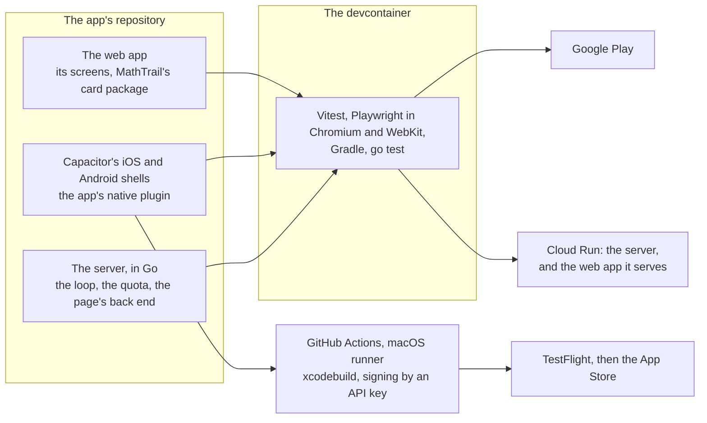

**Chosen on 2026-11-11: technology 1**, one web app in the browser and in Capacitor.

### 11.8 Notes for the later parts

- **For section 3.** With RevenueCat, the server keeps the subscription's state from RevenueCat's webhooks rather than from each store's notifications (3.5).
- **For section 8.** RevenueCat's 1 % past $2,500 a month. $0 for iOS builds while the repository is public, and about $16 a day for a rented Mac when one is needed.
- **For section 12.** The card's package (4.6), and a stable `outputSchema` for every tool the app reads, `get_package` and `prepare_task` included (5.10).
- **For section 13.** The first task of the new repository proves the riskiest part on the author's devices: the native plugin's calls to MathTrail with no `Origin`, streamed, through the TypeScript SDK's `fetch`, and its sign-in with an `https` callback. Other rules that carry over from MathTrail's:
  - "devcontainer only", with the iOS build in CI as its one exception;
  - exact versions, which cover Capacitor's plugins and the iOS and Android dependencies;
  - GitHub Actions pinned by commit.
